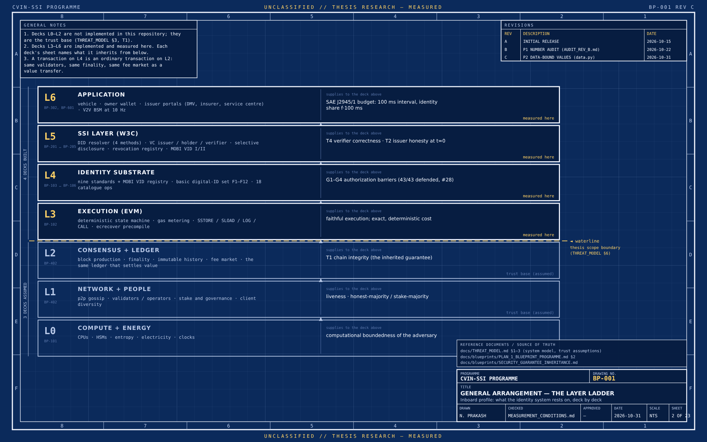

# CVIN-SC: The Work So Far

Oct 31, 2026 · @Nikhil Prakash

## What this is

CVIN-SC puts self-sovereign identity for connected and autonomous vehicles on a measured footing. Nine blockchain identity standards and the MOBI Vehicle Identity standard are implemented as working systems, placed under one vehicle-identity operation set, lifted to W3C DID and Verifiable Credential conformance, run inside a V2V and V2I simulation, and extended with zero-knowledge VIN privacy and an agent that operates identity on the vehicle's behalf. Every number in the thesis is tied to a committed result file.

The research came first; the implementation that followed is what the repository at [github.com/nikhilprakash24/CVIN-SC-Implementation-SSI-DID](https://github.com/nikhilprakash24/CVIN-SC-Implementation-SSI-DID) now holds. This document lists what the work does that I have not found elsewhere, what it found, where the work was frozen so the dissertation can be finished, where each piece lives in the repository, and where the thesis stands.

## What this work does that I have not found elsewhere

Each item below is something I have not found done before, as positioned against the literature in chapter 2. Priority claims invite counter-examples, so each is stated for what it is: measured, domain-constrained and reproducible. Each is built, tested and measured, not proposed.

1. **Nine blockchain identity standards compared on one footing for vehicles.** ERC-1056, ERC-721, ERC-725, ERC-725xy, ERC-735, ERC-1155, ERC-4337, LSP8 and the CVIN-Combined hybrid, with MOBI VID measured alongside as the application profile, all implemented as contracts and exercised over one canonical vehicle-identity operation set. The prior work I have found compares a few standards, mostly on paper; this measures all nine on the same operations with exact gas, N=30, zero variance.
2. **A working, measured implementation of the MOBI Vehicle Identity standard's published concepts.** MOBI published VID I (birth certificate) and VID II (lifecycle events) as specifications; I have not found another open implementation. Here they run: on-chain registration, eleven lifecycle event types, multi-party attestation with signature verification, VIN encryption, and a realisation sweep showing VID generalises across five identity backends. The security analysis found and fixed a real gap in the attestation path (a signature stored but never verified on chain), with the fix's gas cost measured. The implementation was checked clause by clause against VID I v2.0, and where it falls short of the standard's mandatory fields the deviation is recorded, not hidden.
3. **A minimal SSI standard for identity substrates.** A twelve-function interface (identity and keys, credentials, presentation) that any identity system can be held to, with a parameterised compliance suite. Eight substrates have been ported against it. It exposes a structural finding: no existing ERC provides credential presentation natively.
4. **The identity-dependent transaction (IDTx).** A transaction whose execution depends on a proof about the sender's identity, named and positioned as a primitive, implemented as an on-chain executor, and compared across ten identity systems on a twelve-function basis. This is the organising idea the later layers build on.
5. **SSI measured against the V2V safety budget, side by side with IEEE 1609.2 PKI.** Real cryptographic verification placed in the message path of a 50-vehicle, 10 Hz simulation: 0.142 ms warm against the 100 ms SAE J2945/1 budget, 1.65 million verifications, every injected attack caught, PKI measured on the same path for comparison. I have not found SSI measured this way in the V2X security literature; chapter 2 marks that as a claim still to be confirmed.
6. **Infrastructure as credentialed identities.** Roadside units, signal controllers and a traffic-management centre as DIDs, issuing signed SPaT and I2I messages with field binding, replay rejection and revocation re-check, pre-registered and measured (I1 to I5).
7. **W3C conformance measured, not claimed.** An executable, CI-gated compliance checker against DID Core 1.0 and VC Data Model 2.0 (94.3% structural self-score), plus the external W3C DID test suite run against the resolver (335 of 336 generated tests).
8. **Zero-knowledge VIN privacy inside a V2X identity stack.** A Groth16 circuit proves a vehicle's manufacturer is authorised, its model year meets a threshold and its region matches, without revealing the VIN; verified off chain in 18 ms and on chain inside an IDTx for 301,163 gas. The result settles where ZK belongs: registration and session time, not per message.
9. **The agent-wrapped identity.** Identity for machines, then machines for identity: the Steward turns an owner's plain-English rules into a signed policy, computes the proofs, refuses everything else, survives prompt injection, holds a twenty-questions narrowing attack to at most 3 bits leaked, and presents its own DID and delegation credential. Seven expectations were pre-registered; six passed and one failed, and the failure is reported.
10. **A rigour method that travels with the results.** A 63-row claim register grading every quantitative statement (verified, estimated, superseded), pre-registered expectations with amendments, measurement conditions named per claim, result cards generated and CI-checked against the register, and a stale-figure checker that fails the build when a number in a document no longer matches its source. Any examiner can trace any number to the command that produced it.

As far as my searches show, standards bodies and transport regulators have not yet taken up most of items 4 to 9. That is the ground this thesis occupies.

## Headline results

Five research questions, five measured answers. Each number below has a row in the claim register that names the result file and the commit it was read from.

| Question | Result | Register |
| --- | --- | --- |
| RQ1 Gas cost (H1) | Identity creation spans 33.7x across the nine standards: CVIN-Combined 52,216 gas to ERC-735 1,757,893. N=30 runs, byte-identical, zero variance. | #25 |
| RQ2 Security (H5) | No single standard dominates. 43 of 43 applicable attack cells defended across 54 scenarios; only ERC-4337 offers genuine on-chain key recovery. CVIN-Combined wins on fidelity per gas but is dominated by ERC-4337 on the six-criterion harness. | #36 |
| RQ3 W3C compliance (H2) | 94.3% structural self-score on the executable checker (DID Core 14/15, VC Data Model 2.0 27/29); 335 of 336 generated tests pass on the external W3C DID test suite. | #4, #24 |
| RQ4 Real-time V2V (H3) | Warm SSI credential verification 0.142 ms against a 100 ms budget; 1.65 million verifications over 30 seeded 50-vehicle runs; all 210 registered attacks rejected for the expected reason. | #27 |
| RQ4 Infrastructure (I1 to I5) | Signed SPaT from a roadside unit verifies at 1.197x a warm BSM, at the edge of the pre-registered band and not falsified; a revoked RSU is honoured for at most k-1 messages by a cached verifier, exactly as bounded. | #44 to #48 |
| RQ5 Zero-knowledge privacy (H6) | ZK-VIN proves a vehicle's manufacturer, model-year threshold and region without revealing the VIN: 3,498 constraints, prove 399 ms, verify 18.4 ms, 301,163 gas on chain. Feasible at registration and session time, not per message. | #56 to #62 |
| RQ5 The Steward | An agent operates the proofs under the owner's plain-English policy, survives prompt injection, and holds a twenty-questions narrowing attack to at most 3.0 bits leaked on 90 of 90 runs. Six of seven pre-registered expectations passed; Z-E6 (honest service level) failed and is reported as such. | #61, #62 |

The failed expectation is kept in the thesis deliberately. Pre-registration means the result stands whichever way it falls.

## The freeze point

The field this work sits in is moving fast, and the work has moved with it. Verifiable Credentials 2.0 reached Recommendation in 2025; account abstraction and agent-identity standards (ERC-4337, ERC-8004) are still settling; MOBI VID is on its second version; zero-knowledge proof systems change yearly; and the question of identity for AI agents barely existed when this work began and is now one of its layers. Inside the work the same thing happened: the zero-knowledge tier was deferred in September and built in October, and each line of exploration kept opening the next.

A dissertation cannot be finished against a moving target, so the work is frozen. The implementation froze on 31 October 2026: the results of record are the last runs before that date, and every number in the thesis reads from them. The written research side has its own freeze for the same reason. What arrives after the freeze, whether a new standard, a new proof system, or a new idea of my own, goes to the programme around the thesis (Phase 2, the side papers) and not into it. The dissertation is completed against the frozen state; the field and the work continue past it, and the rest is there to explore once it is done.

## The two sides not included here

The implementation above is one of three sides of the past twelve months. The other two are larger in pages and are not attached; they are listed so the shape of the whole is visible.

**The full pass and exploration (March to May 2026).** A complete re-examination of the CVIN work from first principles, over 100 pages of notebooks and written work: every assumption revisited, every design choice re-argued, and the research paths worth taking laid out before the build began. The implementation side followed from it. Not included at this time.

**The written research side.** Literature surveys and systematic reviews; the research questions explored further and from different angles in successive passes; the three-circle framing of the problem that yields seven distinct perspectives and lines of push; a full update of the work for 2026; the agentic-AI identity and agent-wrapped-identity programme; and further content blocks that form the basis of the thesis. This side has its own freeze point, for the reason given above, and what falls outside the dissertation's scope is kept for after it, not discarded.

Parts of that research side already live in the repository as working papers, not thesis prose:

| Working papers | What they are | Size |
| --- | --- | --- |
| [Roots thread (G-R1)](https://github.com/nikhilprakash24/CVIN-SC-Implementation-SSI-DID/tree/claude/cv2x-testbed-setup-011CUz5ay5VfEAsZzv5cexDy/docs/roots) | Every technology the identity system rests on, traced from its roots through an eight-layer stack to this repository's code and back: 51 breaking points, 31 numeric bounds, a blind re-derivation check | 27 papers, about 200,000 words |
| [Phase 2 programme](https://github.com/nikhilprakash24/CVIN-SC-Implementation-SSI-DID/tree/claude/cv2x-testbed-setup-011CUz5ay5VfEAsZzv5cexDy/docs/phase2) | The research programme that starts from what the thesis established and left open: idea register, architecture, deep-dive briefs with sources fetched at origin, academic reviews | 33 papers, about 68,000 words |
| [ZKP and agent identity reports A, B, C](https://github.com/nikhilprakash24/CVIN-SC-Implementation-SSI-DID/tree/claude/clone-cvin-id-scs-011CUyxScetMdSQFkuQUNLTt/docs/zkp) | The build report, the standalone ZKP-and-identity paper, and the agent-wrapped-identity paper, with 205 verified sources and a citation checker | 3 reports, about 40,000 words |
| [Side-papers register](https://github.com/nikhilprakash24/CVIN-SC-Implementation-SSI-DID/blob/claude/clone-cvin-id-scs-011CUyxScetMdSQFkuQUNLTt/SIDE_PAPERS.md) | Eight registered results that stand as short papers beside the thesis, and a ninth proposed: the silent-signature security note, the account-abstraction tax, the VIN privacy pattern, the V2V feasibility study, the CVIN-Combined design paper, two methodology notes, the minimal function set and IDTx | 8 registered, 1 proposed |
| [Related-work workspace](https://github.com/nikhilprakash24/CVIN-SC-Implementation-SSI-DID/tree/claude/cv2x-testbed-setup-011CUz5ay5VfEAsZzv5cexDy/docs/related-work) | The systematic-review apparatus for chapter 2: verified BibTeX only, a claims matrix per kept paper, a search log with PRISMA counts, inspected code bases and tool trials | in progress |

The dissertation is the narrow, formal centre of this. It takes what is measured and defensible; the rest is the programme around it.

## The repository, layer by layer

The system is built as five layers, each a top-level folder, with the thesis and its evidence under `docs/`. Start with the [README](https://github.com/nikhilprakash24/CVIN-SC-Implementation-SSI-DID/blob/claude/clone-cvin-id-scs-011CUyxScetMdSQFkuQUNLTt/README.md), then the layer that interests you.

| Layer | What it holds | Link |
| --- | --- | --- |
| 1 Blockchain identity | Nine identity standards (ERC-1056, 721, 725, 725xy, 735, 1155, 4337, LSP8 and the CVIN-Combined hybrid) plus the MOBI VID profile, as Solidity contracts with a shared Hardhat test suite and gas harness | [1\_blockchain-identity](https://github.com/nikhilprakash24/CVIN-SC-Implementation-SSI-DID/tree/claude/clone-cvin-id-scs-011CUyxScetMdSQFkuQUNLTt/1_blockchain-identity) |
| 2 W3C SSI | DID resolver, Verifiable Credentials, MOBI VID I/II birth certificate and lifecycle events, executable W3C compliance checker | [2\_w3c-ssi-layer](https://github.com/nikhilprakash24/CVIN-SC-Implementation-SSI-DID/tree/claude/clone-cvin-id-scs-011CUyxScetMdSQFkuQUNLTt/2_w3c-ssi-layer) |
| 3 CV2X testbed | SUMO-integrated V2V and V2I simulation: 50 vehicles at 10 Hz, signed BSM and SPaT messages, replay and revocation attacks, infrastructure DIDs | [3\_cv2x-testbed](https://github.com/nikhilprakash24/CVIN-SC-Implementation-SSI-DID/tree/claude/clone-cvin-id-scs-011CUyxScetMdSQFkuQUNLTt/3_cv2x-testbed) |
| 4 Comparison framework | Identical-operation gas benchmark (N=30), 54-scenario security suite, threat matrix, multi-backend MOBI VID fidelity | [4\_comparison-framework](https://github.com/nikhilprakash24/CVIN-SC-Implementation-SSI-DID/tree/claude/clone-cvin-id-scs-011CUyxScetMdSQFkuQUNLTt/4_comparison-framework) |
| 5 ZKP and agent identity | ZK-VIN Groth16 circuit, on-chain verifier gate, the Steward agent that operates proofs under an owner's policy, attack simulations | [5\_zkp-agent-identity](https://github.com/nikhilprakash24/CVIN-SC-Implementation-SSI-DID/tree/claude/clone-cvin-id-scs-011CUyxScetMdSQFkuQUNLTt/5_zkp-agent-identity) |

Sheet BP-001 of the 23-sheet blueprint set. The four decks above the waterline are built and measured in this repository; the three below are the trust base the thesis assumes and names. Every sheet is generated from code and every number on it is read from the results of record.

The documents a reader will want most:

| Document | Why read it | Link |
| --- | --- | --- |
| Thesis chapters 1 to 7 | The drafted thesis, one folder per chapter | [docs/thesis](https://github.com/nikhilprakash24/CVIN-SC-Implementation-SSI-DID/tree/claude/clone-cvin-id-scs-011CUyxScetMdSQFkuQUNLTt/docs/thesis) |
| Claim register | 63 numbered claims, each graded V (verified), E (estimated), S (superseded) or U, with the result file and commit behind it | [docs/MEASUREMENT\_CONDITIONS.md](https://github.com/nikhilprakash24/CVIN-SC-Implementation-SSI-DID/blob/claude/clone-cvin-id-scs-011CUyxScetMdSQFkuQUNLTt/docs/MEASUREMENT_CONDITIONS.md) |
| Grand report | One command re-runs every suite and regenerates this; 563 passing at the last run | [sandbox/grand/report/GRAND\_REPORT.md](https://github.com/nikhilprakash24/CVIN-SC-Implementation-SSI-DID/blob/claude/clone-cvin-id-scs-011CUyxScetMdSQFkuQUNLTt/sandbox/grand/report/GRAND_REPORT.md) |
| Blueprint drawing set | 23 engineering-drawing sheets of the system, primitives to application, generated from code | [docs/blueprints](https://github.com/nikhilprakash24/CVIN-SC-Implementation-SSI-DID/tree/claude/cv2x-testbed-setup-011CUz5ay5VfEAsZzv5cexDy/docs/blueprints) |
| After-action reports 1 to 41 | A dated record of every working session: what was claimed, what was checked, what changed | [docs/AFTER\_ACTION\_REPORT\_\*.md](https://github.com/nikhilprakash24/CVIN-SC-Implementation-SSI-DID/tree/claude/clone-cvin-id-scs-011CUyxScetMdSQFkuQUNLTt/docs) |
| Sources | The verified source register for the literature review; 205 sources for the ZKP layer alone | [SOURCES.md](https://github.com/nikhilprakash24/CVIN-SC-Implementation-SSI-DID/blob/claude/clone-cvin-id-scs-011CUyxScetMdSQFkuQUNLTt/SOURCES.md) |
| Pull requests | 20 merged PRs, each a reviewed integration step | [Pull requests](https://github.com/nikhilprakash24/CVIN-SC-Implementation-SSI-DID/pulls?q=is%3Apr) |
| Full commit history | 572 commits across all branches | [Commits](https://github.com/nikhilprakash24/CVIN-SC-Implementation-SSI-DID/commits/claude/clone-cvin-id-scs-011CUyxScetMdSQFkuQUNLTt) |

## Thesis draft 1 and what comes next

All seven chapters exist as a first full draft, about 45,000 words, with chapters 3 to 7 reading their numbers from the measured artifacts. This is one take: one method, one ordering of the argument, written to find out whether the material holds together as a thesis. It does. The plan from here is to produce a few more drafts, each approaching the same evidence from a different angle (for instance, leading with the comparison framework rather than the implementation, or with the identity-dependent transaction as the organising idea), and then to write the final version myself, informed by what each take revealed. An October audit checked every quantitative sentence in this draft against the claim register, and the mismatches it found are being fixed from the register.

| Chapter | State in draft 1 |
| --- | --- |
| 1 Introduction | Drafted; RQ5 and H6 adopted as an extension |
| 2 Literature review | Drafted from verified sources; two absence claims await the author's sign-off |
| 3 Methodology | Drafted, including the Z-E1 to Z-E7 pre-registration |
| 4 Implementation | Drafted, including the ZK-VIN tier and the Steward |
| 5 Results | Drafted from measured artifacts; RQ5 results in place |
| 6 Discussion | Drafted, including the IDTx and the agent wrapper |
| 7 Conclusion | Drafted |
| Appendices A to G | Indexed; generated from artifacts at LaTeX assembly |

Next, in order: settle the two integration branches into one trunk, merge the nine active workstreams, place the 23 blueprint sheets and nine simulation figures into the chapters, re-run the chapter audit against the settled register, then assemble front matter and appendices in the UBC LaTeX template.
