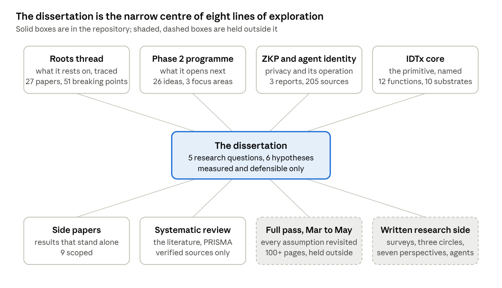

# CVIN-SC: The Research Programme

Nov 4, 2026 · @Nikhil Prakash

## How the work was done

The thesis is the narrow centre of a wider programme, and this document is about the programme: how the problem was explored, how the writing iterated, and how the code was built so that every result can be audited. The method is the same everywhere. A plan is written before the work it governs. Expectations are pre-registered where there is a measurement. Every number carries a status (measured, derived, estimated, superseded) and is never upgraded without evidence. Every session ends with an after-action report that says what was claimed, what was checked and what changed. Scope changes and author decisions are recorded with their dates and reasons rather than absorbed silently. The result is a body of work in which the exploration, the dead ends and the corrections are as visible as the conclusions. Because the field and the work both move quickly, the programme has a freeze point: the implementation froze at 31 October 2026 and the written research side has its own, so the dissertation can be finished against a fixed state while the programme continues past it.

The companion documents, sent with this one, are *The Thesis on One Page* (what the dissertation is) and *The Work So Far* (what exists and what it does).

## The explorations

Each line of exploration feeds the dissertation and is held to the same rule: every number carries a status, and nothing is upgraded without evidence. The dissertation takes from each line only what is measured and defensible; the rest of the line stays open for after it.

## The research working papers

These are research papers in working form, kept in the repository beside the thesis. None is thesis prose; each is a line of inquiry carried as far as it needed to go and then recorded with its status.

| Body of work | What it does | Scale | Link |
| --- | --- | --- | --- |
| Roots thread (G-R1) | Traces every technology the identity system rests on from its origins (Bitcoin's ledger lineage; the parallel identity and cryptography lineage) through an eight-layer stack to this repository's code and back. Phase 1: 51 breaking points, 31 numeric bounds. Phase 2: full-stack depth from hardware to application, every smart-contract function placed, theory and ECE bounds, a reverse register from functionality to roots, a blind re-derivation check by a second reviewer. | 27 papers, about 200,000 words | [docs/roots](https://github.com/nikhilprakash24/CVIN-SC-Implementation-SSI-DID/tree/claude/cv2x-testbed-setup-011CUz5ay5VfEAsZzv5cexDy/docs/roots) |
| Phase 2 programme | The research programme that starts from what the thesis established and left open. 26 ideas in seven tracks, each scored on value, novelty, feasibility, reuse and risk and anchored to a Phase 1 artefact; six candidate programmes; three focus areas (on-chain storage and the IDTx, chains versus databases, modes of chain interaction) with their own plans and figures; two deep-dive briefs (revocation freshness theory, the identity-dependent transaction) with every source fetched at origin; an academic review of the focus areas with dispositions; a scope reconciliation with 15 decisions. | 33 papers, about 68,000 words | [docs/phase2](https://github.com/nikhilprakash24/CVIN-SC-Implementation-SSI-DID/tree/claude/cv2x-testbed-setup-011CUz5ay5VfEAsZzv5cexDy/docs/phase2) |
| ZKP and agent-wrapped identity | Plan 1 (propositions P1 to P6, pre-registered Z-E1 to Z-E7, two amendments), then three reports: A, the build report with verdicts; B, a standalone paper on zero-knowledge proofs and identity from history to on-chain reality; C, the full-circle argument for the agent-wrapped identity, the Steward, the attack and the adaptation. 205 verified sources with a citation checker; a thesis integration map; a ten-piece writing series planned. | 3 reports and 4 plans, about 40,000 words | [docs/zkp](https://github.com/nikhilprakash24/CVIN-SC-Implementation-SSI-DID/tree/claude/clone-cvin-id-scs-011CUyxScetMdSQFkuQUNLTt/docs/zkp) |
| IDTx core | The twelve-function minimal identity set and the identity-dependent transaction as a core contribution: function-to-code map across ten substrates, primitive cards, pseudocode, an analogy matrix (centralised, digital-ID, CAV), a 12 x 10 comparison to other identity systems, an examiner pass that returned a not-defensible verdict and the revision that answered it. | 14 papers, phases 1 and 2 of 6 | [docs/idtx\_core](https://github.com/nikhilprakash24/CVIN-SC-Implementation-SSI-DID/tree/claude/determined-meitner-q2at9c/docs/idtx_core) |
| Side papers | Eight registered results scoped as short papers beside the thesis, and a ninth proposed: the silent-signature security note, the account-abstraction tax, the VIN privacy pattern, MOBI VID portability, V2V feasibility, the CVIN-Combined design paper, two methodology notes, and the function set and IDTx. | 8 registered, 1 proposed | [SIDE\_PAPERS.md](https://github.com/nikhilprakash24/CVIN-SC-Implementation-SSI-DID/blob/claude/clone-cvin-id-scs-011CUyxScetMdSQFkuQUNLTt/SIDE_PAPERS.md) |
| Related-work workspace | The systematic-review apparatus for chapter 2: verified BibTeX only, a claims matrix per kept paper with the research question it touches and whether it threatens the gap claim, a search log with PRISMA counts, inspected code bases with reuse decisions, tool trials with verdicts. | in progress | [docs/related-work](https://github.com/nikhilprakash24/CVIN-SC-Implementation-SSI-DID/tree/claude/cv2x-testbed-setup-011CUz5ay5VfEAsZzv5cexDy/docs/related-work) |
| Research expansion | A catalogue of 37 extensions beyond per-primitive measurement: 12 composed CAV scenarios, 15 primitive upgrades, 10 moonshots, each with tier, touched code, measures and sources; 88 catalogued sources from the sweep; the toll-corridor scenario built. | 5 papers, 1 scenario built | [docs/research-expansion](https://github.com/nikhilprakash24/CVIN-SC-Implementation-SSI-DID/tree/claude/cvin-research-improvements-559o01/docs/research-expansion) |

## How the content iterated

The thesis text was never written once. Each block went through drafting, audit against the register, re-sourcing and revision, and the record of that is kept.

| Instrument | What it records | Count |
| --- | --- | --- |
| [Crux register](https://github.com/nikhilprakash24/CVIN-SC-Implementation-SSI-DID/blob/claude/clone-cvin-id-scs-011CUyxScetMdSQFkuQUNLTt/docs/thesis/CRUX_REGISTER.md) | The questions the thesis must answer for an examiner, each with its claim, its hypotheses, its evidence rows and their status, its open gaps, and the question the examiner will ask. Generated from the register, so it cannot drift from the evidence. | 8 cruxes, all partial (evidenced, with named gaps) |
| [Scope-change log](https://github.com/nikhilprakash24/CVIN-SC-Implementation-SSI-DID/blob/claude/clone-cvin-id-scs-011CUyxScetMdSQFkuQUNLTt/docs/SCOPE_CHANGES.md) | Every change of scope since the 2025 roadmap, dated, with the reason: deferred, narrowed, corrected, added and bounded, reopened. The ZK tier was deferred in September (SC-12) and reopened and built in October; both entries stand. | 26 entries |
| Decision records | Author decisions with their defaults, so work could proceed while a decision was open and be revisited when it closed: Phase 2 decisions P2-D0 to P2-D10; the decision sheet of 2026-10-20 (title, chapter 2 next, the k the thesis defends, Sepolia witness). | 25 decisions |
| [Chapter audit](https://github.com/nikhilprakash24/CVIN-SC-Implementation-SSI-DID/blob/claude/clone-cvin-id-scs-011CUyxScetMdSQFkuQUNLTt/docs/thesis/CHAPTER_AUDIT_2026-10.md) | Every quantitative sentence in chapters 1, 2, 4, 6 and 7 checked against the register and classed OK, mismatch, overstated, unsourced or stale, with the fix. Read-only: it changed nothing, so the chapters could be fixed from the register. | 92 claims checked; 39 OK, 53 to fix |
| Chapter 2 | Drafted from verified sources in October; six absence claims marked rather than asserted; four resolved by search with coverage logged; two held for the author's sign-off. Sections 2.4.5 (revocation freshness) and 2.7 (the IDTx) written from the Phase 2 briefs' fetched sources. | 7,300 words, 2 markers open |
| Chapter 6 section 6.8 | The identity-dependent transaction, what it is and what it is not: drafted as a stub, written in full from the I-24 brief, then revised after the academic review's definition (D-8) and the examiner question it answers (question 12). | 3 versions |
| Pre-registration | Expectations stated before the run: I1 to I5 for infrastructure messaging; Z-E1 to Z-E7 for the ZK and agent layer with amendments A1 (before the first run) and A2 (post hoc, labelled). One (I1) landed at the edge of its pre-registered band without being falsified; one (Z-E6) failed. Both stay in. | 12 expectations: 10 passed, 1 at the band's edge, 1 failed |
| Style and rigour guide | The rules every session and every assistant configuration is bound by, consolidated from the author's directives across 2025-11 to 2026-10 and amended when the after-action reports found a gap in them. | 1 document, amended at WM-1 |

## The code work as a record of judgement

The implementation is not only what runs; it is the record of how it came to run. That record is kept in the repository in a form an examiner can read.

**Plans before work.** Nineteen plans, each written before the work it governs and each stating what would count as done: the merge of three lineages into one trunk, the MOBI and SUMO plan, work milestone WM-2 and its sub-steps, the ZKP plans 1 to 4, the three Phase 2 focus plans, the visual, blueprint and IDTx programmes. Where the work departed from the plan, the departure is logged in the after-action report.

**After-action reports.** Forty-one, one per working session, from the restoration of the repository in September to the integration of the parallel sessions in late October. Each records what was claimed at the start, what was checked, what changed, what was deferred and why, and the state of CI on the closing commit. Several open with a claim pushed before the work and close with the evidence; the discipline is that the report is written whichever way the session went. [docs/AFTER\_ACTION\_REPORT\_\*.md](https://github.com/nikhilprakash24/CVIN-SC-Implementation-SSI-DID/tree/claude/cv2x-testbed-setup-011CUz5ay5VfEAsZzv5cexDy/docs)

**Work milestones.** Work is cut into milestones, each closed only when every plan item has a status, a report exists, an audit by reviewers without the orchestrator's context has a disposition for every finding, confirmed findings are fixed and re-verified, the grand run and CI are green on the closing commit, the next plan is written, and a consolidated handback supersedes the period's. WM-1 is closed under those terms; WM-2 is in progress. Five handbacks hand the state to whoever works next.

**The defect log.** Sixty-seven latent defects found in the research code by the verification passes, the sandbox and the mutation probes, each with severity (whether it affects a thesis claim or a security property), the commit that fixed it or the planned treatment if open. The log is itself a result for the implementation chapter: it is the veracity-versus-automation asymmetry made concrete. [docs/DEFECT\_LOG.md](https://github.com/nikhilprakash24/CVIN-SC-Implementation-SSI-DID/blob/claude/clone-cvin-id-scs-011CUyxScetMdSQFkuQUNLTt/docs/DEFECT_LOG.md)

**A worked example: the silent signature.** The security analysis found that MOBI VID's `attestEvent` stored an attestation signature that was never verified on chain, a replay and forgery gap gated only by role. It was fixed with a domain-separated signature recovered on chain; forged, wrong-key and replayed attestations now revert; the fix's gas cost was measured and entered in the register; the before-and-after is side paper SP-1. Found, fixed, measured, recorded: that is the pattern throughout.

**The evidence machinery.** A claim register of 63 rows; measurement conditions named per claim (M0 in-process, M1 Hardhat, Sim, E for estimates); a run-of-record identity stamped on every result directory; result cards generated from the register and checked in CI; a stale-figure checker that reads HTML and TeX and fails the build when a quoted number no longer matches its source; a technical data package (interface control document, configuration baseline, requirement-to-test trace) in engineering form. [docs/MEASUREMENT\_CONDITIONS.md](https://github.com/nikhilprakash24/CVIN-SC-Implementation-SSI-DID/blob/claude/clone-cvin-id-scs-011CUyxScetMdSQFkuQUNLTt/docs/MEASUREMENT_CONDITIONS.md)

## The parallel-stream method

From mid-October the work ran as parallel streams, each on its own branch with its own plan, its own pre-registered expectations where there was a measurement, and its own definition of done. Streams were integrated through reviewed pull requests onto one trunk (20 merged), and a branch-level integration map (a working document, available on request) records where each stands now. This is how a year's exploration was turned into work an examiner can audit.

| Stream | Plan written | What it produced | Integration |
| --- | --- | --- | --- |
| Core trunk and measurement | WM-1, WM-2 plans | Claim register, result cards, dashboard, stale-figure checker, 41 after-action reports | the trunk |
| ZKP and agent-wrapped identity | Plan 1 (pre-registered Z-E1 to Z-E7) | Layer 5 complete; reports A, B, C; chapter 2 citations | merged (PR 3, PR 16); 2 chapter-2 markers open |
| Blueprint drawings | Plan 1 Blueprint Programme | 23 sheets, Rev A to C, every number data-bound to the results of record | merged to trunk; placement into chapters pending |
| Simulation visuals | Visual Plan with phases | Trace format, figures F1 to F9, SUMO frames, replay viewer, rogue-vehicle scenario | ready, merges clean |
| IDTx core | Core-Contribution Plan, phases 1 to 6 | Function set, pseudocode, 12 x 10 comparison, examiner pass and revision | phases 1 and 2 done, merges clean |
| Testing suite | TSR plan, replan of 2026-10-22 | Test register over every suite; eight test-family charters | ready, merges clean |
| Contracts and security review | WM-2 steps | mintVehicle fix, NatSpec check, bytecode manifest, gas of record re-run | ready; conflicts are regenerable results |
| Roots thread | Phase 1 and 2 plans | 27 papers; blind re-derivation check | merged (PRs 14, 18, 21) |
| Minimal SSI sandbox | Canonical plan, work orders WO-1 to WO-9 | Eight substrates against the twelve-function spec; I2I scenarios; VID layer; trace explorer | decision pending: merge, future work, or archive |

The order of integration is settled: one trunk first, then the numbers, then the ZKP branch, then the figures into the chapters, then the chapter audit re-run against the settled register.

## Not in the repository

Two bodies of work sit outside the repository and are the part of the programme that only the author can present. They are listed here so the shape of the whole is visible; they will be added to this document when ready.

**The full pass and exploration, March to May 2026.** A complete re-examination of the CVIN work from first principles across more than 100 pages of notebooks and written material: every assumption revisited, every design choice re-argued, the research paths worth taking laid out before the build began. The implementation side of the year followed from it.

**The written research side.** Literature surveys and systematic reviews; the research questions taken further and from different angles in successive passes; the three-circle framing of the problem and the seven perspectives and lines of push it opens; a full update of the work for 2026; the agentic-AI identity and agent-wrapped-identity programme in its written form; and the further content blocks that form the basis of the thesis.

This side has a freeze point for finishing the dissertation. What falls outside the dissertation's scope is held, not discarded; the dissertation takes what is measured and defensible, and the rest is there to explore after it is complete.
