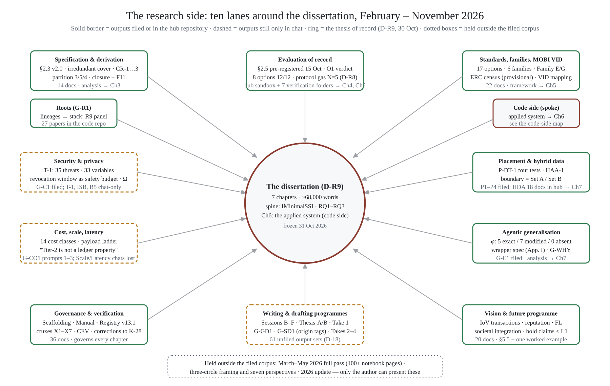

# CVIN-SC: The Research Programme — the research side

Nov 9, 2026 · Nikhil Prakash · v0-3 · **Companion to the code-side document of the same title. That document describes how the code work was done so that every result can be audited; this one describes how the written research was done so that every claim, decision and correction can be traced.**

## How the work was done

The thesis is the narrow centre of a programme that ran, from 10 February 2026, as more than a hundred working chats with an AI assistant, in named lanes, each producing versioned documents. The method is the same in every lane and is the same as the code side's: a plan is written before the work it governs; every result carries a status word (verdict, expectation, analysis) and is never upgraded without evidence; every document is produced in two passes — a first pass, then a re-read by a panel of discipline lenses (CAV/V2X, blockchain/DLT, identity and interdisciplinary, research methods, software and systems, a professional ECE researcher, a professional technical writer) whose findings are logged as a numbered pass log and applied in a second pass that supersedes the first but keeps it for lineage (these lenses, and every "examiner" or "review" named below, are roles performed by the AI assistant under my direction — no one other than me has yet reviewed any of this work); decisions are recorded with their dates, defaults and the work they unblock, and are never taken by default where the thesis depends on them; and every error found in earlier material is entered in a corrections ledger and reported, not replaced.

The programme has a freeze point, shared with the code side: 31 October 2026. The dissertation is completed against the frozen state; the lanes continue past it.

## The lanes of exploration

Ten lanes, in four acts. *Settle the spine* (February–March): the twelve-function interface, the Set A / Set B split, the `createPresentation` gap and the contribution inventory were in place by the end of February; a March burst turned them into prototype code and a vehicular scenario, almost none of it measured under rules the thesis later adopted. *Build the evidence machinery* (April–June): the inductive three-stage methodology, the six-family taxonomy, the LFDT convergence observation, then the sandbox with its trace discipline and its replay-not-simulate rule — and the one measurement that has stood since, ERC-1056 at 12/12 with a committed trace (June 2026; re-run under a pinned compiler in October). *Buy rigour* (July–August): the exemplar corpus and house style, the systematic-review protocol, the research questions at version 5, the related-work audit, then the governance layer in one fortnight — scaffolding, the production manual, chapter sectioning, the accuracy ledger and the claim–evidence–verdict ledger that became the defence spine. *Write and branch* (September–October): first chapter drafts, then the analysis threads (placement, security, cost, roots, zero-knowledge, MOBI VID), two writing lanes, the results-and-methodology lane, and a vision programme that is mostly post-thesis. November opened the drafting programmes that turn the corpus into a thesis the supervisors can read and audit.

## The research working papers

Lines of inquiry carried as far as they needed to go and recorded with their status. None is thesis prose.

| Body of work | What it does | Scale · status |
| --- | --- | --- |
| Minimality and closure (G-A1, G-A2, the completeness contribution) | Recasts "minimal" as an irredundant cover under a clustering rule; builds the 29-operation universe and the elimination trace; defines completeness as closure over an exhibited object set with a falsification condition; finds and amends one closure failure (F11) | 6 papers; analysis, mechanically checkable |
| Placement thread (G-P1, P2–P4, HAA-1) | For each class of identity statement, where the truth lives — on-chain state, anchored commitment or off-chain artefact — by a four-test procedure; the anchoring-minimum proposition; the hybrid anchored architecture; the finding that the placement boundary is the Set A / Set B partition | 4 papers + DPA-0…3; analysis |
| Security and privacy (G-C1, T-1, ISB, B5) | A 35-entry threat catalogue with 33 variables and ten instruments; an identity-benchmark ruler and profile; the I2I secure channel and token-trust specification; the revocation window as a functional-safety budget; the validator–issuer overlap Ω | 5 papers; analysis |
| Cost, scale and latency (G-CO1; ISB-2) | Fourteen cost classes; the payload ladder from verified EVM constants (calldata 16, event 24, storage first-write ≈690, rewrite ≈91 gas per byte); fleet-scale enrolment arithmetic; "throughput is not the binding constraint"; "Tier-2 compliance is not a ledger property" | 4 papers; derived, to be recomputed from pinned cells by arm |
| Empirical rigour (G-B → §2.5) | Measurand definitions, repetition design, void rules, rubric and self-audit — pre-registered by commit on 15 October 2026 | 1 protocol + 1 drafted section; method |
| Standards and MOBI VID (G-D1, Family G, G-MV1) | The related-work audit and systematic-review protocol; the standards-symmetry table; the Family G lineage census of ERC-1056 descendants; the MOBI VID requirement inventory, evidence register, implementation-options plan and the primitives-first argument in three versions | 9 papers; framework; wording rule: never "first implementation of MOBI VID" |
| Agentic generalisation (G-E1, Appendix I, G-WHY) | The mapping φ, its non-correspondences and design rules; the smart-account wrapper specification with a pre-declared validation ladder; the necessity → machines → AI-agents argument planned as a paper series | 4 papers; analysis; wrapper at specification |
| Roots (G-R1) | Technologies from the Bitcoin and identity lineages tied up to the CVIN stack: Phase 1 (51 breaking points) pushed to the code repository; Phase 2 (42 more; 93 in all) adds the hardware-to-application stack and a reverse register from functions to roots; panel review R9 and a Phase 1 erratum filed here | 3 filed here; 27 papers in the code repository |
| Hybrid-data campaign (HDA) | A placement-as-evaluation-axis argument in 18 documents (≈166,700 words) with one measured experiment: gated versus ungated reputation in a toy federated-learning round (weighted error 1.87 versus 27.59 — ordering, not magnitude). Its own verdict on itself: "a complete set of questions and an incomplete set of answers" | 18 docs in the hub; design, with five corrections where a hypothesis had been stated as a result |
| Vision and future programme (P5, P5C, G-WHY) | The post-thesis programme: payment-integrated identity transactions, gated access, reputation, federated learning, societal integration (shared family vehicles, rural owners, right-to-repair); the bold-claims ledger rates none of eleven forward claims above specified composition | 20 papers; enters the thesis as §5.5 and one worked example |

## How the content iterated

| Instrument | What it records | Count |
| --- | --- | --- |
| Thesis Content Registry v11.3 → v12.0 → v13.1 | Every content block of the thesis with type (A prose / B table / C figure), source, version and placement | 3 versions; v13.1 current |
| Scaffolding and Completion Plan v0.1 → v0.4 (filed) with a v2.1 roll | The locked wordings, rulings R-1…R-5 and the chapter skeleton; the single source of truth question (which roll governs) is a recorded open decision | 5 versions |
| Chapter sectioning documents | Binding section-by-section specifications for all five hub chapters and the security thread, with content blocks `CB-*` and findings F-1…F-n per chapter | 6 documents |
| Crux defence compendium X1–X7 | Where the thesis will be attacked, the standing answer, the concession volunteered, the residual risk and the holding order ("give away X6 first; hold X2-N absolutely") | 7 cruxes |
| Claim–evidence–verdict ledger (CEV v2.0) | Every chapter claim mapped to its evidence row and grade; the necessity partition and "no thirteenth function" live here | 18 rows |
| Accuracy ledger and terminology freeze | Corrections numbered to K-28, plus unnumbered withdrawals, and the frozen vocabulary (`IMinimalSSI` never "ISSI"; Set A / Set B never "core/extended"; irredundant cover never "unique minimum"; closed under stated transitions never "complete" unqualified) | entries numbered to K-28; 7 frozen terms |
| Verification passes 1–5 | Each pass re-read the corpus against a stated question and produced a dossier, a ledger or a reconciliation record | 5 passes |
| Precursor report and cover briefs (22 Oct) | The July–October overhaul for the committee: five changes, evidence register, corrections, cruxes, the four results to examine first, the decisions that need a supervisor, a ranked solidify list | 1 report + 2 briefs |
| Phase 1 consolidated record (24 Oct) | The pinned layer under everything: twenty line pins re-verified at the boundary commit; admissibility classes A–D; drift and defect register of 22 items | 1 record |
| Hub vs spoke comparison (30 Oct) and ruling D-R9 | Thirteen overlaps, seventeen conflicts (RQ label collision, option count, three values for "ERC-1056 create", six priority claims), the unified outline, the numbers-of-record rule, twelve decisions ruled | 1 proposal; 12 rulings |
| Take 1 pass log (4 Nov) | Fourteen deltas between the first and second pass of the lift-and-assemble draft, each with lens, finding and fix; keep-out sweep passed | 14 deltas |

## The writing as a record of judgement

The written side is not only what was argued; it is the record of how the argument came to be held at the strength it has.

**Plans before prose.** Every lane opened with a master plan and a prompt pack: phases, work units, definitions of done, and the decisions the lane would need, with defaults stated so that work could proceed while a ruling was open. Twenty-five open decisions were on the board on 14 October; most were one-line rulings, and the board was the only to-do list.

**Two passes, every document.** A first pass, a panel re-read, a numbered pass log, a second pass. The project store holds the pairs. Where the second pass changed a claim's strength, the log says which lens asked for it and why — the abstract cut from 430 to 345 words (UBC limit), a "two compiler environments" sentence deleted because the record did not support it, a status word added to a throughput conclusion.

**Claims narrowed, in writing.** The largest quality change in the programme was a narrowing: "the minimal specification" became "a sufficient and irredundant cover, not the unique minimum" (G-A1, 5 August), and every later document holds that wording. "Complete identity system" became "closed under the stated transitions over the exhibited object set" (30 September). "First implementation of MOBI VID" was withdrawn (falsified by the 2020 paper) and a licensed form fixed. "External validation of the derivation" became "convergence finding, corroboration only". The corrections ledger numbers them to K-28, with further unnumbered withdrawals beside them.

**A worked example: the BSM rate.** Earlier material stated that vehicles broadcast basic safety messages at 1,000–2,000 per second. The research side found the error (the figure is receive-side load at a dense intersection; broadcast is 10 Hz nominal under SAE J2735 / J2945/1), traced its consequence (the verification gap — ≈200 ECDSA verifications per second on an on-board unit — is the real reason Tier 1 is excluded, not consensus latency), swept it through every chapter and entered it as K-15 in the ledger as a critical correction to be reported to the committee. Found, traced, swept, reported: that is the pattern.

**The provenance layer.** Because the assistant was used substantively, the November drafting programme builds the thesis text and an authorship-and-provenance layer together: an origin tag on every paragraph (candidate-authored, co-authored, candidate material AI-structured, AI-drafted, AI-drafted then candidate-rewritten, data of record), a provenance ledger per section, an intellectual-contribution map with the earliest dated evidence for each contribution, an evidence-of-authorship timeline from the 2020 paper to the present, and a one-page disclosure and agreement for the supervisor that goes out before any chapter does. The submission target is zero AI-drafted paragraphs; the record of what the assistant did and did not do is what makes the disclosure precise.

## The parallel-lane method

From August the research side ran as parallel lanes, each in its own chat with its own plan, filed outputs and lane code; chats were primed with a core-instruction document so that each new lane interfaced with the same source of truth. The Programme Atlas (14 October) inventories every chat by lane, with outputs, what it feeds and what to solidify; the Mission Control dashboard renders it. Integration happens by filing (the project store), by import into the hub repository (`docs/INDEX.md`), and by ruling.

| Lane | Plan written | What it produced | Integration state |
| --- | --- | --- | --- |
| Governance and scaffolding (L5) | Scaffolding v0.1, Manual v1.0 | Scaffolding v0.4, Manual v2.0, sectioning ×6, registry v13.1, CEV ledger, Atlas, dashboard | filed; hub `docs/00_governance/` |
| Specification and derivation | G-A1 plan; completeness contribution plan | §2.3 v2.0; closure, F11, App. M-2; function cards | hub `docs/10_drafts/`; closure contribution unfiled (D-18) |
| Evaluation of record (G-RIM, G-P1) | G-RIM master plan (7 phases, 26 work units), prompt series (35) | §2.5 pre-registered; Ch. 4 parts and assembled draft; Phase 1 record; intake delta; codebase inventory | hub drafts; two Chapter 4 lineages to re-base (R0) |
| Analysis threads (L6) | Plans of attack per thread | Placement, T-1, ISB, B5, cost, roots | filed; Scale and Latency chats left no recoverable record (to be confirmed or reconstructed) |
| Standards and MOBI VID (G-MV1, G-D1) | G-MV1 plan | Requirement inventory, evidence register, options plan, primitives-first argument | filed; census execution owed |
| Vision (P5, P5C, G-WHY, L9) | Master plans + prompt packs | Dossier, bold-claims ledger, IoV compendium, necessity argument | filed; post-thesis except §5.5 |
| Writing lanes (Thesis-A, Thesis-B, Sessions B–F) | Finish-and-write plan; trunk + 49-prompt programme | Four full quarry drafts; chapter drafts v0.1–v0.3; the trunk (RQs, cruxes, moves, findings) | chat only — the single largest unfiled block (D-18) |
| Drafting programmes (G-GD1, G-SD1, G-T1) | Three master plans + prompt packs | Take 1 v0-1/v0-2 + panel note; G-GD1 and G-SD1 instruments | Take 1 in chat + repo; G-SD1 gated on the AI-use agreement |
| Supervisor reporting (G-PRE, this update) | — | Precursor report, cover briefs; the code-side and research-side updates | this folder |

The order of integration is settled by D-R9 and by the Take 1 roadmap: the unfiled outputs filed (D-18); the ERC census executed (FW-0); the two Chapter 4 lineages re-based onto one; the migration steps of the merge proposal; the takes compared section by section; the submission draft cut from the best of them, with origin tags carrying the record.

## Not in the project store or the repositories

Two bodies of work sit outside both. **The full pass and exploration of March to May 2026** — more than a hundred pages of notebooks and written work re-examining the CVIN work from first principles. **The framing material I have described to the assistant but not yet filed** — a three-circle framing of the problem that opens seven perspectives, and a 2026 update of the whole. They are named here so the shape is visible and so that nothing in the filed corpus is mistaken for the whole; they will be added to this document when they are filed.

What falls outside the dissertation's scope is held, not discarded. The dissertation takes what is derived and measured and defensible; the rest is there to explore after it is complete.
