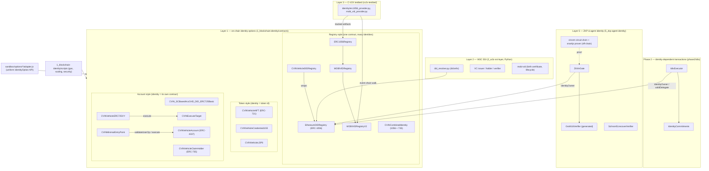
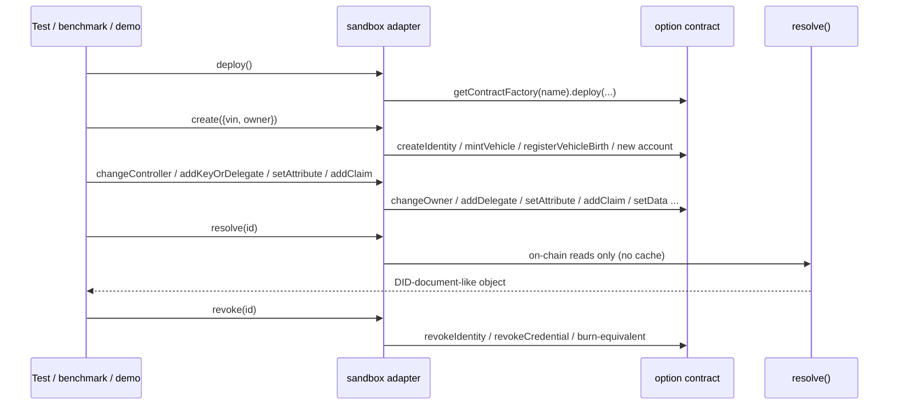

# 00 — Architecture, standards matrix and annotation conventions

This page shows how the contracts fit together. The per-group docs (01–05) cover each contract
function by function; the NatSpec comments in the `.sol` files are the short, inline version of
those docs.

## 1. Where the contracts sit in the stack

**Reading the diagram.**
- **Registry-style options** keep every vehicle in one shared contract, keyed by address.
- **Token-style options** treat identity as a token id issued by an authority.
- **Account-style options** deploy one contract per vehicle; deploying it *is* creating the identity.
- `IdtxExecutor` and `ZkVinGate` use **ERC-1056 ownership** as their source of authority. They
  load the compiled `EthereumDIDRegistry` artifact rather than importing its source.

## 2. Uniform interface → contract functions

Every on-chain option is driven through the same adapter API (`sandbox/lib/identity_option.js`):
`deploy, create, changeController, addKeyOrDelegate, setAttribute, addClaim, revoke, transfer,
resolve, signedOp`. Each adapter's header comment maps these methods to concrete contract
functions; the thesis cites those mappings as the per-option asymmetry note. The matrix that
results is `docs/FEATURE_ASYMMETRY_MATRIX.md`, and the measured gas is in
`sandbox/grand/report/L1-asymmetry.md`.

## 3. Standards → contracts matrix

| Standard | Status | Implemented by | Fidelity (details in group doc) |
|---|---|---|---|
| [ERC-1056](https://eips.ethereum.org/EIPS/eip-1056) Lightweight identity | Stagnant | `EthereumDIDRegistry`; `ERC1056Registry` (subset); `CVINCombinedIdentity` (1056 part) | Port of the uPort registry; the MOBI base drops the `*Signed` variants (01, 02) |
| [did:ethr](https://github.com/decentralized-identity/ethr-did-resolver/blob/master/doc/did-method-spec.md) | DIF method spec | resolved by `2_w3c-ssi-layer/did-resolution/did_resolver.py` | Hashed attribute names are invisible to a stock resolver (01, 02) |
| [W3C DID Core](https://www.w3.org/TR/did-core/) / [VC Data Model](https://www.w3.org/TR/vc-data-model/) | W3C Rec. | Python layer, using on-chain state | 94.3% on the internal checker |
| MOBI VID I / II | MOBI standard | `MOBIVIDRegistry`, `MOBIVIDRegistryV2` | Birth, lifecycle and roles (02) |
| [ERC-721](https://eips.ethereum.org/EIPS/eip-721) | Final | `CVINVehicleNFT`, `CVIN_NFT_DID_ERC721`, `…_Monolithic` | OZ 5 based; the monolithic one is hand-written (03) |
| [ERC-1155](https://eips.ethereum.org/EIPS/eip-1155) | Final | `CVINVehicleCredential1155` | Soulbound: transfers revert (03) |
| [ERC-2981](https://eips.ethereum.org/EIPS/eip-2981) | Final | `CVIN_NFT_DID_ERC721`, `…_Monolithic` | Toll/royalty scenario (03) |
| [ERC-165](https://eips.ethereum.org/EIPS/eip-165) | Final | the OZ-based tokens, `CVINVehicleERC725XY` | — |
| [LSP8](https://docs.lukso.tech/standards/tokens/LSP8-Identifiable-Digital-Asset) | LUKSO | `CVINVehicleLSP8` | Self-contained subset, no LSP1 hooks (03) |
| [ERC-725](https://eips.ethereum.org/EIPS/eip-725) (v1 / X+Y) | Draft | `CVIN_SCBasedAccOrID_DID_ERC725Basic` (stub), `CVINVehicleERC725XY` | X/Y is faithful; v1 basic is a stub (04) |
| [ERC-735](https://github.com/ethereum/EIPs/issues/735) | Issue-only | `CVINVehicleClaimHolder`; `CVINCombinedIdentity` | Adds an issuer whitelist and VIN check (04) |
| [ERC-4337](https://eips.ethereum.org/EIPS/eip-4337) | Draft | `CVINVehicleAccount`, `CVINMinimalEntryPoint` | Single-op EntryPoint harness (04) |
| [EIP-191](https://eips.ethereum.org/EIPS/eip-191) | Final | 735 holder, 4337 account, MOBI V2 (OZ ECDSA) | Combined signs a raw digest instead (04) |
| [EIP-196](https://eips.ethereum.org/EIPS/eip-196)/[197](https://eips.ethereum.org/EIPS/eip-197) bn128 precompiles + Groth16 | Final | `Groth16Verifier` (snarkjs output, pinned) | Single-party setup, so proofs can be forged (05) |
| Schnorr via `ecrecover` | technique | `SchnorrEcrecoverVerifier` | R is carried as an address (05) |
| ISO 3779 VIN | ISO | VIN length checks across the options | 17-char check only |

**OpenZeppelin:** `@openzeppelin/contracts` 5.0.2 (pinned in `1_blockchain-identity/package.json`) supplies
`ERC721`, `ERC721URIStorage`, `ERC721Enumerable`, `ERC1155`, `AccessControl`, `Ownable`, `ERC2981`,
`IERC165`, `Strings` and `ECDSA`/`MessageHashUtils`. `@lukso/lsp-smart-contracts` ^0.14.0 is a
dependency but is not imported by any contract. No ERC-725 or ERC-4337 library is used either:
those options are written from scratch.

## 4. NatSpec conventions used in the `.sol` files

| Tag | Meaning here |
|---|---|
| `@title`, `@notice` | One-line purpose (user-facing; appears in `solc --userdoc` and on Etherscan) |
| `@dev` | Design, access control, events emitted, where the function comes from (an ERC section, or "CVIN extension") |
| `@param`, `@return` | Every parameter and return value |
| `@custom:standard` | Spec name and canonical URL |
| `@custom:security` | A known caveat, documented rather than fixed (research code) |
| `@custom:see` | The catalog doc, sandbox adapter and tests for this contract |
| `@custom:note` | Corrections to previously stale comments |

Not annotated on purpose:
- `5_zkp-agent-identity/contracts/Groth16Verifier.sol`, which is generated by snarkjs and pinned by
  SHA-256 in `5_zkp-agent-identity/artifacts/MANIFEST.json`;
- `1_blockchain-identity/_research-copies/`, which holds older copies that are not compiled.

## 5. Why comment-only edits are safe, and how that was checked

Comments do not change the executable bytecode. They only change the CBOR metadata appended to
it, whose IPFS hash covers the source text. The annotation pass was checked like this:

1. Every artifact was compiled before and after the pass.
2. The trailing metadata (`a264…0033`) was stripped from the creation and runtime bytecode.
3. The stripped bytecode and the ABIs were compared, and they matched for every contract.
4. The cv2x-testbed's tracked artifacts (`artifacts/`, `contracts/ERC1056Registry_{abi.json,bytecode.txt}`)
   were regenerated so that `cv2x-testbed/scripts/check_artifacts_fresh.js` passes.
5. The Hardhat suites (main, phase2, zkp), the MOBI copy check and `tools/prepush_check.sh` were
   re-run.

The metadata hash is 32 bytes either way. Deployment gas can move in multiples of 12, because calldata
costs differ for zero (4 gas) and non-zero (16 gas) bytes, but runtime gas is unaffected. Measured on
the nine-standard benchmark, 2 of 61 cells moved, both deployments, by exactly ±12 gas: ERC-735
`createIdentity` and MOBI-VID-V2 `deployRegistry`. The delta is logged in
`4_comparison-framework/results/gas_moved_by_natspec_2026-10-24.json`. `tools/bytecode_manifest.js`
deliberately ignores this metadata noise and fails only on real code changes.
