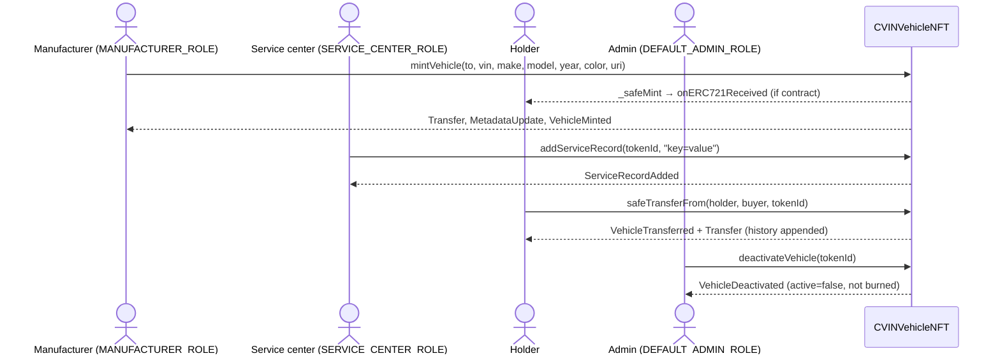
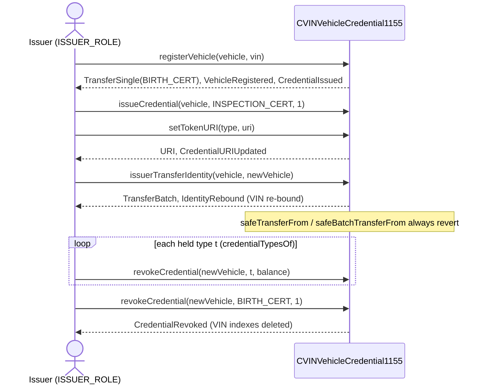
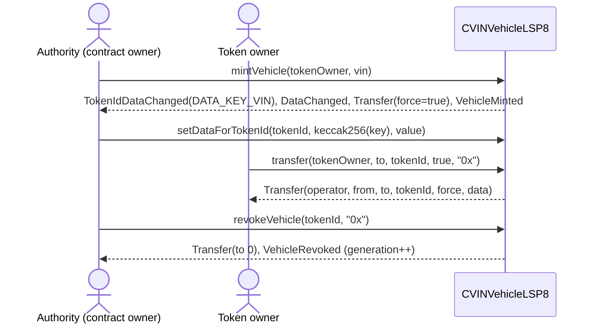

# 03 — Token-based vehicle identity: ERC-721, ERC-1155, LUKSO LSP8

This group covers the CVIN identity options where **a vehicle's identity is a token**. There are three ERC-721 contracts: `CVINVehicleNFT`, which is the primary one with VIN linkage, roles, service records, transfer history and a `did:nft` string; `CVIN_NFT_DID_ERC721`, an OpenZeppelin-based NFT with ERC-2981 royalties and a toll scenario; and `CVIN_NFT_DID_ERC721_Monolithic`, a hand-written ERC-721 and ERC-2981 in a single file with no OZ inheritance. The group also has one ERC-1155 contract, `CVINVehicleCredential1155`, where token ids are *credential types* and the vehicle is the address that holds a soulbound BIRTH_CERT. Finally there is one LSP8-flavoured contract, `CVINVehicleLSP8`, which uses `bytes32` tokenIds equal to `keccak256(VIN)` and has a per-token key/value store. That contract is self-contained and does not import the LUKSO package. All three primary contracts (`CVINVehicleNFT`, `CVINVehicleCredential1155`, `CVINVehicleLSP8`) share the same ISO 3779 VIN normaliser (defect D13). They are compared with each other through the sandbox adapters, the gas benchmarks and the security scenarios.

All paths below are relative to the repo root. `1bi/` is short for `1_blockchain-identity/`.

---

## Standards & protocols

| Spec | Status | Purpose / canonical interface | Used by | Fidelity in this repo |
|---|---|---|---|---|
| **ERC-721** (EIP-721) | Final | Non-fungible tokens: `balanceOf`, `ownerOf`, `safeTransferFrom`×2, `transferFrom`, `approve`, `setApprovalForAll`, `getApproved`, `isApprovedForAll`; events `Transfer`, `Approval`, `ApprovalForAll`. There are optional Metadata (`name`, `symbol`, `tokenURI`) and Enumerable (`totalSupply`, `tokenByIndex`, `tokenOfOwnerByIndex`) extensions. | `CVINVehicleNFT`, `CVIN_NFT_DID_ERC721` (both through OZ), `CVIN_NFT_DID_ERC721_Monolithic` (hand-written) | The OZ-based contracts are fully compliant. **Monolithic:** implements the core plus Metadata only (no Enumerable). It does not inherit `IERC721` in Solidity: `contract ... is IERC165, IERC2981, Ownable` (L12). It still answers `supportsInterface(IERC721)` = true (L244-250). Smaller deviations: `setApprovalForAll` rejects `operator == msg.sender` (L109); `_transfer` emits an `Approval` event while clearing approvals (L176/L185-188), which OZ v5 does not do; `mint` uses `_mint`, not `_safeMint` (L253-256). |
| **ERC-721 Metadata / URIStorage** (OZ) | n/a (OZ extension) | Per-token `tokenURI` | all three ERC-721 contracts | `CVIN_NFT_DID_ERC721` and Monolithic hard-code `_baseURI()` = `"https://baseuri.example.com/"`. Because of that a stored URI is **prefixed** with the base, so `ipfs://…` becomes `https://baseuri.example.com/ipfs://…` (`ERC721/CVIN_NFT_DID_ERC721.sol:19-21`, Monolithic L69-88). `CVINVehicleNFT` has no base, so its URI is returned unchanged. |
| **ERC-165** | Final | `supportsInterface(bytes4)` | ERC-721 ×3 and ERC-1155 | OZ versions merge OZ interfaces. Monolithic has a hand-written list: 165/721/721Metadata/2981. **LSP8 contract has no ERC-165 at all.** Its header lists the missing LSP8 interface id 0x3a271706 as omitted (L40). |
| **ERC-2981** (NFT royalty) | Final | `royaltyInfo(tokenId, salePrice)` | `CVIN_NFT_DID_ERC721` (OZ `ERC2981`), Monolithic (hand-written, L215-242) | The constructor sets a default royalty. Monolithic's `_setTokenRoyalty` and `_resetTokenRoyalty` are internal and never called, so per-token royalties are unreachable. |
| **ERC-1155** (EIP-1155) | Final | Multi-token: `balanceOf`, `balanceOfBatch`, `setApprovalForAll`, `isApprovedForAll`, `safeTransferFrom`, `safeBatchTransferFrom`, `uri`; events `TransferSingle/Batch`, `ApprovalForAll`, `URI` | `CVINVehicleCredential1155` (OZ `ERC1155`) | The interface is complete because it is inherited, **but `safeTransferFrom`/`safeBatchTransferFrom` always revert** (`ERC1155/CVINVehicleCredential1155.sol:338-348`). This is an intentional soulbound deviation from ERC-1155's free transferability. `setApprovalForAll` still works but grants nothing useful. `uri()` is overridden per credential type (L238-244). The `URI` event is emitted on `setTokenURI` (L234). Mint and transfer use OZ's acceptance check, so a *contract* vehicle address must implement `IERC1155Receiver`. |
| **ERC-5192 / "soulbound"** | Final (5192) | `locked(tokenId)` + `Locked/Unlocked` events | — | **Not implemented.** The 1155 soulbound behaviour comes from the reverting overrides alone. No `locked()` function and no ERC-5192 interface id. EIP-4906 (metadata update events) is **not present** in any contract in this group (grep for `4906` and `5192` in `1bi/contracts` returns nothing). |
| **LUKSO LSP8** Identifiable Digital Asset | LUKSO standard (lsp-smart-contracts v0.14 line) | `bytes32` tokenIds; `totalSupply`, `balanceOf`, `tokenOwnerOf`, `tokenIdsOf`, `transfer(from,to,tokenId,force,data)`, `transferBatch`, operator functions (`authorizeOperator`, `revokeOperator`, `isOperatorFor`, `getOperatorsOf`), `setDataForTokenId`/`getDataForTokenId` and batch variants; event `Transfer(operator, from, to, tokenId, force, data)`, `TokenIdDataChanged`; built on ERC725Y + LSP4 metadata + LSP1 receiver hooks | `CVINVehicleLSP8` | **Representative subset** (see header L15-44). Implemented with matching signatures: the views, `transfer`, the Transfer event shape (L93-100), `TokenIdDataChanged` (L103-107), set/get data and their batch variants. **Omitted:** LSP1 universal-receiver notification. `force` only means "an EOA recipient is allowed" (L256-258); there is no LSP1 probing. Also omitted: operators, `transferBatch`, ERC725Y collection-level `setData`/`getData`, LSP4 keys, and ERC-165. **Extensions:** an extra generic `DataChanged(dataKey, value)` (L110, without tokenId), `mintVehicle`/`revokeVehicle`, the token owner may burn, a hand-written `owner`/`transferOwnership` without renounce, and generation-scoped data (REVIEW_02 K-8). |
| **ERC725Y / LSP2 keys** | LUKSO | key/value data | `CVINVehicleLSP8` (style only) | Data keys are plain `keccak256("CVIN_VIN")` etc. (L49-55). They are **not** LSP2 JSON-schema-encoded keys. |
| **W3C DID / `did:nft`** | W3C DID Core (Rec); `did:nft` is not a registered method | DID string | `CVINVehicleNFT.getVehicleDID` | Only a string is produced: `did:nft:erc721:0x<lowercase addr>:<tokenId>` (L285-294, hex helper L399-414, which is not EIP-55 checksummed). There is no DID document and no resolver on-chain. The other contracts expose no DID function. |
| **ISO 3779 VIN** | ISO | 17-char VIN, no I/O/Q | all three primary contracts | `_normalizeVIN`: length 17, upper-cases a–z, allows `[A-HJ-NPR-Z0-9]`. The check digit (position 9) is intentionally **not** verified (`CVINVehicleNFT.sol:361-397`, copied in 1155 L291-327 and LSP8 L198-234). |

**Dependencies** (`1bi/package.json`): `@openzeppelin/contracts` **5.0.2** (exact), `@openzeppelin/contracts-upgradeable` 5.0.2, `@lukso/lsp-smart-contracts` ^0.14.0. The LSP8 contract does not import the LUKSO package. OZ modules used: `ERC721`, `ERC721URIStorage`, `ERC721Enumerable`, `ERC1155`, `ERC2981`, `AccessControl`, `Ownable`, `Strings`, and the interfaces `IERC165`/`IERC2981`/`IERC721`/`IERC721Metadata`/`IERC721Receiver`. Compilers: `CVINVehicleLSP8` uses `pragma ^0.8.24`, the others `^0.8.20`. `hardhat.config.js` configures 0.8.24/0.8.20/… and `paths.sources = "./contracts"`, so `_research-copies/` is **not compiled**.

---

## 1. `1bi/contracts/ERC721/CVINVehicleNFT.sol` — primary ERC-721 vehicle identity

**Purpose:** one NFT per vehicle. Holds VIN↔tokenId maps, an on-chain metadata struct, a transfer-history log, append-only service-record URIs, a soft "deactivate" flag and the `did:nft` string.
**Inherits:** `ERC721, ERC721URIStorage, ERC721Enumerable, AccessControl` (L24). It also imports `Strings`. Constructor: name "CVIN Vehicle Identity", symbol "CVIN-VID". It grants `DEFAULT_ADMIN_ROLE` and `MANUFACTURER_ROLE` to the deployer (L94-97).

| State variable | Type | Line | Notes |
|---|---|---|---|
| `_nextTokenId` | `uint256 private` = 1 | 28 | sequential ids starting at 1 (0 = "no token" sentinel) |
| `MANUFACTURER_ROLE`, `INSPECTOR_ROLE`, `SERVICE_CENTER_ROLE` | `bytes32 constant` | 31-33 | `INSPECTOR_ROLE` is granted but **no function checks it** |
| `vinToTokenId` | `mapping(string=>uint256) public` | 36 | keyed by the normalised VIN |
| `tokenIdToVIN` | `mapping(uint256=>string) public` | 39 | duplicates `vehicleMetadata.vin` |
| `vehicleMetadata` | `mapping(uint256=>VehicleMetadata) public` | 42-53 | vin, make, model, year (uint16), color, manufacturer, mintTimestamp, active |
| `transferHistory` | `mapping(uint256=>TransferRecord[]) public` | 56-63 | from, to, timestamp, blockNumber |
| `serviceRecords` | `mapping(uint256=>string[]) public` | 66 | URIs |
| `_VIN_ALLOWED`, `_VIN_LOWER_AZ` | `uint256 private constant` | 394-397 | character bitmaps |

**Events:** `VehicleMinted(tokenId, vin, owner, manufacturer)` (L70), `VehicleTransferred(tokenId, from, to, timestamp)` (L77), `ServiceRecordAdded(tokenId, recordURI, addedBy)` (L84), `VehicleDeactivated(tokenId, by)` (L90). The inherited ERC-721 events are also emitted: `Transfer`, `Approval`, `ApprovalForAll`, and the role events.
**Modifiers:** only the inherited `onlyRole`.

| Function | Visibility / mutability | What it does | Access control | Events | Origin |
|---|---|---|---|---|---|
| `constructor()` L94 | — | sets name and symbol, grants admin and manufacturer roles | — | `RoleGranted`×2 | OZ / CVIN |
| `mintVehicle(address to, string vin, string make, string model, uint16 year, string color, string metadataURI) returns (uint256)` L112 | external | normalises the VIN, requires it to be unique and `to≠0`, `_safeMint`s, sets the URI, writes the maps and metadata, and pushes a mint record to the history | `MANUFACTURER_ROLE` | `Transfer`, `MetadataUpdate`*, `VehicleMinted` | CVIN extension (wraps ERC-721 mint) |
| `_update(address to, uint256 tokenId, address auth) returns (address)` L168 | internal override | for a transfer that is neither a mint nor a burn, appends a history record and emits | (inherits ERC-721 auth) | `VehicleTransferred` | ERC-721 hook + CVIN |
| `addServiceRecord(uint256 tokenId, string recordURI)` L197 | external | appends a URI; the token must exist | `SERVICE_CENTER_ROLE` | `ServiceRecordAdded` | CVIN |
| `getServiceRecords(uint256)` L211 | external view | returns all service records | — | — | CVIN |
| `getTransferHistory(uint256)` L226 | external view | returns the `TransferRecord[]` | — | — | CVIN |
| `getOwnershipChain(uint256)` L239 | external view | returns the `to` of every record | — | — | CVIN |
| `deactivateVehicle(uint256)` L260 | external | sets `active=false` (soft revoke; the token is **not** burned) | `DEFAULT_ADMIN_ROLE` | `VehicleDeactivated` | CVIN |
| `isVehicleActive(uint256)` L274 | external view | reads the flag (false for a nonexistent token) | — | — | CVIN |
| `getVehicleDID(uint256)` L285 | external view | returns `did:nft:erc721:<addr>:<id>` | — | — | CVIN (did:nft) |
| `getTokenIdFromVIN(string)` L301 | external view | lookup with normalisation; reverts if not found | — | — | CVIN |
| `getVINFromTokenId(uint256)` L314 | external view | lookup; reverts if the token does not exist | — | — | CVIN |
| `getVehiclesByOwner(address)` L326 | external view | loops `tokenOfOwnerByIndex` | — | — | CVIN over ERC-721 Enumerable |
| `getTotalVehicles()` L341 | external view | `_nextTokenId-1` (count of minted tokens) | — | — | CVIN |
| `grantManufacturerRole / grantInspectorRole / grantServiceCenterRole(address)` L347-357 | external | wrappers around `grantRole` | `DEFAULT_ADMIN_ROLE` | `RoleGranted` | CVIN |
| `_normalizeVIN(string)` L376 | internal pure | ISO 3779 normalise/validate | — | — | CVIN (D13) |
| `toHexString(address)`, `char(bytes1)` L399, L411 | internal pure | lower-case hex | — | — | CVIN helper |
| `tokenURI(uint256)` L418 | public view override | resolves the ERC721/URIStorage diamond | — | — | ERC-721 Metadata |
| `supportsInterface(bytes4)` L427 | public view override | merges 721/Enumerable/URIStorage/AccessControl | — | — | ERC-165 |
| `_increaseBalance(address,uint128)` L436 | internal override | required by Enumerable | — | — | OZ |
| *Inherited:* `balanceOf, ownerOf, name, symbol, approve, getApproved, setApprovalForAll, isApprovedForAll, transferFrom, safeTransferFrom×2, totalSupply, tokenByIndex, tokenOfOwnerByIndex, hasRole, getRoleAdmin, grantRole, revokeRole, renounceRole` | public | standard behaviour | owner/approved; role admin | standard | ERC-721 / Enumerable / AccessControl |

\* In OZ 5.0.2, `ERC721URIStorage._setTokenURI` emits the EIP-4906 `MetadataUpdate` event. The contract does not declare EIP-4906 itself.

**Design notes / caveats**
- There is no burn path. "Revocation" is the soft `active=false` flag, and a deactivated vehicle can **still be transferred** and still receive service records, because neither function checks `active`.
- `transferHistory` and `serviceRecords` are unbounded arrays. The getters return whole arrays, so a long history can exceed view gas limits.
- `INSPECTOR_ROLE` is not used. Service records are unsigned free-form strings.
- `mintVehicle` uses `_safeMint`, which calls `onERC721Received` on the recipient **before** the VIN maps and metadata are written (L131 vs L135-156). This is a reentrancy window for a malicious receiver. The caller holds the manufacturer role, so impact is limited.
- The `did:nft` address is lowercase and not checksummed.

---

## 2. `1bi/contracts/ERC721/CVIN_NFT_DID_ERC721.sol` — OZ ERC-721 + ERC-2981 + toll scenario

**Inherits:** `ERC721, ERC721URIStorage, Ownable, ERC2981` (L9). Constructor `(name, symbol, royaltyReceiver, royaltyFeeNumerator)` sets `Ownable(msg.sender)` and `_setDefaultRoyalty` (L10-17).
**State:** `_entryTimestamps` (`mapping(uint256=>uint256) private`, L52).
**Events:** `EntryRecorded(tokenId, timestamp)` (L54), `TollPaid(tokenId, payer, amount)` (L55), plus the inherited ERC-721/Ownable events. **Modifiers:** inherited `onlyOwner`.

| Function | Vis/mut | What it does | Access | Events | Origin |
|---|---|---|---|---|---|
| `constructor(string,string,address,uint96)` L10 | — | init plus default royalty | — | `OwnershipTransferred` | OZ |
| `_baseURI()` L19 | internal view | returns the constant `https://baseuri.example.com/` | — | — | ERC-721 Metadata |
| `_update(...)` L23 | internal | pass-through override | — | — | OZ |
| `tokenURI(uint256)` L32 | public view | base + stored URI | — | — | ERC-721 Metadata |
| `supportsInterface(bytes4)` L36 | public view | 721 + URIStorage(4906) + 2981 | — | — | ERC-165 |
| `mint(address to, uint256 tokenId, string uri)` L40 | public | `_mint` (not safe) plus set URI; the caller picks the tokenId | `onlyOwner` | `Transfer`, `MetadataUpdate` | ERC-721 |
| `recordEntry(uint256 tokenId, uint256 timestamp)` L58 | public | stores an arbitrary timestamp; the token must exist | `onlyOwner` | `EntryRecorded` | CVIN extension (toll) |
| `getEntryTimestamp(uint256)` L65 | public view | returns the timestamp | — | — | CVIN |
| `payToll(uint256 tokenId)` L71 | public payable | caller must be `ownerOf`; requires `msg.value>0` and an owner other than 0 (D9 fix); forwards ETH to `owner()` | token holder | `TollPaid` | CVIN |
| *Inherited:* ERC-721 core, `royaltyInfo`, `owner`, `transferOwnership`, `renounceOwnership` | | | | | ERC-721 / 2981 / Ownable |

**Caveats:** no VIN binding and no DID string, despite the name. `payToll` does not check that an entry was recorded and accepts any amount. Royalties on a vehicle identity are a carry-over from the NFT template. The stored URI is prefixed by the fake base URI.

---

## 3. `1bi/contracts/ERC721/CVIN_NFT_DID_ERC721_Monolithic.sol` — hand-written ERC-721 + ERC-2981

**Purpose:** the same functional surface as `CVIN_NFT_DID_ERC721` without the toll functions, written out in full so the gas cost of OZ inheritance can be compared with a single hand-written file.
**Inherits:** `IERC165, IERC2981, Ownable` (L12). It imports `IERC721`, `IERC721Metadata` and `IERC721Receiver` only for interface ids and the receiver call.

| State | Line | Notes |
|---|---|---|
| `_owners`, `_balances`, `_tokenApprovals`, `_operatorApprovals` | 16-19 | ERC-721 core |
| `_tokenURIs` | 26 | URIStorage |
| `_defaultRoyaltyInfo`, `_tokenRoyaltyInfo` (struct `RoyaltyInfo{receiver, uint96 royaltyFraction}`) | 29-34 | ERC-2981 |
| `_name`, `_symbol` | 47-48 | Metadata |

**Events:** `Transfer`, `Approval`, `ApprovalForAll` (L21-23), declared locally; plus the Ownable event. **Modifiers:** `onlyOwner`.

| Function | Vis/mut | What it does | Access | Events | Origin |
|---|---|---|---|---|---|
| `constructor(string,string,address,uint96)` L38 | — | name, symbol, default royalty | — | `OwnershipTransferred` | — |
| `name()`, `symbol()` L50, L54 | public view | | — | — | ERC-721 Metadata |
| `balanceOf(address)` L58 | public view | reverts on the zero address | — | — | ERC-721 |
| `ownerOf(uint256)` L63 | public view | reverts if the token does not exist | — | — | ERC-721 |
| `_baseURI()` L69 | internal view | constant base | — | — | Metadata |
| `tokenURI(uint256)` L73 | public view | base+uri, or base+id | — | — | Metadata |
| `approve(address,uint256)` L90 | public | caller must be owner or operator | owner/operator | `Approval` | ERC-721 |
| `getApproved(uint256)` L102 | public view | | — | — | ERC-721 |
| `setApprovalForAll(address,bool)` L108 | public | rejects `operator==msg.sender` | — | `ApprovalForAll` | ERC-721 |
| `isApprovedForAll(address,address)` L115 | public view | | — | — | ERC-721 |
| `transferFrom(address,address,uint256)` L119 | public | | owner/approved/operator | `Approval`(clear), `Transfer` | ERC-721 |
| `safeTransferFrom(address,address,uint256)` / `(…,bytes)` L125, L129 | public | transfer, then `onERC721Received` check | same | same | ERC-721 |
| `_safeTransfer`, `_exists`, `_isApprovedOrOwner`, `_mint`, `_burn`, `_transfer`, `_approve`, `_checkOnERC721Received` L134-206 | internal/private | core helpers; `_burn` is **never called** | — | `Transfer`/`Approval` | ERC-721 |
| `_setTokenURI` L209 | internal | | — | — | URIStorage |
| `royaltyInfo(uint256,uint256)` L215 | external view | per-token or default, fee/10000 | — | — | ERC-2981 |
| `_setTokenRoyalty`, `_setDefaultRoyalty`, `_resetTokenRoyalty` L226-242 | internal | per-token variants unused | — | — | ERC-2981 |
| `supportsInterface(bytes4)` L244 | public view | 165/721/721Metadata/2981 | — | — | ERC-165 |
| `mint(address,uint256,string)` L253 | public | `_mint` + `_setTokenURI` | `onlyOwner` | `Transfer` | ERC-721 |

**Caveats:** the D-series fix replaced `_balances += tokenId` with `+= 1` (L153-155, 166, 178-179). The regression test is `balanceCountsTokens.regression.test.js`. There is no Enumerable extension, no burn and no VIN.

---

## 4. `1bi/contracts/ERC1155/CVINVehicleCredential1155.sol` — soulbound credential registry

**Purpose:** each token id is a credential type: BIRTH_CERT=1, REGISTRATION=2, INSPECTION_CERT=3, INSURANCE_CERT=4, MAINTENANCE_BADGE=5 (any id ≤255 is allowed). A *vehicle* is an address holding a BIRTH_CERT. Only issuers mint, burn and move credentials. The header lists the D7 and D8 invariants (L20-44).
**Inherits:** `ERC1155, AccessControl` (L46). Constructor: base URI `ipfs://cvin-vehicle-credentials/{id}.json`; grants `DEFAULT_ADMIN_ROLE` and `ISSUER_ROLE` to the deployer (L83-86).

| State | Type | Line |
|---|---|---|
| `ISSUER_ROLE` | bytes32 constant | 48 |
| `BIRTH_CERT`…`MAINTENANCE_BADGE` | uint256 constants 1-5 | 51-55 |
| `vehicleVIN` | `mapping(address=>string) public` | 60 |
| `vinHashToVehicle` | `mapping(bytes32=>address) public` (keccak of the normalised VIN) | 63 |
| `_tokenURIs` | `mapping(uint256=>string) private` | 66 |
| `MAX_CREDENTIAL_TYPE` | constant 255 | 69 |
| `_heldTypes` | `mapping(address=>uint256) private` (bitmap of held non-BIRTH types) | 73 |
| `_VIN_ALLOWED`, `_VIN_LOWER_AZ` | constants | 324-327 |

**Events:** `VehicleRegistered(vehicle, vinHash, vin)`, `CredentialIssued(vehicle, type, amount, issuer)`, `CredentialRevoked(...)`, `CredentialURIUpdated(type, uri)`, `IdentityRebound(from, to, vinHash, credentialTypesMoved)` (L76-81). Inherited: `TransferSingle`, `TransferBatch`, `ApprovalForAll`, `URI`, and the role events. **Modifiers:** `onlyRole`.

| Function | Vis/mut | What it does | Access | Events | Origin |
|---|---|---|---|---|---|
| `registerVehicle(address vehicle, string vin)` L94 | external | requires a non-zero address, no existing BIRTH_CERT and a unique normalised VIN; binds the VIN; mints 1 BIRTH_CERT | `ISSUER_ROLE` | `TransferSingle`, `VehicleRegistered`, `CredentialIssued` | CVIN |
| `issueCredential(address, uint256 type, uint256 amount)` L121 | external | vehicle must be registered, type≠1, type≤255, amount>0; mints | `ISSUER_ROLE` | `TransferSingle`, `CredentialIssued` | CVIN |
| `revokeCredential(address, uint256 type, uint256 amount)` L137 | external | burns; a BIRTH_CERT can only be burned when no other types are held (D8), and burning it clears the VIN maps | `ISSUER_ROLE` | `TransferSingle`, `CredentialRevoked` | CVIN |
| `issuerTransferCredential(address from, address to, uint256 type)` L169 | external | moves the whole balance of one type. For BIRTH_CERT: the recipient must be unregistered and `from` must hold nothing else, then the VIN is re-bound. For other types: the recipient must be registered. Self-transfer is rejected (S2 sandbox finding). | `ISSUER_ROLE` | `TransferSingle` | CVIN |
| `issuerTransferIdentity(address from, address to)` L197 | external | batch-moves the BIRTH_CERT and all held types, then re-binds the VIN (D7) | `ISSUER_ROLE` | `TransferBatch`, `IdentityRebound` | CVIN |
| `_rebindVIN(address,address)` L219 | private | moves `vehicleVIN` and points `vinHashToVehicle` at the new holder | — | — | CVIN |
| `setTokenURI(uint256 type, string)` L229 | external | per-type URI; accepts any type id | `ISSUER_ROLE` | `URI`, `CredentialURIUpdated` | ERC-1155 `URI` + CVIN |
| `uri(uint256)` L238 | public view override | override URI, else the `{id}` template | — | — | ERC-1155 Metadata URI |
| `isRegistered(address)` L248 | external view | BIRTH_CERT>0 | — | — | CVIN |
| `hasCredential(address,uint256)` L252 | external view | balance>0 | — | — | CVIN |
| `credentialTypesOf(address)` L260 | public view | enumerates the bitmap in ascending order (excludes BIRTH) | — | — | CVIN |
| `vinHashOf(string)` L278 | public pure | keccak of the normalised VIN | — | — | CVIN |
| `vehicleForVIN(string)` L285 | external view | case-insensitive lookup | — | — | CVIN |
| `_normalizeVIN(string)` L306 | internal pure | ISO 3779 | — | — | CVIN (D13) |
| `safeTransferFrom(...)` L338 / `safeBatchTransferFrom(...)` L342 | public **pure** override | **always revert** (soulbound) | — | — | ERC-1155 (disabled) |
| `_update(address,address,uint256[],uint256[])` L355 | internal override | maintains the `_heldTypes` bitmap | — | — | OZ hook + CVIN |
| `supportsInterface(bytes4)` L377 | public view | 1155 + MetadataURI + AccessControl | — | — | ERC-165 |
| *Inherited:* `balanceOf`, `balanceOfBatch`, `setApprovalForAll`, `isApprovedForAll`, AccessControl API | | | | | ERC-1155 / AccessControl |

**Caveats:** `ISSUER_ROLE` is one flat role for the whole registry, so any issuer can revoke any other issuer's credential (documented at L36-38). Credentials are fungible balances with no per-unit issuer or payload. The identity *address* changes when the vehicle is resold, so off-chain callers should key by the VIN hash. Deregistering a vehicle takes N+1 transactions (burn every other type first). A `pure` override of the transfer functions makes them unusable even by an approved operator; this is intended.

---

## 5. `1bi/contracts/LSP8/CVINVehicleLSP8.sol` — representative LSP8

**Purpose:** a single collection in which the contract `owner` is the issuing authority. Each vehicle is token `keccak256(normalisedVIN)` with a per-token key/value store. **Imports nothing.** It writes its own Ownable-like logic and enumeration.

| State | Type | Line | Notes |
|---|---|---|---|
| `DATA_KEY_VIN`, `DATA_KEY_REGISTRATION`, `DATA_KEY_INSPECTION`, `DATA_KEY_INSURANCE` | bytes32 constants | 49-55 | `keccak256("CVIN_…")` |
| `owner` | `address public` | 60 | authority |
| `name`, `symbol` | `string public` | 62-63 | |
| `_existingTokens` | uint256 | 65 | totalSupply |
| `_tokens` | `mapping(bytes32=>TokenRecord{address owner; uint96 generation})` | 72-78 | generation is bumped on revoke (K-8) |
| `_ownedTokens` / `_ownedTokensIndex` | owner→bytes32[] / id→index | 81-84 | swap-and-pop enumeration |
| `_tokenIdData` | `tokenId=>generation=>key=>bytes` | 88 | |

**Events:** `Transfer(operator, from, to, tokenId, force, data)` (L93), `TokenIdDataChanged(tokenId, dataKey, dataValue)` (L103), `DataChanged(dataKey, dataValue)` (L110), `OwnershipTransferred` (L112), `VehicleMinted(tokenId, vin, vehicleOwner)` (L114), `VehicleRevoked(tokenId, previousOwner)` (L115).
**Modifier:** `onlyOwner` (L119-122).

| Function | Vis/mut | What it does | Access | Events | Origin |
|---|---|---|---|---|---|
| `constructor(string _name, string _symbol)` L126 | — | deployer becomes owner | — | `OwnershipTransferred` | CVIN |
| `totalSupply()` L135 | external view | | — | — | LSP8 |
| `balanceOf(address)` L139 | external view | | — | — | LSP8 |
| `tokenOwnerOf(bytes32)` L143 | public view | reverts if the token does not exist | — | — | LSP8 |
| `tokenIdsOf(address)` L149 | external view | | — | — | LSP8 |
| `tokenIdForVIN(string)` L156 | public pure | keccak of the normalised VIN | — | — | CVIN |
| `exists(bytes32)` L160 | public view | | — | — | CVIN |
| `mintVehicle(address vehicleOwner, string vin) returns (bytes32)` L171 | external | normalises the VIN, mints, writes `DATA_KEY_VIN` to the current generation | `onlyOwner` | `TokenIdDataChanged`, `DataChanged`, `Transfer`(force=true), `VehicleMinted` | CVIN over LSP8 `_mint` |
| `_normalizeVIN(string)` L213 | internal pure | ISO 3779 | — | — | CVIN (D13) |
| `transfer(address from, address to, bytes32 tokenId, bool force, bytes data)` L244 | external | caller must be the token owner and `from`; `to≠0` and `to≠from`; if `!force`, `to` must have code | token owner only (no operators) | `Transfer` | LSP8 (subset) |
| `revokeVehicle(bytes32 tokenId, bytes data)` L276 | external | burns and bumps the generation, so data becomes unreachable | contract owner **or** token owner | `Transfer`(to 0), `VehicleRevoked` | CVIN (≈ LSP8 `_burn`) |
| `setDataForTokenId(bytes32, bytes32, bytes)` L297 | external | writes to the current generation; the token must exist | `onlyOwner` | `TokenIdDataChanged`, `DataChanged` | LSP8 |
| `getDataForTokenId(bytes32, bytes32)` L309 | external view | reads the current generation | — | — | LSP8 |
| `setDataBatchForTokenIds(bytes32[], bytes32[], bytes[])` L318 | external | batch write | `onlyOwner` | per item | LSP8 |
| `getDataBatchForTokenIds(bytes32[], bytes32[])` L337 | external view | batch read | — | — | LSP8 |
| `transferOwnership(address)` L350 | external | rejects the zero address; there is no renounce | `onlyOwner` | `OwnershipTransferred` | Ownable-like |
| `_addTokenTo`, `_removeTokenFrom` L359, L365 | private | enumeration | — | — | CVIN |

**Caveats:**
- In the LUKSO spec, `force=false` requires the recipient to implement LSP1. Here the only check is that the recipient has code, and `force=true` is always used for mint and burn.
- No operators, so marketplaces and agents cannot move a token on the owner's behalf.
- `DataChanged` carries no tokenId, so it is ambiguous across tokens.
- After a revoke, the old data is still in storage and in past events. Only the getter hides it.
- The tokenId is derived from the VIN alone, so anyone who knows a VIN can compute its tokenId (VIN privacy).
- The token owner can burn their own identity.

---

## Where / when / how it's used

**Typical lifecycles**
- *ERC-721 (`CVINVehicleNFT`):* deploy (the deployer is admin and manufacturer) → `grantServiceCenterRole` → `mintVehicle` → `addServiceRecord` (attribute update) → resolve through `ownerOf`, `vehicleMetadata`, `tokenURI`, `getTransferHistory` and `getVehicleDID` → `safeTransferFrom` by the holder (logged in history) → `deactivateVehicle` (soft revoke, no burn).
- *ERC-721 toll (`CVIN_NFT_DID_ERC721`):* deploy(name, symbol, royaltyReceiver, fee) → `mint(to, id, uri)` → `recordEntry` → `payToll{value}` by the holder.
- *ERC-1155:* deploy → `registerVehicle` → `issueCredential` (claims) → `setTokenURI` (per-type attribute) → resolve through `vinHashToVehicle`, `balanceOfBatch` and `uri` → `issuerTransferIdentity` (resale) → `revokeCredential` for each held type, then BIRTH_CERT (deregistration).
- *LSP8:* deploy(name, symbol) → `mintVehicle` → `setDataForTokenId` (attributes, claims) → resolve through `tokenOwnerOf` and `getDataForTokenId` → `transfer(…, force=true, "0x")` by the token owner → `revokeVehicle`.

**Tests** (`1bi/test/L2-identity-system/`; npm scripts `test:erc721`, `test:erc1155`, `test:lsp8` in `1bi/package.json`)
- `per-option/ERC721/combined.js` (7 tests): deploys `CVIN_NFT_DID_ERC721` and the Monolithic contract side by side and compares them.
- `per-option/ERC721/identityBased.js` (1) and `per-option/ERC721/regularExtended.js` (5): toll and extended behaviour of `CVIN_NFT_DID_ERC721`.
- `per-option/ERC721/payTollAfterRenounce.regression.test.js` (5): regression for D9.
- `per-option/ERC721/balanceCountsTokens.regression.test.js` (4): regression for the Monolithic balance fix.
- `per-option/ERC721/vinNormalisation.regression.test.js` (8): D13 on `CVINVehicleNFT`.
- `per-option/ERC1155/CVINVehicleCredential1155.test.js` (29), `soulboundRebinding.regression.test.js` (40, D7/D8), `selfTransfer.regression.test.js` (2), `vinNormalisation.regression.test.js` (8).
- `per-option/LSP8/CVINVehicleLSP8.test.js` (35) and `vinNormalisation.regression.test.js` (9).
- `security/securityScenarios.test.js` (80 tests in total): covers `CVINVehicleNFT`, 1155 and LSP8 among other options.
- None of these contracts is referenced in `cv2x-testbed/`, `phase2` code or `5_zkp-agent-identity/` (grep returns no matches outside docs).

**Sandbox** (the uniform IdentityOption interface)
- `sandbox/options/erc-721/adapter.js`: wraps **only `CVINVehicleNFT`**. The header maps create→`mintVehicle`, changeController/transfer→`safeTransferFrom`, setAttribute→`addServiceRecord("k=v")`, revoke→`deactivateVehicle`, and resolve→the views plus `getVehicleDID`. It right-pads short VINs with '0'. The two sibling contracts are listed as unused.
- `sandbox/options/erc-721/manifest.yaml`: lists all three ERC-721 contracts.
- `sandbox/options/erc-721/demos/`: attributes, authorisation-roles, controller, creation, did-resolution, lifecycle-history, revocation, token-economics, vin-linkage.
- `sandbox/options/erc-1155/adapter.js`: the id is the keccak of the upper-cased VIN. Mapping: create→`registerVehicle`; changeController/transfer→`issuerTransferIdentity`; setAttribute→`setTokenURI(BIRTH_CERT, v)`; addClaim→`issueCredential` (topic 1 is mapped to 3); revoke→N+1 `revokeCredential` calls; resolve→`vinHashToVehicle`, `vehicleVIN`, `balanceOfBatch(1..5)` and `uri`.
- `sandbox/options/erc-1155/`: `manifest.yaml` and demos (attributes, authorisation-roles, claims, controller, creation, lifecycle-history, revocation, token-economics, vin-linkage).
- `sandbox/options/lsp8/adapter.js`: create→`mintVehicle`; transfer→`transfer(force=true)`; setAttribute→`setDataForTokenId(keccak(key))`; addClaim→`setDataForTokenId(DATA_KEY_INSPECTION or keccak("CVIN_CLAIM/<topic>"), abi.encode(data, sig))` (the signature is not verified); revoke→`revokeVehicle`, or clearing the slot for a claim.
- `sandbox/options/lsp8/`: `manifest.yaml` and demos (attributes, claims, controller, creation, lifecycle-history, revocation, token-economics, vin-linkage).
- `sandbox/grand/make_manifests.py` and `sandbox/grand/report/demos.json` aggregate the manifests and demos above.

**Benchmarks and metrics**
- `1bi/scripts/benchmark_gas.js`: deploys `CVINVehicleNFT` (L128-135), `CVINVehicleCredential1155` (L501-536) and `CVINVehicleLSP8` (L656+) and measures their CRUD operations.
- `1bi/scripts/benchmark_scaling.js` and `1bi/scripts/mobi_vid_backend_sweep.js`: use the 1155 contract.
- `1bi/scripts/security_scenarios.js`: covers all three primary contracts.
- `1bi/benchmarks/adapters/{erc721,erc1155,lsp8}.adapter.js`: catalogue adapters for the metrics harness. The erc721 adapter uses `mintVehicle`, `addServiceRecord`, `transferFrom` and `deactivateVehicle`. The erc1155 adapter uses `registerVehicle`, `issueCredential`, `revokeCredential` and `issuerTransferIdentity`. The lsp8 adapter uses `mintVehicle`, `setDataForTokenId`, `transfer` and `revokeVehicle`.
- Benchmark outputs: `1bi/results/metrics{,-rpc}/latest/{REPORT.md,crud.json,raw.jsonl}`, `4_comparison-framework/results/{gas_benchmark,gas_benchmark_stats,scaling_marginal,mobi_vid_backends}.json` and `4_comparison-framework/security-analysis/results/attack_results.json`.
- `4_comparison-framework/feature-matrix/make_feature_matrix.py` (L19): maps "ERC-721" to the three ERC-721 contracts. The script also lists the 1155 and LSP8 contracts.
- `1bi/benchmarks/rubric/did-method-rubric.json`.

**Docs** that discuss these contracts: `docs/DEFECT_LOG.md` (D7, D8, D9, D13), `docs/FEATURE_ASYMMETRY_MATRIX.md`, `docs/DID_METHOD_RUBRIC.md`, `docs/REVIEW_02_CODEBASE.md` (K-8, K-13), `docs/thesis/chapter4-implementation/README.md`, `docs/thesis/chapter6-discussion/section-feature-asymmetry.md`, `docs/phase2/focus/F1_onchain_storage_idtx/*`, `INVENTORY.md` and `SOURCES.md`.

---

## Duplicates / stale copies

`1bi/_research-copies/ERC721/` has a README, `contracts/`, `scripts/deployBoth.js`, `deployMonolithic.js`, `deployRegular.js` and `test/{combined,identityBased,regularExtended}.js`. It is **not compiled** (sources = `./contracts`). These are stale pre-OZ-v5 originals:

| Research copy | vs live | Differences |
|---|---|---|
| `contracts/CVIN_NFT_DID_ERC721.sol` (39 lines) | `contracts/ERC721/CVIN_NFT_DID_ERC721.sol` (84) | No `Ownable(msg.sender)`, so it would not compile on OZ 5. Overrides `_burn` (removed in OZ v5) instead of `_update`. `supportsInterface` leaves out URIStorage. The **toll scenario is missing** (recordEntry, getEntryTimestamp, payToll, events). |
| `contracts/CVIN_NFT_DID_ERC721_monolithic.sol` (251) | `contracts/ERC721/CVIN_NFT_DID_ERC721_Monolithic.sol` (256) | Old `IERC721Metadata` import path. No `Ownable(msg.sender)`. Has the **balance bug** (`_balances += tokenId` / `-= tokenId`). Uses `to.isContract()`, which was removed in OZ 5. |
| `contracts/CVIN_NFT_DID_ERC721_monolithic_alt.sol` (251) | research monolithic | Same file except one line (L186): `to.code.length > 0` instead of `to.isContract()`. Same contract name `CVIN_NFT_DID_ERC721_Monolithic`, so it would clash if both were compiled. It still has the balance bug. |
| `contracts/README.md` | — | 1 byte (empty) |
| `test/*.js` | `1bi/test/L2-identity-system/per-option/ERC721/*.js` | Not identical: the diff is 41, 24 and 10 lines (combined, identityBased, regularExtended). The live versions are the maintained ones. |

There are no byte-identical copies of `CVINVehicleNFT`, `CVINVehicleCredential1155` or `CVINVehicleLSP8` anywhere in the repo. `_normalizeVIN` is deliberately duplicated in all three, with only the revert prefixes differing.

---

## Diagrams & examples

The three primary contracts implement the same lifecycle, but each gives a different party control. The diagrams follow the sandbox adapter mappings described above.

**ERC-721 (`CVINVehicleNFT`)**: the holder transfers, and an admin revokes softly.



**ERC-1155 (`CVINVehicleCredential1155`)**: the issuer handles every step, because credentials are soulbound.



**LSP8 (`CVINVehicleLSP8`)**: the authority writes data, and the token owner transfers.



**ethers v6 usage.** The snippet below is condensed from `sandbox/options/erc-721/adapter.js` (L81-153), `sandbox/options/erc-1155/adapter.js` (L93-149) and `sandbox/options/lsp8/adapter.js` (L97-148). The Hardhat `ethers` object is assumed.

```js
// ERC-721: the deployer holds MANUFACTURER_ROLE; grant SERVICE_CENTER_ROLE for setAttribute
const nft = await (await ethers.getContractFactory('CVINVehicleNFT', deployer)).deploy();
await nft.grantServiceCenterRole(deployer.address);
await (await nft.mintVehicle(owner.address, vin17, 'CVIN', 'Sandbox', 2024, 'none',
  `ipfs://cvin-vehicle/${vin17}.json`)).wait();
const tokenId = await nft.vinToTokenId(vin17);
await nft.addServiceRecord(tokenId, 'colour=blue');
await nft.connect(owner)['safeTransferFrom(address,address,uint256)'](owner.address, buyer.address, tokenId);
await nft.deactivateVehicle(tokenId);              // soft revoke, token not burned

// ERC-1155: issuer-mediated only
const c = await (await ethers.getContractFactory('CVINVehicleCredential1155', deployer)).deploy();
await c.registerVehicle(owner.address, vin17);
await c.issueCredential(owner.address, 3n, 1n);    // INSPECTION_CERT
await c.issuerTransferIdentity(owner.address, buyer.address);
for (const t of await c.credentialTypesOf(buyer.address))
  await c.revokeCredential(buyer.address, t, await c.balanceOf(buyer.address, t));
await c.revokeCredential(buyer.address, 1n, 1n);   // BIRTH_CERT last (D8)

// LSP8: bytes32 tokenId = keccak256(normalised VIN)
const l = await (await ethers.getContractFactory('CVINVehicleLSP8', deployer)).deploy('CVIN Vehicle Identity LSP8', 'CVIN-LSP8');
await l.mintVehicle(owner.address, vin17);
const id = await l.tokenIdForVIN(vin17);
await l.setDataForTokenId(id, ethers.id('colour'), ethers.toUtf8Bytes('blue'));
await l.connect(owner).transfer(owner.address, buyer.address, id, true, '0x');
await l.revokeVehicle(id, '0x');
```
