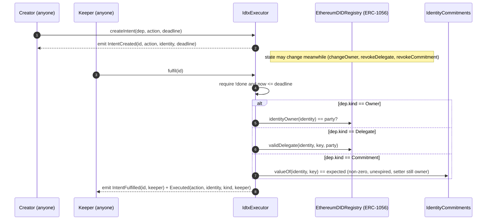

# 05 — Zero-knowledge verifiers and identity-dependent transactions (IDTx)

**Contracts covered**
- `5_zkp-agent-identity/contracts/Groth16Verifier.sol` (generated by snarkjs, 210 lines)
- `5_zkp-agent-identity/contracts/SchnorrEcrecoverVerifier.sol` (68 lines)
- `5_zkp-agent-identity/contracts/ZkVinGate.sol` (212 lines)
- `phase2/idtx/contracts/IdtxExecutor.sol` (256 lines; holds two contracts, `IdentityCommitments` and `IdtxExecutor`)
- `5_zkp-agent-identity/test-contracts/` holds **no `.sol` files**. It only holds `zkvin_gate.test.js`, the Hardhat test directory for layer 5 (see section 4).

**Summary.** These contracts are the on-chain side of layer 5 (ZKP and the agent-wrapped identity) and the Phase 2 F1 prototype of *identity-dependent transactions*. An IDTx is a transaction that is allowed, or has its effect, only if some state of an identity it names holds. That state is read during execution from the ledger or from a proof the transaction carries. `IdtxExecutor` evaluates three plaintext predicates against Phase 1's unmodified ERC-1056 `EthereumDIDRegistry`: owner, delegate, and registered-commitment validity. It can run them in the same transaction as the action, or in a later transaction through an intent. `ZkVinGate` adds a *knowledge-of-opening* dependency. It accepts a Groth16 proof (checked by the snarkjs-generated `Groth16Verifier`) that the prover knows a VIN, model year and salt opening a Poseidon commitment anchored for the identity. The proof also shows that the VIN's WMI belongs to an authorised-manufacturer Merkle set, that the model year is at least a minimum, and that the region matches, with one nullifier per scope. `SchnorrEcrecoverVerifier` is a gas-comparison baseline: a Schnorr proof of knowledge of a secp256k1 key, checked through the `ecrecover` precompile. Everything here is a research artefact. The Groth16 keys come from an insecure single-party setup with fixed entropy.

---

## 2. Standards & protocols

| Standard / protocol | What it is | How faithfully it is implemented here |
|---|---|---|
| **Groth16** (zk-SNARK, Groth 2016) | A pairing-based proof system. The proof is (A ∈ G1, B ∈ G2, C ∈ G1), and the verifier checks e(A,B) = e(α,β)·e(vk_x,γ)·e(C,δ), where vk_x = IC0 + Σ pubᵢ·ICᵢ. | `Groth16Verifier.sol` is the standard snarkjs template, output **unedited** by `snarkjs zkey export solidityverifier` (`circuits/build_circuit.sh:29`). The VK constants are at lines 30–68 (α, β, γ, δ and IC0…IC7, so 7 public signals). `verifyProof` (line 77) range-checks every public signal against the scalar field `r` (`checkField`, used at lines ~186–198) and builds vk_x with `g1_mulAccC`. It negates A by writing `q - A.y` (line ~138) and runs one 4-pair pairing check. **Not checked:** the template does not check that A, B and C are on the curve or in the subgroup. It relies on the precompiles failing instead, which is the usual snarkjs behaviour. **Deployment caveat:** the trusted setup is a single party with fixed entropy strings (`build_circuit.sh:7-8, 23-28`), so the "toxic waste" is public and anyone can forge proofs. The circuit is fine; the keys are not. |
| **EIP-196 / EIP-197** (alt_bn128 precompiles 0x06 add, 0x07 mul, 0x08 pairing) and **EIP-1108** (their repriced gas) | BN254 curve operations available to the EVM. | `Groth16Verifier.sol` calls `staticcall(sub(gas(),2000), 7, …)` (ecMul, line 94), `…, 6, …` (ecAdd, line 104) and `…, 8, _pPairing, 768, …` (pairing over 4 pairs × 192 bytes, line 178). Gas is measured under Hardhat with `evmVersion: cancun`. |
| **snarkjs / circom 2 / circomlib** | Toolchain: circuit → R1CS → powers-of-tau and phase-2 zkey → Solidity verifier. | Circuit: `5_zkp-agent-identity/circuits/zkvin.circom` (`pragma circom 2.1.6`, `ZkVin(4)`, so the Merkle depth is 4 and the set holds up to 16 WMIs). Public inputs are `[commitment, mfrRoot, minModelYear, region, scope, challenge]` (line 125). The output `nullifier` comes first in the public-signal vector, which gives the gate layout `[nullifier, commitment, mfrRoot, minModelYear, region, scope, challenge]` (`ZkVinGate.sol:78-84`). Constraints: 6-bit range checks on each VIN character, with the VIN packed into one field element (102 bits). Poseidon(4) commitment `commitment === c.out`. The WMI is `vin[0] + 64·vin[1] + 4096·vin[2]` and must be a Merkle leaf (`MerkleInclusion`). `GreaterEqThan(12)` after 12-bit range checks. Nullifier is Poseidon(salt, scope). The challenge is bound by a dummy `challenge*challenge` constraint (lines 121–122). That is the usual trick to keep a public input from being optimised away. It does **not** bind the proof to any particular transaction or caller. Build and hashes: `circuits/build_circuit.sh`, which writes `artifacts/MANIFEST.json` with the SHA-256 of `contracts/Groth16Verifier.sol`. |
| **Poseidon hash** | A SNARK-friendly hash (circomlib). | Used only inside the circuit. The contracts store and compare the resulting field elements as `uint256` and never hash on chain. |
| **Schnorr proof of knowledge (sigma protocol) via the `ecrecover` trick** | Schnorr PoK of x where P = x·G on secp256k1. It abuses `ecrecover(h,v,r,s) = addr(r⁻¹(s·R − h·G))` so that the precompile returns addr(s·G − e·P). | `SchnorrEcrecoverVerifier.sol:42-50`. It sets r = Pₓ, σ = −e·Pₓ and h = −s·Pₓ (mod n), recovers address(R), then recomputes `e = keccak256(addr(R) ‖ parity ‖ Pₓ ‖ message)`. **Deviations from textbook Schnorr:** (a) the commitment R is carried only as its 20-byte Ethereum address, not as a point (the standard ecrecover-Schnorr variant, as in Chainlink/noot). (b) The challenge is a keccak over a packed encoding with no domain separator. (c) `ecrecover` here takes v = parity + 27 and the curve order `Q` (named Q but it is secp256k1's n, line 30). (d) It checks that Pₓ ≠ 0 and that Pₓ, s, e < n and parity ≤ 1 (line 44), but it does **not** check that Pₓ < field prime p or that Pₓ is on the curve. `ecrecover` returns 0 for an invalid x, which is caught at line 48. The prover is `5_zkp-agent-identity/zkid/schnorr_evm.py:20-32`. It rejection-samples k until e < n. |
| **ERC-1056** (Ethr-DID lightweight identity registry) | An identity is an address, with `identityOwner`, `validDelegate`, and attributes kept in events. | Consumed only through minimal interfaces: `IERC1056Owner.identityOwner` (`ZkVinGate.sol:29-34`) and `IERC1056.identityOwner/validDelegate` (`IdtxExecutor.sol:41-52`). The registry is Phase 1's unmodified `EthereumDIDRegistry` (`1_blockchain-identity/artifacts/contracts/ERC1056/EthereumDIDRegistry.sol/EthereumDIDRegistry.json`, deployed by the tests). ERC-1056 attributes live only in events, so contracts cannot read them. That is why both contracts keep their own commitment store (`IdtxExecutor.sol:20-22` comment; test `idtx.test.js:138`). |
| EIP-712 / EIP-191 / ERC-165 | — | **Not used** by any contract in this group. There is no signature-based meta-transaction and no interface detection. |

---

## 3. Per-contract reference

### 3.1 `Groth16Verifier` — `5_zkp-agent-identity/contracts/Groth16Verifier.sol`

- **Purpose:** checks a Groth16 proof against the ZK-VIN verification key. Generated code; do not hand-edit, because CI checks its SHA-256 against `artifacts/MANIFEST.json`.
- **Pragma / licence:** `>=0.7.0 <0.9.0`, GPL-3.0 (snarkjs header, lines 1–19). Compiled with 0.8.24, optimizer 200 runs, viaIR (`1_blockchain-identity/hardhat.zkp.config.js`).
- **Inheritance / imports:** none.
- **State:** only compile-time constants. There is no storage.

| Constant | Line | Meaning |
|---|---|---|
| `r` | 25 | BN254 scalar-field order (public-signal bound) |
| `q` | 27 | BN254 base-field prime (used to negate A.y) |
| `alphax/y`, `betax1..y2`, `gammax1..y2`, `deltax1..y2` | 30–43 | Verification key α (G1), β, γ, δ (G2) |
| `IC0x/y` … `IC7x/y` | 46–68 | IC points: constant term plus one per public signal (7) |
| `pVk`, `pPairing`, `pLastMem` | 70–73 | Scratch-memory offsets (0, 128, 896) |

- **Events / modifiers / errors:** none.

| Function | Visibility / mutability | What it does | Access | Events | Origin |
|---|---|---|---|---|---|
| `verifyProof(uint[2] _pA, uint[2][2] _pB, uint[2] _pC, uint[7] _pubSignals) returns (bool)` (l.77) | `public view` | Inline assembly. Checks every signal is < r (returns false otherwise), builds vk_x via ecMul/ecAdd, and runs the bn128 pairing on (−A,B),(α,β),(vk_x,γ),(C,δ). Returns the result via `return(0,0x20)`. | none | — | snarkjs Groth16 template / EIP-197 |
| inner Yul `checkField`, `g1_mulAccC`, `checkPairing` (l.79–181) | assembly-internal | Field check; IC accumulation; pairing input layout | — | — | snarkjs |

**Notes / caveats**
- A failed precompile `staticcall` returns `false` instead of reverting. `ZkVinGate` turns `false` into `InvalidProof()`.
- G2 points are given in snarkjs's swapped (x1,x0) order. Callers must pass the `b` coordinates in the order `snarkjs zkey export soliditycalldata` prints, which is what `fixtures/zkvin_proof.json` contains.
- Groth16 proofs are malleable. A different valid (A,B,C) for the same public signals can be derived. `ZkVinGate` therefore keys replay protection on the **nullifier**, not on the proof bytes. That is correct.
- The VK comes from the insecure setup (see section 2).

### 3.2 `SchnorrEcrecoverVerifier` — `5_zkp-agent-identity/contracts/SchnorrEcrecoverVerifier.sol`

- **Purpose:** Plan 1 to-do 1, which compares a sigma-protocol verifier's on-chain gas with Groth16's (comment at lines 7–13).
- **Inheritance / imports:** none. `pragma ^0.8.24`, MIT.

| State | Line | Notes |
|---|---|---|
| `uint256 private constant Q` | 30 | secp256k1 group order n (`0xFFFF…4141`) |

| Event | Line |
|---|---|
| `Proved(bytes32 indexed px, bytes32 message)` | 55 |

| Function | Visibility / mutability | What it does | Access | Events | Origin |
|---|---|---|---|---|---|
| `verify(uint8 parity, bytes32 px, bytes32 message, bytes32 e, bytes32 s) returns (bool)` (l.42) | `public pure` | Range checks (l.44). Computes h = n − s·Pₓ and σ = n − e·Pₓ mod n. `ecrecover(h, parity+27, px, σ)` gives addr(s·G − e·P). Returns `e == keccak256(abi.encodePacked(addr, parity, px, message))`. | none | — | Schnorr PoK + ecrecover trick |
| `prove(uint8 parity, bytes32 px, bytes32 message, bytes32 e, bytes32 s)` (l.64) | `external` (state-changing only so gas is measured as a tx) | `require(verify(...), "invalid proof")` and emit | none | `Proved` | repo-specific wrapper |

**Notes / caveats**
- There is no replay protection: the same (px, message, e, s) can be resubmitted to `prove`. `message` must carry any nonce or context.
- The proof shows knowledge of the key behind Pₓ and the given parity. It is not tied to any ERC-1056 identity, so it is a gas baseline only.
- When s·Pₓ ≡ 0 or e·Pₓ ≡ 0, h or σ becomes `Q` (= n) rather than 0, and ecrecover then rejects it. This is harmless.

### 3.3 `ZkVinGate` — `5_zkp-agent-identity/contracts/ZkVinGate.sol`

- **Purpose:** an IDTx whose dependency is *knowledge of the opening* of the identity's anchored commitment, proved in zero knowledge. It closes gap AR-5 in `docs/phase2/focus/F1_onchain_storage_idtx/ANALYSIS.md` (header comment lines 4–24). The VIN, the exact model year and the manufacturer stay hidden. The identity itself is public.
- **Inheritance / imports:** none. It declares the interfaces `IERC1056Owner` (l.29) and `IZkVinVerifier` (l.38, same ABI as `Groth16Verifier.verifyProof`). `pragma ^0.8.24`, MIT.

| State variable | Type | Line | Meaning |
|---|---|---|---|
| `NULLIFIER … CHALLENGE` | `uint256 private constant` 0–6 | 78–84 | Public-signal indices fixed by `zkvin.circom` |
| `Service` struct | `{scope, minModelYear, region, challenge, active}` | 88–94 | Per-service verifier policy |
| `registry` | `IERC1056Owner public immutable` | 97 | Phase 1 ERC-1056 registry |
| `verifier` | `IZkVinVerifier public immutable` | 99 | Groth16Verifier address |
| `governor` | `address public` | 101 | Deployer. It has no setter, so it cannot be transferred. |
| `mfrRoot` | `uint256 public` | 103 | Authorised-manufacturer Merkle root. Set only in the constructor, with no updater. |
| `commitmentOf` | `mapping(address => uint256) public` | 106 | Anchored Poseidon commitment per identity |
| `services` | `mapping(bytes32 => Service) public` | 108 | Service registry by id |
| `nullifierUsed` | `mapping(uint256 => mapping(uint256 => bool)) public` | 110 | scope → nullifier → used |

| Event | Line |
|---|---|
| `CommitmentAnchored(address indexed identity, uint256 commitment)` | 115 |
| `ServiceSet(bytes32 indexed serviceId, uint256 scope, uint256 minModelYear, uint256 region, uint256 challenge)` | 122 |
| `Admitted(address indexed identity, bytes32 indexed serviceId, uint256 nullifier, bytes32 action)` | 128 |

Custom errors (l.131–142): `NotIdentityOwner`, `NotGovernor`, `UnknownService`, `SignalMismatch(uint256 index)`, `NullifierUsed`, `InvalidProof`. Modifiers: none; the checks are inline.

| Function | Visibility / mutability | What it does | Access | Events | Origin |
|---|---|---|---|---|---|
| `constructor(IERC1056Owner registry_, IZkVinVerifier verifier_, uint256 mfrRoot_)` (l.148) | — | Sets the immutables, `governor = msg.sender`, and `mfrRoot` | deployer | — | repo |
| `anchorCommitment(address identity, uint256 commitment)` (l.159) | `external` | Overwrites `commitmentOf[identity]` | `registry.identityOwner(identity) == msg.sender`, else `NotIdentityOwner` | `CommitmentAnchored` | repo, over ERC-1056 ownership |
| `setService(bytes32 serviceId, uint256 scope, uint256 minModelYear, uint256 region, uint256 challenge)` (l.172) | `external` | Creates or overwrites a service, always with `active = true` | `governor`, else `NotGovernor` | `ServiceSet` | repo |
| `admit(address identity, bytes32 serviceId, uint256[2] a, uint256[2][2] b, uint256[2] c, uint256[7] pub, bytes32 action)` (l.189) | `external` | Service must be active. `pub[1]` must equal the anchored commitment, which must be non-zero. `pub[2..6]` must equal `mfrRoot` and the service's minYear, region, scope and challenge (`SignalMismatch(i)`). The nullifier must be unused in the scope. `verifier.verifyProof` must pass (`InvalidProof`). Then it marks the nullifier used and emits. | **anyone** (owner, agent or relayer) | `Admitted` | repo, with a Groth16 verifier call |
| public getters `registry()`, `verifier()`, `governor()`, `mfrRoot()`, `commitmentOf(address)`, `services(bytes32)`, `nullifierUsed(uint256,uint256)` | `view` (auto) | Read state | none | — | Solidity auto-getters |

**Design notes / security caveats**
- **`action` is not bound into the proof.** The circuit binds `scope` and `challenge` but no transaction data. Anyone who sees a pending `admit` in the mempool can front-run it with the same proof and a different `action`, or a different `serviceId` that has the same scope, root, year, region and challenge. Because the nullifier is then spent, the original transaction reverts with `NullifierUsed`.
- **`challenge` is static per service.** It changes only when the governor calls `setService` again. So it acts as a session parameter, not a per-request fresh nonce, and replay is stopped only by the nullifier.
- **One admission per (vehicle salt, scope) for ever.** A nullifier is never cleared, so a second admission in the same scope needs a new salt, which means re-anchoring a new commitment.
- **No AR-6 equivalent.** Compare `IdentityCommitments.valueOf`: here, after an ERC-1056 ownership transfer, the previous owner's commitment stays valid until the new owner overwrites it. The test at `zkvin_gate.test.js:80-86` checks only that the old owner can no longer *anchor*.
- `anchorCommitment` accepts `0`, which effectively disables the identity because `admit` requires `anchored != 0`.
- Services cannot be deactivated (`active` is always true). `governor` and `mfrRoot` are fixed after deployment, even though the header says "a governor publishes the root".
- Which identity was admitted is public. Hiding that needs a Semaphore-style anonymity set, which is noted as a to-do (l.21-22).
- Checks come before effects: the external view call to the verifier happens before the nullifier is written. The verifier is trusted and immutable, so there is no reentrancy risk.

### 3.4 `IdentityCommitments` and `IdtxExecutor` — `phase2/idtx/contracts/IdtxExecutor.sol`

- **Purpose:** the Phase 2 F1 IDTx prototype. Its header (l.4–36) defines an IDTx. Revised 2026-10-14 for review items AR-4 (the caller is not part of the predicate), AR-5 (commitment validity, not knowledge) and AR-6 (a commitment stops counting once its setter no longer owns the identity).
- **Imports / inheritance:** none. It declares `interface IERC1056 { identityOwner; validDelegate; }` (l.41–52). `pragma ^0.8.24`, MIT.

#### `IdentityCommitments` (l.65–135)

| State variable | Type | Line | Meaning |
|---|---|---|---|
| `registry` | `IERC1056 public immutable` | 67 | ERC-1056 registry |
| `_value` | `mapping(address => mapping(bytes32 => bytes32)) private` | 69 | commitment per (identity, key) |
| `validUntil` | `mapping(address => mapping(bytes32 => uint64)) public` | 71 | expiry |
| `setBy` | `mapping(address => mapping(bytes32 => address)) public` | 73 | owner at set time (AR-6) |

Events: `CommitmentSet(address indexed identity, bytes32 indexed key, bytes32 commitment, uint64 validUntil)` (l.80) and `CommitmentRevoked(address indexed identity, bytes32 indexed key)` (l.84).
Modifier: `onlyIdentityOwner(address identity)` (l.94), which checks `registry.identityOwner(identity) == msg.sender`.

| Function | Visibility / mutability | What it does | Access | Events | Origin |
|---|---|---|---|---|---|
| `constructor(IERC1056 registry_)` (l.88) | — | Sets the registry | deployer | — | repo |
| `setCommitment(address identity, bytes32 key, bytes32 commitment, uint64 until)` (l.105) | `external` | Requires a non-zero commitment and `until > now`. Stores the value, the expiry and `setBy = msg.sender`. | `onlyIdentityOwner` | `CommitmentSet` | repo |
| `revokeCommitment(address identity, bytes32 key)` (l.119) | `external` | Deletes all three entries | `onlyIdentityOwner` | `CommitmentRevoked` | repo |
| `valueOf(address identity, bytes32 key) returns (bytes32)` (l.130) | `external view` | Returns 0 if expired or if the current owner ≠ `setBy`; otherwise the commitment | none | — | repo (AR-6) |
| `registry()`, `validUntil(address,bytes32)`, `setBy(address,bytes32)` | auto `view` | getters | none | — | auto |

#### `IdtxExecutor` (l.152–256)

| Item | Line | Meaning |
|---|---|---|
| `enum Kind { Owner, Delegate, Commitment }` | 154 | Dependency kind |
| `struct Dependency { Kind kind; address identity; bytes32 key; bytes32 expected; address party; }` | 157–163 | The predicate |
| `struct Intent { Dependency dep; bytes32 action; uint64 deadline; address creator; bool done; }` | 166–172 | A deferred IDTx |
| `registry` (`IERC1056 public immutable`) | 175 | ERC-1056 registry |
| `commitments` (`IdentityCommitments public immutable`) | 177 | Commitment store |
| `_intents` (`Intent[] private`) | 179 | Intent list |

Events: `Executed(bytes32 indexed action, address indexed identity, Kind kind, address caller)` (l.186), `IntentCreated(uint256 indexed id, bytes32 indexed action, address indexed identity, uint64 deadline)` (l.192) and `IntentFulfilled(uint256 indexed id, address keeper)` (l.196). There are no modifiers.

| Function | Visibility / mutability | What it does | Access | Events | Origin |
|---|---|---|---|---|---|
| `constructor(IERC1056 registry_, IdentityCommitments commitments_)` (l.201) | — | Sets the immutables | deployer | — | repo |
| `holds(Dependency d) returns (bool)` (l.210) | `public view` | Owner: `identityOwner(identity) == party`. Delegate: `validDelegate(identity, key, party)`. Commitment: `valueOf(identity,key)` is non-zero and equals `expected`. Never reads `msg.sender` (AR-4). | none | — | repo, over ERC-1056 |
| `execute(Dependency d, bytes32 action)` (l.221) | `external` | `require(holds(d))`, then emit. The "action" is only an event. | anyone | `Executed` | repo |
| `createIntent(Dependency d, bytes32 action, uint64 deadline) returns (uint256 id)` (l.231) | `external` | Requires `deadline > now`. Pushes the intent and returns its index. | anyone | `IntentCreated` | repo |
| `fulfil(uint256 id)` (l.241) | `external` | Requires not done and `now ≤ deadline`, then **re-evaluates** `holds(dep)`. Sets done and emits. | anyone (a keeper) | `IntentFulfilled`, `Executed` | repo |
| `intentCount() returns (uint256)` (l.253) | `external view` | `_intents.length` | none | — | repo |
| `registry()`, `commitments()` | auto `view` | getters | none | — | auto |

**Design notes / caveats**
- The **Commitment** kind proves only that a public digest was registered. It proves no knowledge of the value behind it (AR-5). `ZkVinGate` is the knowledge-of-opening counterpart.
- Anyone can create intents, so `_intents` can be spammed. That has no effect except storage growth paid by the spammer. `creator` is stored but never read. An out-of-range `fulfil(id)` panics (0x32).
- Because `holds` is re-evaluated at `fulfil`, there is no on-chain time-of-check/time-of-use gap (tested at `idtx.test.js:113-127`).
- Actions are only events: no external call and no value transfer, so there is no reentrancy surface.
- Delegate validity relies on ERC-1056's `validDelegate` expiry semantics (`block.timestamp < validity`).

---

## 4. Where / when / how it's used

### Build and toolchain
- `5_zkp-agent-identity/circuits/build_circuit.sh`: compiles `zkvin.circom` with circom 2.2.x, runs a fixed-entropy powers-of-tau (2^12) and phase-2 setup, exports `artifacts/verification_key.json`, `zkvin_final.zkey` and `zkvin.wasm`, **regenerates `contracts/Groth16Verifier.sol`**, and writes `artifacts/MANIFEST.json` (SHA-256 hashes).
- `1_blockchain-identity/hardhat.zkp.config.js`: sources `5_zkp-agent-identity/contracts` (all three layer-5 contracts), tests `5_zkp-agent-identity/test-contracts`, artifacts in `5_zkp-agent-identity/hh-artifacts`. Solc 0.8.24, viaIR, cancun.
- `1_blockchain-identity/hardhat.phase2.config.js`: sources `phase2/idtx/contracts`, tests `phase2/idtx/test`, artifacts in `phase2/idtx/artifacts`.
- Both configs live in `1_blockchain-identity/` only so they can reuse its `node_modules`. The tests load the Phase 1 `EthereumDIDRegistry` artifact, so run `npx hardhat compile` (the Phase 1 build) first.

### Off-chain proof generation
- `5_zkp-agent-identity/scripts/zkvin_lib.js`: shared helpers (`ROOT`, `toField`, `context`, `runIdentity`).
- `5_zkp-agent-identity/scripts/prove_and_verify.js`: `snarkjs.groth16.fullProve` with `artifacts/zkvin.wasm` and `zkvin_final.zkey`. Checks one honest proof and five false statements (Z-E1, Z-E2, Z-E4). `--bench` writes `results/zkvin_bench.json`; `--fixture` writes `fixtures/zkvin_proof.json`, the calldata (`a`, `b`, `c`, `pub`) for the insurer and toll scopes plus `mfrRoot`, the vehicle commitment and the request parameters.
- `5_zkp-agent-identity/zkid/schnorr_evm.py`: the Python prover for `SchnorrEcrecoverVerifier`. Produces `fixtures/schnorr_evm.json`.
- The Python `zkid` package (`sigma.py`, `nullifier.py`, `merkle.py`, `transcript.py`, `ec.py`, `hashing.py`) implements the off-chain sigma, nullifier and Merkle primitives. It is tested by `5_zkp-agent-identity/tests/test_zkid.py` and mutated by `mutate_zkid.sh`.

### Tests
- `5_zkp-agent-identity/test-contracts/zkvin_gate.test.js` (run with `npx hardhat --config hardhat.zkp.config.js test`). `deployAll` deploys the Phase 1 ERC-1056 registry from its artifact, then `Groth16Verifier`, then `ZkVinGate(registry, verifier, FIX.mfrRoot)`. It anchors the commitment for `owner.address` (the vehicle identity is its own owner) and sets the services `insurer:acme` and `toll:A`. The cases:
  - The verifier accepts the fixture proof and rejects a tampered one (l.32).
  - The agent admits once per scope; a second attempt fails with `NullifierUsed` (l.41).
  - Different scopes give different, unlinkable nullifiers (l.49).
  - A proof for one service cannot be used at another; scope is bound (l.57).
  - A wrong identity, root, threshold or challenge gives `SignalMismatch(i)` (l.63).
  - A tampered proof whose signals all match is rejected (l.74).
  - Only the ERC-1056 owner can anchor, and after a transfer the old owner cannot (l.80).
  - The Schnorr verifier accepts a valid proof and rejects a wrong message, s+1 or a flipped parity (l.88).
- `phase2/idtx/test/idtx.test.js` (run with `npx hardhat --config hardhat.phase2.config.js test`). It deploys the registry, `IdentityCommitments` and `IdtxExecutor` (l.29–31). Cases:
  - Owner dependency, and a third-party caller (AR-4) (l.38, l.44).
  - Delegate dependency, including revocation and expiry (l.51).
  - Commitment over a plaintext (l.63) and over a ciphertext digest (l.74).
  - AR-6 setter-ownership rule (l.85).
  - Only the owner can set or revoke a commitment (l.95).
  - Intent fulfil (l.106); fail after an ownership transfer, after a revocation, or after expiry (l.113–135).
  - ERC-1056 exposes no attribute getter (l.138).

### Mutation probes
- `phase2/idtx/mutate_idtx.sh` mutates `IdtxExecutor.sol` in place and restores it on exit. There are five mutants: `holds_always_true`, `no_recheck_at_fulfil`, `commitment_validity_ignored`, `commitment_setter_ignored` and `deadline_ignored`. Each one must make `hardhat.phase2.config.js test` fail. CI runs it in `.github/workflows/test-contracts.yml` (l.44–45).
- `5_zkp-agent-identity/mutate_zkid.sh` mutates only the **Python** `zkid` and `steward` code (Schnorr challenge, range proof, nullifier scope, leakage budget, transcript context). It does not mutate any `.sol` contract. **No mutation probe exists for `ZkVinGate` or the verifiers.**

### Benchmarks, figures, demos and CI
- `5_zkp-agent-identity/scripts/measure_gas.js` deploys all three layer-5 contracts and records gas into `results/gas_zk.json`: `deploy_groth16_verifier`, `deploy_zkvin_gate`, `anchor_commitment`, `set_service`, `verify_proof_view_estimate`, `admit_with_groth16`, `deploy_schnorr_verifier`, `schnorr_prove_tx` and `schnorr_verify_view_estimate`. It also checks the pre-registered expectation "Z-E3 admit < 350,000 gas" (l.49). `5_zkp-agent-identity/README.md:37` reports **301,163 gas** for `ZkVinGate.admit` (condition M1).
- `5_zkp-agent-identity/figures/make_figures.py` (l.112, 217, 328) draws ZkVinGate's gas into the thesis figures. `figures/ssi_tables.json` also references the contracts.
- `5_zkp-agent-identity/bench/manual_burden.py` (the "one ZK-VIN proof by hand" estimate) and `demos/full_circle_demo.py` reference the ZK-VIN or Groth16 flow.
- `.github/workflows/zkp-layer5.yml` has these jobs: rebuild-free artefact-hash check against `MANIFEST.json`, `node scripts/prove_and_verify.js`, `bash mutate_zkid.sh`, and a "ZkVinGate and Schnorr verifier (Hardhat)" job that runs `npx hardhat compile && npx hardhat --config hardhat.zkp.config.js test`.
- Docs that mention the contracts include:
  - `docs/zkp/PLAN_1_ZKP_AND_AGENT_IDENTITY.md` and `PLAN_1_PHASED_PROMPTS.md`
  - `docs/zkp/REPORT_A_ZKP_INTEGRATION.md`, `REPORT_B_ZKP_AND_IDENTITY.md`, `REPORT_C_AGENT_WRAPPED_IDENTITY.md` and `THESIS_INTEGRATION_MAP.md`
  - `docs/phase2/focus/F1_onchain_storage_idtx/ANALYSIS.md` and `EXECUTION.md`
  - `docs/phase2/reviews/ACADEMIC_REVIEW_F1-F3.md` and `DISPOSITIONS_F1-F3.md`
  - `docs/phase2/briefs/I-24_IDTX.md`, `IDEA_REGISTER.md` and `ideas.yaml`
  - `docs/MEASUREMENT_CONDITIONS.md`
  - `docs/thesis/chapter4…7/README.md`
  - `docs/figures/result_cards.html` and `dashboard_snapshot.json`
  - `docs/SESSION_MANIFEST_2026-09.md` and `docs/AFTER_ACTION_REPORT_28.md`
  - the root `README.md` (l.102)

### Typical call sequence (ZK-VIN)
1. **Setup (off chain, once):** `bash circuits/build_circuit.sh` produces the zkey, the wasm and `Groth16Verifier.sol`.
2. **Deploy:** `Groth16Verifier`, then `ZkVinGate(ERC1056 registry, verifier, mfrRoot)`. The deployer becomes the governor.
3. **Owner anchors:** the identity's ERC-1056 owner calls `anchorCommitment(identity, Poseidon(packedVIN, modelYear, region, salt))`.
4. **Governor configures:** `setService(serviceId, scope, minModelYear, region, challenge)`.
5. **Prove (off chain):** the holder or an agent runs `snarkjs.groth16.fullProve` with the private VIN, model year, salt and Merkle path, plus the public parameters. The output is (a, b, c, pub), with `pub[0]` the nullifier.
6. **Verify on chain:** anyone calls `admit(identity, serviceId, a, b, c, pub, action)`. The gate checks the signals, checks the nullifier is fresh, calls `verifier.verifyProof`, marks the nullifier and emits `Admitted`.

### Typical call sequence (IDTx)
1. Deploy `IdentityCommitments(registry)`, then `IdtxExecutor(registry, commitments)`.
2. Optionally, the owner calls `setCommitment(identity, key, digest, until)`.
3. Either `execute(dep, action)` in the same transaction, or `createIntent(dep, action, deadline)` followed later by a keeper's `fulfil(id)`, which re-checks `holds(dep)`.

---

## 5. Duplicates, copies and stale copies

- A repo-wide search (excluding `node_modules`, `artifacts`, `cache` and `.git`) finds **exactly one copy** of each source: `Groth16Verifier.sol`, `SchnorrEcrecoverVerifier.sol`, `ZkVinGate.sol` and `IdtxExecutor.sol`.
- `Groth16Verifier.sol` is *generated*, so it is effectively a copy of the key material in `5_zkp-agent-identity/artifacts/zkvin_final.zkey` and `verification_key.json`. Its SHA-256 is pinned in `artifacts/MANIFEST.json` and checked by CI. Re-running `build_circuit.sh` overwrites it in place. If the circuit changes without a rebuild, the verifier and `fixtures/zkvin_proof.json` go stale together, and the manifest step catches it.
- Compiled outputs live in `5_zkp-agent-identity/hh-artifacts/` and `phase2/idtx/artifacts/`, which are build products and not maintained by hand.
- `ZkVinGate.sol` and `IdtxExecutor.sol` each declare their own minimal ERC-1056 interface (`IERC1056Owner` and `IERC1056` respectively), which duplicates part of Phase 1's `EthereumDIDRegistry` ABI. Both were written separately and are not shared code.
- `5_zkp-agent-identity/test-contracts/` contains no Solidity, only `zkvin_gate.test.js`.

---

## Diagrams & examples

### Off-chain proving → `ZkVinGate.admit` → `Groth16Verifier`

```mermaid
sequenceDiagram
    autonumber
    participant O as Identity owner
    participant H as Holder / agent (circom + snarkjs)
    participant G as ZkVinGate
    participant R as EthereumDIDRegistry (ERC-1056)
    participant V as Groth16Verifier
    O->>G: anchorCommitment(identity, Poseidon(packedVIN, modelYear, region, salt))
    G->>R: identityOwner(identity) == msg.sender?
    Note over G: governor: setService(serviceId, scope, minModelYear, region, challenge)
    H->>H: snarkjs.groth16.fullProve(private VIN, year, salt, Merkle path; public params)
    H-->>H: (a, b, c, pub), pub[0] = nullifier = Poseidon(salt, scope)
    H->>G: admit(identity, serviceId, a, b, c, pub, action)
    G->>G: check pub[1..6] vs commitmentOf, mfrRoot, service; nullifier unused in scope
    G->>V: verifyProof(a, b, c, pub) (ecMul 0x07, ecAdd 0x06, pairing 0x08)
    V-->>G: true / false (false → InvalidProof)
    G->>G: nullifierUsed[scope][pub[0]] = true
    G-->>H: emit Admitted(identity, serviceId, nullifier, action)
```

### IDTx intent → fulfil against ERC-1056



### ethers v6 example (mirrors the tests)

Adapted from `5_zkp-agent-identity/test-contracts/zkvin_gate.test.js` (`deployAll`, l.16–28 and l.41–46) and `phase2/idtx/test/idtx.test.js` (l.24–31, l.106–111):

```js
// ZK-VIN gate: FIX = fixtures/zkvin_proof.json (proof made by snarkjs off chain)
const verifier = await (await ethers.getContractFactory("Groth16Verifier")).deploy();
const gate = await (await ethers.getContractFactory("ZkVinGate")).deploy(
  await registry.getAddress(), await verifier.getAddress(), FIX.mfrRoot);
await gate.connect(owner).anchorCommitment(vehicle, FIX.vehicle.commitment);
await gate.setService(INSURER, FIX.request.scope, FIX.request.minModelYear, FIX.vehicle.region, FIX.request.challenge);
const P = FIX.insurer;
await expect(gate.connect(agent).admit(vehicle, INSURER, P.a, P.b, P.c, P.pub, ACTION))
  .to.emit(gate, "Admitted").withArgs(vehicle, INSURER, P.pub[0], ACTION);

// IDTx: next-transaction intent re-checked at fulfilment
const exec = await (await ethers.getContractFactory("IdtxExecutor"))
  .deploy(await registry.getAddress(), await commitments.getAddress());
const dep = { kind: 0 /* Owner */, identity: vehicle, key: ethers.ZeroHash, expected: ethers.ZeroHash, party: owner.address };
const deadline = (await ethers.provider.getBlock("latest")).timestamp + 600;
await exec.createIntent(dep, ethers.id("insure"), deadline);
await expect(exec.connect(keeper).fulfil(0)).to.emit(exec, "IntentFulfilled").withArgs(0, keeper.address);
```
