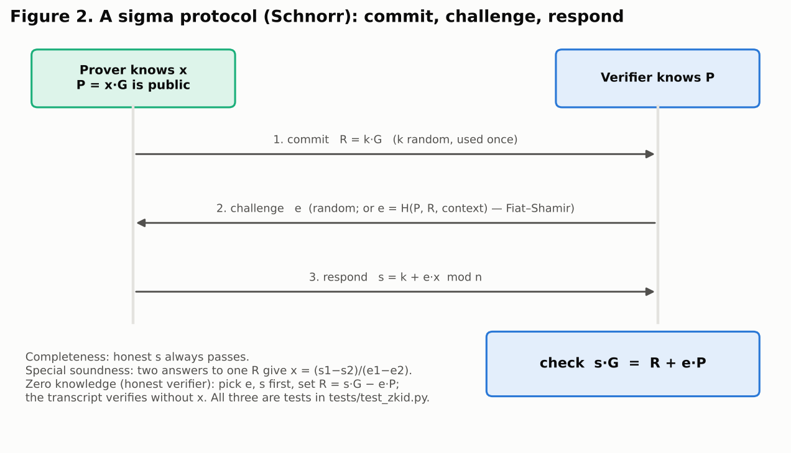
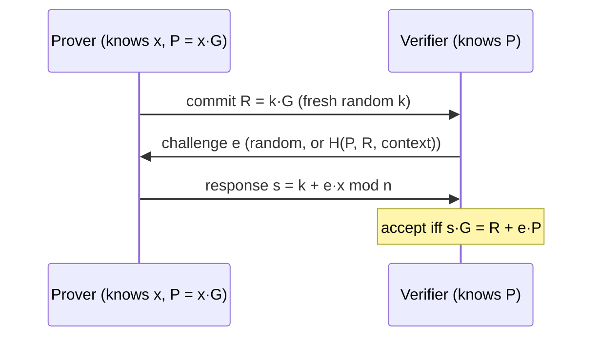
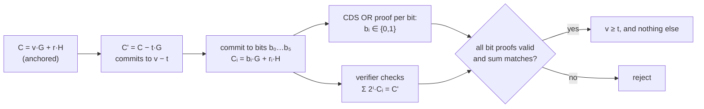
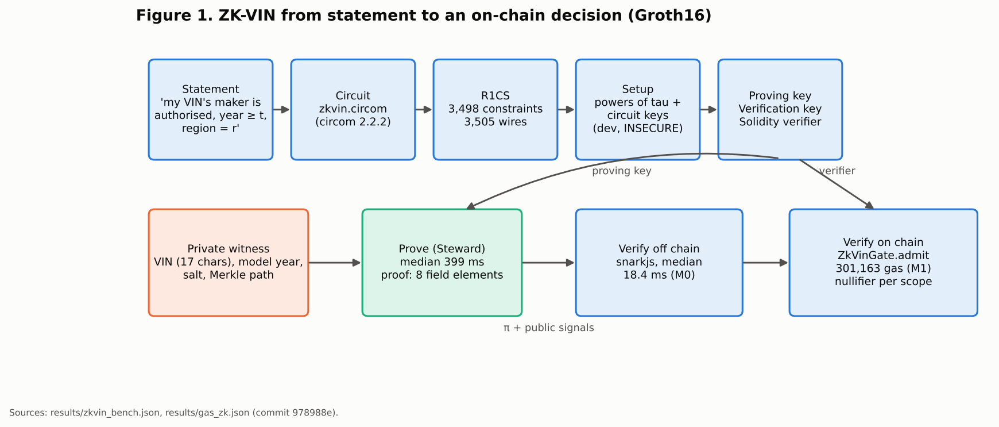
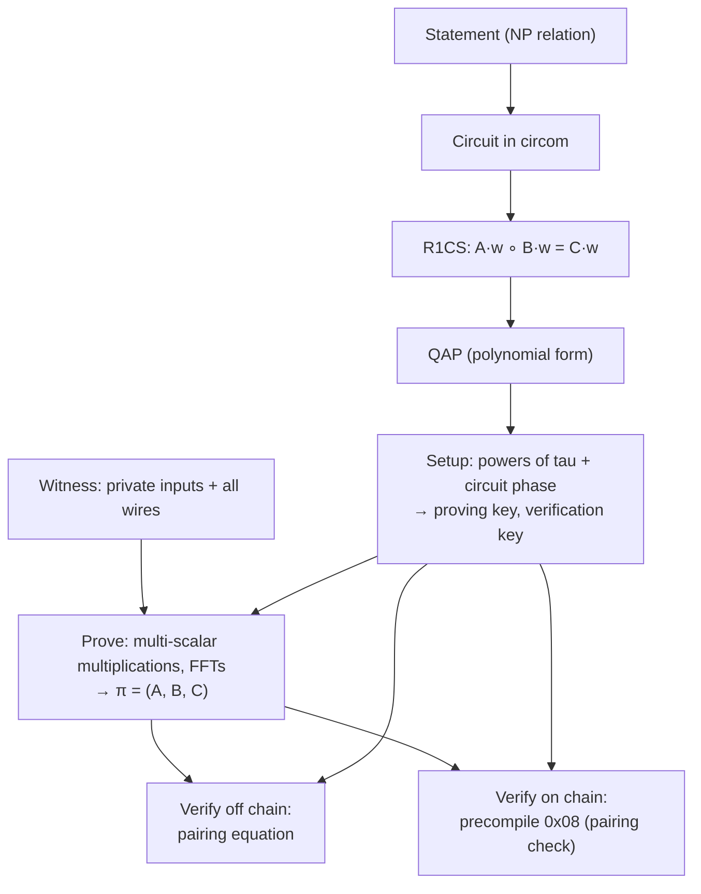
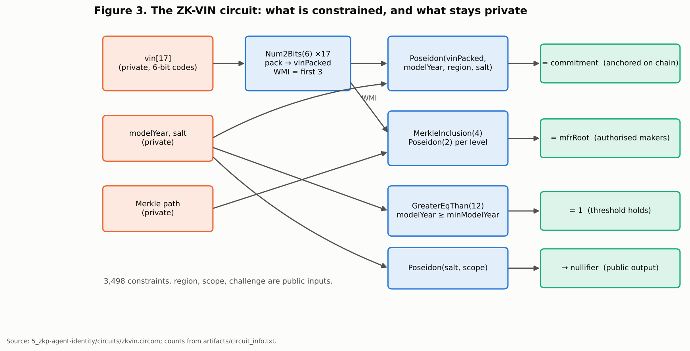
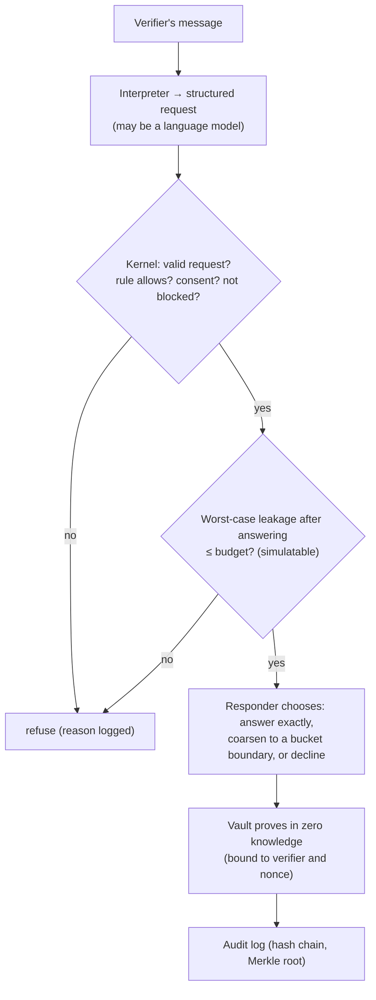
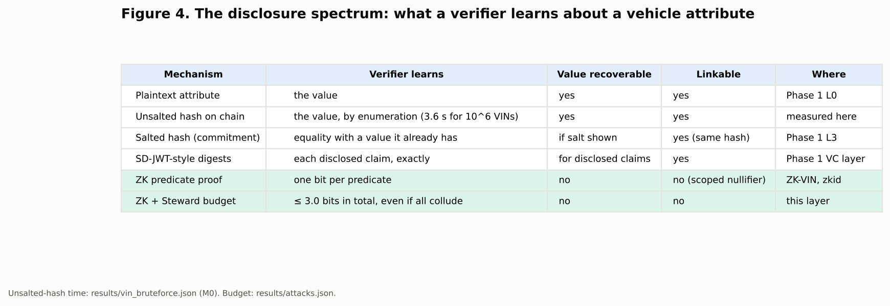

# Proving Without Telling: Zero-Knowledge Proofs, Identity, Privacy and Self-Sovereign Data for Connected Machines

**Report B of Plan 1 — a standalone paper, written to be cut down for the thesis**

**Author:** Nikhil Prakash (MASc, UBC ECE)
**Written:** 2026-10-15. **Supersedes:** nothing. **Binds:** `docs/STYLE_AND_RIGOUR_GUIDE.md`; every number here comes
from a results file of record in `5_zkp-agent-identity/results/` (commit `978988e`, `code_clean` true) or from a cited
source in `docs/zkp/SOURCES_ZKP.md`, and carries its condition tag (M0 in-process, M1 Hardhat local, E estimate).
**Companions:** Report A (what was built and measured), Report C (the agent-wrapped identity), `THESIS_INTEGRATION_MAP.md`.

---

## Abstract

Identity has always carried a paradox: to be recognised, one must reveal. A driver shows a licence to prove an age and
surrenders a name, an address and a birth date in the same motion; a vehicle broadcasts a certificate to prove it is
legitimate and becomes traceable across a city. Zero-knowledge proofs, introduced by Goldwasser, Micali and Rackoff in
1985, dissolve the paradox in principle: a prover convinces a verifier that a statement is true while revealing nothing
beyond its truth. This paper traces zero knowledge from its theoretical origin to its deployment on blockchains and in
digital-identity wallets; sets out the cryptography it rests on (hashing, commitments, public-key cryptography, Merkle
trees, pairings and the Fiat–Shamir transform); reviews its use for identity, privacy, data control and self-sovereign
identity (SSI); and confronts the reality of identity data that is stored on, or anchored to, a public ledger. It then
reports a working instance inside a six-year research programme on vehicle identity: **ZK-VIN**, a circuit that proves a
vehicle's manufacturer is authorised, its model year meets a threshold and its region matches, against a commitment
anchored on chain, without revealing the VIN. On this host the proof is generated in a median 399 ms and verified in
18.4 ms off chain (M0), and verified on chain inside an identity-dependent transaction for 301,163 gas (M1). The paper
closes with two findings that carry into Report C. Operating zero-knowledge identity by hand is not tedious but
infeasible (one ZK-VIN proof is estimated at about 124,500 working years of hand computation, status E). And
zero knowledge per proof is not privacy per session: a verifier that asks many individually zero-knowledge questions
recovers the hidden value unless something remembers and limits what has been said.

---

## 1. Introduction

### 1.1 The paradox of being known

Every identity system answers two questions at once: *who are you?* and *what may you do?* Institutions answer the
second by asking the first. A bar checks a birth date to learn one bit (over the drinking age or not) and is handed
the whole document. An insurer asks whether a car is recent enough to qualify for a product and receives its VIN, from
which make, model, plant, options and, through data brokers, a driving history follow. A connected vehicle proves to a
roadside unit (RSU) that it holds a valid credential and, in doing so, emits an identifier that can be followed.

The cost of over-disclosure is not abstract. The Equifax breach of 2017 exposed about 147 million people's identity
records [@EQUIFAX-FTC2019]; the Cambridge Analytica episode involved the Facebook data of up to 87 million people
[@FB-CA-2018]. In 2023 every one of the 25 car brands Mozilla reviewed received its "Privacy Not Included" warning
[@MOZILLA-CARS-2023]; in 2025 the US Federal Trade Commission banned General Motors and OnStar for five years from
disclosing drivers' geolocation and behaviour data to consumer reporting agencies, data it found had been collected
"without adequately notifying consumers and obtaining their affirmative consent" [@FTC-GM-2025]. Zuboff names the
underlying economic logic: human experience treated as "free raw material" for prediction [@ZUBOFF2019]; the slogan
that a user who does not pay is the product has a documented lineage back to 1973 [@QI-PRODUCT].

### 1.2 What zero knowledge offers

A zero-knowledge proof lets a holder show *that* a statement about hidden data is true without showing the data. The
bar learns "over the age"; the insurer learns "model year at least 2020, manufacturer authorised"; the RSU learns
"holds a valid, unrevoked credential", and receives a value that cannot be matched with what a different RSU received.
The data minimisation that the GDPR requires ("adequate, relevant and limited to what is necessary", Art. 5(1)(c);
data protection by design and by default, Art. 25) becomes a property of the protocol instead of a promise of the
verifier [@GDPR].

### 1.3 Why this paper exists inside a vehicle-identity thesis

The thesis this paper serves compares blockchain identity standards for connected and autonomous vehicles: nine
standards implemented and measured, a W3C DID and Verifiable Credential layer at 94.3 % on an internal compliance
checker, MOBI VID realised on five backends, and a V2X testbed with real cryptography in the message path (the
repository README and the claim register, `docs/MEASUREMENT_CONDITIONS.md`). Three privacy items were deferred along
the way: the zero-knowledge VIN tier of the MOBI VID I design (scope change SC-12, idea I-09); the observation that a
contract can depend on a committed value only by equality, never by knowledge of what it commits to (the F1 academic
review's finding AR-5); and selective disclosure beyond salted digests (idea I-10). This paper supplies the theory and
the literature; Report A supplies the implementation and the measurements; Report C draws the consequence.

### 1.4 Contributions

1. A history of zero knowledge from 1985 to 2026, tied to the identity problem rather than to cryptocurrency alone (§2).
2. A compact account of the cryptographic substrate a reader needs, with the project's own implementations as running
   examples (§3–§4).
3. Step-by-step algorithm breakdowns with flowcharts for a sigma protocol, OR and range proofs, Fiat–Shamir, Groth16 and
   the ZK-VIN circuit (§5), and a verbose technical exposition with the equations (§13).
4. An analysis of identity, PII, privacy, data control and SSI through the lens of what a verifier learns (§7–§8), and
   of what remains true when identity data is stored on or anchored to a ledger (§9).
5. A mini literature review, organised by theme, with each work's role in this project stated (§10).
6. A map of zero knowledge across every layer of the project (§11), an integrated narrative of one vehicle's life told
   through proofs (§12), and the potential and limits (§14–§15).

---

## 2. A short history of proving without telling

**The definition (1985–1989).** Goldwasser, Micali and Rackoff introduced interactive proofs and the measure of
"knowledge complexity" at STOC 1985 [@GMR85], with the journal version in 1989 [@GMR89]. Their question was how much
*knowledge*, beyond the truth of a statement, a proof must convey; their answer, for some statements, was none. The
paper shared the 1993 Gödel Prize [@GODEL93], and Goldwasser and Micali received the 2012 ACM Turing Award for work that
turned cryptography "from an art into a science" [@TURING12]. The idea was popularised by Quisquater and colleagues'
cave of Ali Baba: Peggy shows Victor she knows the password to a door inside a ring-shaped cave by emerging from
whichever side Victor names, over and over, without ever saying the word [@QQQ89].

**Generality (1986–1991).** Goldreich, Micali and Wigderson showed that every language in NP has a zero-knowledge proof
if one-way functions exist, via a proof for graph three-colouring [@GMW91]. That result is the reason a statement as
specific as "this VIN's manufacturer is authorised and its model year is at least 2020" can be proved in zero knowledge
at all: it is an NP statement, so it reduces to a circuit.

**Practicality (1986–1994).** Fiat and Shamir showed how to replace the verifier's random challenge by a hash of the
transcript, turning an interactive identification into a signature [@FS86]; Bellare and Rogaway formalised the random
oracle model that justifies it [@BR93]; Pointcheval and Stern gave the security argument for Schnorr-type signatures
[@PS00]. Schnorr's identification protocol (1989/1991), designed to minimise a smart card's work [@Sch89; @Sch91], became the template "sigma protocol". Chaum and Pedersen proved the
equality of discrete logarithms [@CP92]; Pedersen gave the commitment that is perfectly hiding and computationally
binding [@Ped91]; Cramer, Damgård and Schoenmakers showed how to prove "at least d of n" statements without revealing
which (OR proofs) [@CDS94]. All of these are implemented and tested in this project's `zkid` library (Report A §2).

**Non-interaction and succinctness (1988–2000).** Blum, Feldman and Micali introduced non-interactive zero knowledge in
the common reference string model [@BFM88], the ancestor of every trusted-setup SNARK. The PCP theorem showed that an NP
proof can be checked by reading a constant number of its bits [@AS98; @ALMSS98]; Kilian [@Kil92] and Micali [@Mic00]
turned PCPs plus Merkle commitments into succinct arguments.

**SNARKs become engineering (2013–2019).** Gennaro, Gentry, Parno and Raykova introduced quadratic arithmetic programs
[@GGPR13]; Pinocchio made them nearly practical [@PHGR13]; libsnark's "SNARKs for C" verified program execution
[@BCCT12-SNARKsC]. Groth's 2016 construction reduced a proof to three group elements, checked with three pairings
[@Groth16]: it is the system this project uses, through circom [@Circom23; @circom-docs] and snarkjs [@snarkjs]. Its
weakness is a circuit-specific trusted setup, addressed by multi-party "powers of tau" ceremonies [@BGM17] and, later,
by universal setups (PLONK [@PLONK19], Marlin [@Marlin20]) and transparent systems with no setup at all: Bulletproofs
[@BBBPWM18], STARKs [@STARK18], Halo and Halo 2 [@Halo19; @Halo2]. Folding schemes (Nova) made recursion cheap
[@Nova22]; Poseidon made hashing inside circuits cheap ("up to 8x fewer constraints per message bit than Pedersen
Hash") [@Poseidon21]. Thaler's book is the standard reference for the field [@Thaler22].

**Blockchains make it urgent (2008–2026).** Bitcoin's ledger is public by design [@Nakamoto08]. Zerocash (2014) used
zk-SNARKs to make payments private at scale [@Zerocash14], leading to Zcash [@ZcashSpec]. Ethereum added precompiles
for BN254 addition, scalar multiplication and pairing checks in 2017 [@EIP196; @EIP197] and cut their prices in 2019
(pairing check 34,000·k + 45,000 gas) [@EIP1108; @EIP1679], which is what makes an on-chain Groth16 verifier cost a few
hundred thousand gas. Zero-knowledge rollups now carry much of Ethereum's execution [@zkSync; @Starknet; @Scroll];
Semaphore lets a member of a group signal once without revealing which member, using nullifiers [@Semaphore]; MACI
verifies private vote tallies on chain [@MACI]; zkLogin lets users sign in to a blockchain with an OpenID Connect token
without linking their account on chain [@zkLogin24]. The technology also met the law: the US Treasury sanctioned the
Tornado Cash mixer in 2022, stating it had laundered more than $7 billion [@OFAC22]; the Fifth Circuit held in 2024 that
its immutable smart contracts were not "property" under IEEPA [@VanLoon24], and the sanctions were lifted in 2025
[@OFAC25].

**Identity takes it up (2001–2026).** Camenisch and Lysyanskaya's anonymous credentials (2001) let a holder prove
possession of a credential "unlinkably many times" [@CL01; @CL2001; @CL02]; IBM's Idemix [@Idemix02] and Microsoft's
U-Prove [@UProve] implemented the idea; Boneh, Boyen and Shacham's short group signatures [@BBS04] became today's BBS
signatures, standardised in draft at the IRTF [@BBS-IRTF] and as a W3C cryptosuite [@VC-BBS]. Hyperledger AnonCreds
supports zero-knowledge predicates such as "age over 18" [@AnonCreds]. The W3C Verifiable Credentials Data Model 2.0
(May 2025) allows zero-knowledge-derived presentations [@VCDM2] on top of DIDs [@DIDCore]. SD-JWT, the salted-hash
selective-disclosure format, became RFC 9901 in November 2025 [@RFC9901]; it is not zero knowledge and is linkable
across presentations unless credentials are batch-issued. In 2024 Frigo and shelat built anonymous credentials over
existing ECDSA-signed mobile documents, with ECDSA proofs in about 20 ms [@FrigoShelat24], and Google open-sourced the
libraries for age assurance [@GoogleZK25]. The EU Digital Identity Wallet's Architecture and Reference Framework now
carries a discussion topic and a technical specification for zero-knowledge proofs [@EUDI-ARF], and Spain's data
protection authority has asked for zero knowledge by default [@AEPD-TopicG]. Not every "privacy-preserving" wallet is
zero knowledge: the coverage of Apple's 2025 Digital ID describes selective disclosure, not ZK proofs [@AppleID25].

The arc is plain: zero knowledge began as a question about knowledge, became a tool for payments, and is becoming the
expected way to prove facts about people and, this paper argues, about machines.

---

## 3. The cryptographic substrate

Zero knowledge is built from a handful of primitives. Each is introduced here with the property a proof relies on and
the place it appears in this project.

### 3.1 Hash functions

A cryptographic hash function maps any input to a fixed-length digest such that it is infeasible to find an input for a
given digest (preimage resistance), a second input with the same digest as a given one (second-preimage resistance), or
any two inputs with the same digest (collision resistance). SHA-256 (FIPS 180-4) [@FIPS180-4] underpins Bitcoin and
this project's Merkle trees, transcripts and hash commitments. Ethereum uses Keccak-256, the pre-standard padding of
the function NIST standardised as SHA-3 [@FIPS202]; the two differ, which is why `zkid/hashing.py` implements Keccak in
full and tests it against Ethereum's (Report A §2). Inside circuits a third family matters: hash functions designed for
few constraints, of which Poseidon is the one this project uses [@Poseidon21].

A hash is *not* a privacy mechanism for low-entropy data. "Hashing the VIN" hides nothing from anyone who can enumerate
plausible VINs, and §9.2 measures how fast.

### 3.2 Commitments

A commitment is a sealed envelope: binding (the committer cannot later open it to a different value) and hiding (the
envelope reveals nothing about its content). A salted hash, H(salt ‖ value), is binding by collision resistance and
hiding only if the salt has enough entropy. A Pedersen commitment, C = v·G + r·H on an elliptic curve, is *perfectly*
hiding (every C opens to every v under some r) and binding as long as nobody knows the discrete logarithm of H with
respect to G [@Ped91]. `zkid` derives H by hashing a public string to the curve, so that nobody can know it; a test shows
that a known logarithm would let the committer open one commitment to two different model years (Report A §2). Phase 1
of the project anchors salted VIN hashes on chain (MOBI VID I); ZK-VIN replaces them with Poseidon commitments that a
circuit can open in zero knowledge.

### 3.3 Asymmetric cryptography

Diffie and Hellman founded public-key cryptography in 1976 [@DH76]; RSA followed in 1978 [@RSA78]. Elliptic-curve
cryptography gives the same functions with shorter keys; Bitcoin, Ethereum and every DID in this project use the curve
secp256k1 [@SEC2]. A private key is a 256-bit scalar x; the public key is the point P = x·G; an Ethereum address is the
last 20 bytes of the Keccak-256 hash of P. Signatures (ECDSA on Ethereum, Schnorr elsewhere) prove control of a key, and
a signature is itself a non-interactive proof of knowledge of the key, bound to a message. The hand-cost of one such
check is measured in §9.4 and Report C.

### 3.4 Merkle trees

Merkle's hash tree commits to a list with one 32-byte root and proves any element's membership with a path of
log₂(n) sibling hashes [@Merkle87]. Blockchains use it for transactions and state; zero-knowledge systems use it for set
membership ("this manufacturer is on the authorised list") without revealing which member. `zkid/merkle.py` separates
leaf and node hashing so that an inner node cannot pose as a leaf; ZK-VIN uses a depth-4 Poseidon tree of authorised
world manufacturer identifiers.

### 3.5 Pairings

A bilinear pairing e: G₁ × G₂ → G_T satisfies e(a·P, b·Q) = e(P, Q)^{ab}. It lets a verifier check a multiplicative
relation between hidden exponents, which is how Groth16 checks a whole circuit with three pairings [@Groth16]. Ethereum
exposes pairings on the BN254 curve as a precompile [@EIP197; @EIP1108].

### 3.6 The Fiat–Shamir transform

An interactive proof needs a live verifier to send an unpredictable challenge. Fiat and Shamir replace it by the hash of
everything the verifier would have seen [@FS86]; under the random-oracle model the result is a non-interactive proof
[@BR93]. The transform is only as good as what is hashed: leaving out the statement, the commitment or the context (who
is verifying, a nonce) yields proofs that can be replayed or re-targeted. Every `zkid` proof derives its challenge from
a domain-separated transcript that includes the verifier's identity and nonce, and the tests show a proof failing for
another verifier and for another nonce.

---

## 4. What a zero-knowledge proof is

### 4.1 The three properties

A proof system for a relation R (statement x, witness w) is a zero-knowledge proof of knowledge if:

- **Completeness.** If (x, w) ∈ R, an honest prover convinces an honest verifier.
- **Soundness (of knowledge).** If the verifier accepts, the prover "knows" a w with (x, w) ∈ R, in the sense that an
  extractor could compute w by running the prover; a cheating prover succeeds only with negligible probability.
- **Zero knowledge.** There is a simulator that, given only x, produces transcripts the verifier cannot distinguish from
  real ones; so a transcript teaches the verifier nothing it could not have produced alone [@GMR89].

These are not slogans in this project: `tests/test_zkid.py` runs an extractor that recovers a Schnorr key from two
accepting transcripts, and a simulator whose transcripts verify without the key (Report A §2).

### 4.2 Proofs and arguments, interactive and not, succinct and not

A *proof* is sound against unbounded provers; an *argument* against efficient ones. SNARKs (succinct non-interactive
arguments of knowledge) are arguments with short proofs and fast verification. Sigma protocols are three-move
interactive proofs made non-interactive by Fiat–Shamir. Table B-1 places the systems this paper discusses.

**Table B-1. Families of zero-knowledge systems relevant to identity.**

| Family | Example | Setup | Proof size | Verify | Assumptions | Role here |
|---|---|---|---|---|---|---|
| Sigma protocols + Fiat–Shamir | Schnorr, Chaum–Pedersen, CDS OR, bit-range proofs | none | grows with statement (65 B Schnorr; 1,362 B for a 6-bit range proof, measured) | ms | discrete log, random oracle | `zkid`; the Steward's threshold proofs; Schnorr on chain |
| Pairing SNARK | Groth16 [@Groth16] | circuit-specific trusted setup | 3 group elements (8 field elements as calldata, 256 B) | 3 pairings | pairings, knowledge assumptions | ZK-VIN; `ZkVinGate` |
| Universal SNARK | PLONK [@PLONK19], Marlin [@Marlin20] | one universal, updatable setup | small | fast | pairings, polynomial commitments | to-do |
| Transparent, recursive | Halo 2 [@Halo2], Nova [@Nova22] | none | small to moderate | moderate | discrete log | to-do |
| Transparent, hash-based | STARKs [@STARK18] | none | tens–hundreds of KB | fast | hashes only; plausibly post-quantum | discussed |
| Range-proof specialised | Bulletproofs [@BBBPWM18] | none | logarithmic | linear | discrete log | discussed |
| Anonymous credentials | CL [@CL02], BBS [@BBS-IRTF], AnonCreds [@AnonCreds] | issuer keys | constant to small | ms | strong RSA or pairings | discussed |

### 4.3 Trusted setup, honestly

A Groth16 setup produces a proving key and a verification key from secret randomness ("toxic waste"). Whoever knows it
can forge proofs. The ZK-VIN keys in this repository come from a single-party setup with fixed entropy, chosen so that
the build is reproducible; they are therefore *insecure by construction*, and every artefact says so. A deployment
would use a multi-party ceremony in which the setup is safe if any one participant destroys their share [@BGM17], or a
transparent system.

---

## 5. Algorithm breakdowns and flowcharts

### 5.1 Schnorr: the template of every sigma protocol

*Why it is complete:* s·G = (k + e·x)·G = R + e·P. *Why it is sound:* answering two challenges e₁ ≠ e₂ for one R gives
x = (s₁ − s₂)/(e₁ − e₂); a prover who could answer more than one challenge could compute x. *Why it is zero
knowledge:* pick e and s first and set R = s·G − e·P; this transcript is distributed exactly like a real one and needs
no x. The same extraction is an *attack* when a real signer reuses a nonce k: two signatures reveal the key, the failure
behind several well-known wallet compromises; `test_nonce_reuse_leaks_the_key` demonstrates it.

### 5.2 OR proofs and range proofs

To prove that a Pedersen commitment C hides a bit (0 or 1) without saying which, the prover runs two Schnorr-style
proofs, one real and one simulated, and lets the verifier's single challenge split between them (CDS [@CDS94]). To prove
v ∈ [0, 2ⁿ), it commits to each bit, proves each is a bit, and the verifier checks that Σ 2ⁱ·Cᵢ = C. To prove v ≥ t, the
verifier forms C − t·G, which commits to v − t, and the prover shows that is in range. That is "model year at least
2020" as a sigma protocol: 1,362 bytes, proved in a median 64.2 ms and verified in 68.8 ms in pure Python on this host
(M0, `results/sigma_bench.json`).

### 5.3 Groth16, from statement to on-chain decision

### 5.4 The ZK-VIN circuit

The circuit (`5_zkp-agent-identity/circuits/zkvin.circom`) has 1,667 non-linear and 1,831 linear constraints (3,498 in
all) over 3,505 wires, six public inputs, 27 private inputs and one public output (`artifacts/circuit_info.txt`). It
range-checks each of the 17 VIN characters to 6 bits and packs them into one field element; recomputes the Poseidon
commitment of (VIN, model year, region, salt) and constrains it to equal the anchored one; derives the world
manufacturer identifier from the first three characters and proves its membership in a depth-4 Poseidon Merkle tree;
range-checks model year and threshold to 12 bits and constrains model year ≥ threshold; and outputs the nullifier
Poseidon(salt, scope). Each false statement (unauthorised manufacturer, low model year, wrong region, wrong salt, a VIN
different from the committed one) makes witness generation fail; `scripts/prove_and_verify.js` checks all five.

### 5.5 The custodian's decision loop

The last algorithm is not cryptographic, and §9.5 and Report C argue it is just as necessary: deciding whether to
answer at all.

---

## 6. Zero knowledge on blockchains and distributed ledgers

A public ledger is a machine for agreement among parties who do not trust each other, and it buys that agreement with
transparency: every node sees every transaction [@Nakamoto08]. Zero knowledge is the tool that lets a ledger *verify*
without *seeing*. Three patterns matter for identity.

**Private state with public validity.** Zerocash proved that a hidden payment obeyed the rules [@Zerocash14]. The
identity analogue proves that a hidden attribute obeys a policy, and the ledger checks the proof.

**Verification as a transaction.** Since EIP-196/197 a contract can verify a Groth16 proof [@EIP196; @EIP197]; after
EIP-1108 a four-pair pairing check costs 45,000 + 4 × 34,000 = 181,000 gas [@EIP1108], to which a verifier adds about
6,150 gas per public input (one ECMUL and one ECADD) and the transaction base. That arithmetic predicts a little under
250,000 gas for ZK-VIN's seven public signals; the measured `eth_estimateGas` of a bare `verifyProof` call was 256,038,
and the full `ZkVinGate.admit` transaction, with its signal checks and nullifier write, 301,163 (M1,
`results/gas_zk.json`). The derivation is labelled as such; the two measured values are exact.

**Nullifiers and one-use semantics.** Semaphore's nullifier lets a group member act once per "external nullifier"
without revealing which member acted [@Semaphore]. ZK-VIN's nullifier, Poseidon(salt, scope), lets a toll operator
refuse a second use in its scope while learning nothing that matches the same vehicle at an insurer.

**Scale and law.** Rollups show that zero knowledge can carry production load [@zkSync; @Starknet; @Scroll]; Tornado
Cash shows that privacy technology on a public ledger is also a legal object [@OFAC22; @VanLoon24; @OFAC25]. An identity
system that uses zero knowledge must be able to explain, to a regulator, what is hidden, from whom, and how lawful
access works; the scoped design here (one nullifier per scope, a named identity at the gate) is deliberately on the
accountable side of that line.

---

## 7. Identity, identity-linked information and privacy

### 7.1 What counts as personal

Personal information is not only names and numbers that obviously identify. Sweeney estimated that 87 % of the US
population was likely unique on 5-digit ZIP, gender and date of birth [@SWEENEY2000]; Golle's re-analysis put it at
63 % [@GOLLE2006]; both are cited because the correction matters and the conclusion stands. De Montjoye and colleagues
found that four spatio-temporal points identify 95 % of individuals in a mobility dataset [@DEMONTJOYE2013], which is
directly relevant to vehicles. Sweeney's k-anonymity formalised one response [@SWEENEY2002]; differential privacy
formalised another [@DWORK2006; @DWORKROTH2014].

A VIN is identity-linked information twice over: it identifies a vehicle uniquely by design, and through registration,
insurance and service records it identifies a person. Location traces from a connected car are identity-linked even
without a VIN.

### 7.2 Privacy as control over flows

Cameron's first law of identity says a system "must only reveal information identifying a user with the user's
consent", and his second that minimal disclosure "is the most stable long-term solution" [@CAMERON2005]. The GDPR turns
those into duties: data minimisation (Art. 5(1)(c)), the right to erasure (Art. 17), and protection by design and by
default (Art. 25) [@GDPR]. In Canada PIPEDA remains the private-sector baseline [@PIPEDA]; its intended replacement in
Bill C-27 died on prorogation in January 2025 [@BILLC27].

Zero knowledge is the only technique in this paper that makes minimisation *verifiable by the data subject*: the holder
can see that the proof carries one bit, rather than trusting the verifier to discard the rest.

---

## 8. Data control, selective disclosure and self-sovereign identity

### 8.1 SSI as a set of properties

Allen's ten principles (existence, control, access, transparency, persistence, portability, interoperability,
consent, minimalisation, protection) [@ALLEN2016] remain the reference statement of self-sovereign identity, with Tobin
and Reed's argument for a native identity layer [@TOBIN2016], Preukschat and Reed's practitioner book [@PREUKSCHAT2021],
and the surveys of Mühle et al. [@MUHLE2018] and Schardong and Custódio [@SCHARDONG2022]. The W3C standards supply the
mechanics: DIDs "designed so that they may be decoupled from centralized registries" [@W3C-DID] and credentials whose
*holder* role is "possessing one or more verifiable credentials" [@W3C-VC2].

Of Allen's ten, two, *minimalisation* and *protection*, cannot be delivered by data formats alone. They need a
mechanism that discloses less than a document; that mechanism is selective disclosure, and its strongest form is zero
knowledge.

### 8.2 Three ways to disclose less

1. **Salted-digest selective disclosure** (SD-JWT [@RFC9901], ISO mDL [@ISO18013-5], and Phase 1's VC layer). The issuer
   signs digests of salted claims; the holder reveals chosen claims and their salts. Cheap and standard; but each
   disclosed claim is revealed exactly, and the digests are linkable across presentations.
2. **Multi-message signatures with proofs** (BBS [@BBS-IRTF; @VC-BBS], CL/AnonCreds [@CL02; @AnonCreds]). The holder
   derives an unlinkable proof that discloses a subset of signed messages, and in AnonCreds a predicate over one.
3. **General zero-knowledge proofs** (SNARKs over credentials: zk-creds [@zkcreds23], zkSSI [@zkSSI24], Privado ID
   [@PrivadoID; @iden3], ECDSA credentials [@FrigoShelat24]). Any computable predicate, over any committed data.

ZK-VIN is of the third kind; the Steward's threshold proofs are of the first two kinds' spirit, built from sigma
protocols.

### 8.3 SSI is not a binary

Decentralisation is a means. Wüst and Gervais's "do you need a blockchain?" framework [@WUST2018] and Marlinspike's
observation that users "do not want to run their own servers" and almost all dApps rely on one or two providers
[@MOXIE2022] are reminders that a system can be decentralised in name and centralised in fact. This project's position,
developed in Report C with two tables, is that an identity system should first meet the baseline functions of identity
management, and then offer SSI properties as far as each use case can realise them, without forcing every datum on
chain. Zero knowledge helps on both sides: it makes off-chain data checkable on chain, and it keeps on-chain data from
saying more than it must.

---

## 9. Back to reality: identity data on, or anchored to, a ledger

The promises above meet five hard facts once identity touches a ledger.

### 9.1 Permanence versus erasure

A ledger is designed not to forget; the GDPR gives a right to be forgotten. The European Data Protection Board's 2025
guidelines say storing personal data on a blockchain "should be avoided" where it conflicts with data protection
principles, and point to keeping data off chain with only commitments or hashes on chain [@EDPB-2025; @CNIL2018]. This
project does exactly that (VIN commitments, not VINs) and Report C's table C-1 marks erasure as *partial*, because the
commitment itself remains.

### 9.2 A hash of a small space is not secret

Hashing does not hide a value an attacker can enumerate. `bench/vin_bruteforce.py` takes a widely published sample VIN,
assumes the attacker sees the car (so knows the manufacturer, vehicle descriptor, model-year and plant characters) and
enumerates all 10⁶ serial numbers, computing each check digit: the unsalted SHA-256 is reversed in 3.58 s on one CPU
core of this host, at 279,587 hashes per second (M0, `results/vin_bruteforce.json`; pre-registered expectation Z-E7,
PASS). If the vehicle descriptor is unknown too (33⁵ × 10⁶ candidates), the measured rate extrapolates to about 1,620
core-days; at a published rate of 22.1 GH/s for one consumer GPU [@Hashcat4090] it would take about half an hour
(both status E). A 128-bit random salt makes the enumeration hopeless. Phase 1 salted its VIN hashes; this measurement
is the reason that was right.

### 9.3 A commitment proves equality, not knowledge

A contract can compare a submitted value with a stored commitment, but it cannot check that a caller *knows* what the
commitment contains without the opening being revealed (AR-5). A zero-knowledge proof closes that gap: `ZkVinGate`
admits a transaction only when the submitted proof shows knowledge of an opening that satisfies the policy, and the
opening never appears on chain (Report A §4).

### 9.4 Zero knowledge proves what was committed, not what is true

A proof shows that hidden data satisfies a predicate; it does not show that the data describes the world. If the
issuer committed the wrong model year, ZK-VIN proves the wrong model year faithfully. Adjacent work on agent-to-agent
predicate proofs makes the same point: the predicate binds to the committed value, not the system of record
[@ZKGATEWAY2026]. Trust in the *issuer* (the manufacturer's birth record in MOBI VID I) does not go away.

### 9.5 Zero knowledge per proof is not privacy per session

Each ZK-VIN proof reveals one bit. A verifier that chooses thresholds adaptively (2010? 2018? 2022? 2020?) learns the
model year exactly by bisection, each answer being a perfectly valid zero-knowledge proof. Spreading the questions over
many verifier identities defeats any per-verifier limit. This is old knowledge in another setting: Denning's tracker
showed that refusing small query sets does not protect a statistical database [@DENNING1979]; Dinur and Nissim showed
that answering many queries reconstructs a database [@DINUR2003]; Kenthapadi, Mishra and Nissim showed that even
*refusals* leak unless the decision to refuse is simulatable [@KENTHAPADI2005]. ETSI's 2025 report on selective
disclosure and zero knowledge notes that disclosed predicate values themselves remain correlatable [@ETSI-TR119476], and
the EFF has warned that zero knowledge alone does not solve operational privacy [@EFF-ZKP-2026]. Report A §6 measures
the attack against this project's own predicate credentials: undefended, the attacker recovers the exact model year on
all 30 seeds within 5 questions (Z-E5, PASS). Something must remember every answer given to everyone and stop before
the sum says too much; Report C names that something.

### 9.6 Inhuman arithmetic

Finally, the numbers involved are not for people. One Groth16 ZK-VIN proof and its public signals run to 1,161
characters of decimal field elements (Figure 6); at a classic per-character keying error rate of 0.6 % [@PANKO-BASIC,
partial], the chance of copying them without a single error is 0.04 % (status E). By hand, at Shirriff's measured pace of
16 minutes 45 seconds per SHA-256 round [@SHIRRIFF2014], one ZK-VIN proof is estimated at about 124,500 working years and
one Schnorr verification at about 7.8 (status E, `results/manual_burden.json`). The software does them in 399 ms and
4.5 ms. Report C develops what follows from this.

---

## 10. Mini literature review

The review is organised in seven strands. For each, a paragraph states what the strand established and a second states
how this work uses it or departs from it (guide rule 1.3.8).

**10.1 Foundations of zero knowledge.** GMR defined zero knowledge and knowledge complexity [@GMR85; @GMR89]; GMW showed
every NP statement has a zero-knowledge proof [@GMW91]; Fiat–Shamir, Bellare–Rogaway and Pointcheval–Stern made proofs
non-interactive and gave them security arguments [@FS86; @BR93; @PS00]; Schnorr, Chaum–Pedersen, Pedersen and CDS gave the
building blocks [@Sch89; @Sch91; @CP92; @Ped91; @CDS94]. *Incorporation:* all of these are implemented in `zkid` and their
properties are executable tests (extraction, simulation, binding failure under a known trapdoor, nonce-reuse key
recovery). The project adds no new theory here; it makes the theory inspectable inside a vehicle-identity codebase.

**10.2 Succinct proof systems.** QAPs and Pinocchio [@GGPR13; @PHGR13], Groth16 [@Groth16], PLONK and Marlin [@PLONK19;
@Marlin20], Bulletproofs [@BBBPWM18], STARKs [@STARK18], Halo and Nova [@Halo19; @Halo2; @Nova22], Poseidon [@Poseidon21] and
circom [@Circom23] define the practical design space; benchmarking work such as zk-Bench [@zkBench23] and Guo et al.'s EVM
verifier study [@GuoBench24] measures it. *Incorporation:* ZK-VIN uses Groth16 with Poseidon for the smallest proofs and
the cheapest on-chain verification; the choice is defended in Report A, and a universal or transparent system is a
to-do because the single-party setup is the weakest point of the current build.

**10.3 Anonymous credentials and SSI.** CL credentials and Idemix [@CL01; @CL02; @Idemix02], U-Prove [@UProve], BBS
[@BBS04; @BBS-IRTF; @VC-BBS], AnonCreds [@AnonCreds], SD-JWT [@RFC9901], W3C VC 2.0 and DIDs [@VCDM2; @DIDCore], zk-creds
[@zkcreds23], zkSSI [@zkSSI24], Privado ID [@PrivadoID], ECDSA-based credentials [@FrigoShelat24] and the EU wallet framework
[@EUDI-ARF] show the migration of zero knowledge from theory into identity standards; Hesse et al. note that binding
credentials to a human remains open [@HESSE2023]. *Incorporation:* Phase 1's VC layer implements SD-JWT-style digests;
layer 5 adds predicate proofs and a circuit over a manufacturer-anchored commitment. The departure is the subject:
vehicles and their software agents, not people, are the holders.

**10.4 Zero knowledge on chain.** Zerocash [@Zerocash14], the BN254 precompiles [@EIP196; @EIP197; @EIP1108], Semaphore
[@Semaphore], MACI [@MACI], World ID [@WorldID] and zkLogin [@zkLogin24] establish on-chain verification and nullifiers as
working patterns; Tornado Cash marks the legal boundary [@OFAC22; @VanLoon24]. *Incorporation:* `ZkVinGate` combines an
on-chain Groth16 verifier with Semaphore-style scoped nullifiers and the Phase 2 identity-dependent transaction model;
unlike Semaphore it names the identity (an anonymity set is a to-do), which keeps it accountable.

**10.5 Vehicular privacy, V2X and ZK.** Pseudonymous keys and their linkability limits are the classic V2X answer
[@RayaHubaux07; @Petit15]; SCMS separates authorities so that no single one can link certificates [@Whyte13; @Brecht18],
under IEEE 1609.2 [@IEEE1609.2]; MOBI VID gives vehicles a blockchain birth identity [@MOBI-VID]. A recent body of work
applies ZK or anonymous credentials to vehicles: group ZKP authentication [@Rasheed20], SSI for emissions data
[@Terzi20], blockchain-assisted authentication [@Feng20], DID-based EV charging [@Parameswarath22], DID registration
[@LiBDRA23], aggregated ZKP for platoons with 500 ms constant verification [@LiPlatoon23], zk-SNARK VANET authentication
that names proof generation "a major obstacle" in time-sensitive settings [@Shahrouz24], Schnorr ZKP vehicle–RSU
authentication with 1,728-bit overhead [@Jiang24], anonymous traceable credentials [@Liu24ATRC; @ZhangTIFS25],
zk-SNARK task sharing [@Zhang24; @Chen25], ZK assurance for AV perception with 8 ms proving on a GPU [@Hasan26], and a
survey of decentralised trust management [@AlMarshoud24], with a broader DID/VC survey beyond human SSI [@Mazzocca25].
*Incorporation:* the measurements here agree with the literature's central tension: verification is cheap enough for
V2X (18.4 ms off chain) and proving is not per-message (399 ms), so ZK-VIN belongs at registration and session time,
which is also the conclusion the I-09 kill criterion anticipated. The departures are the anchoring of the proof to a
MOBI VID commitment on a contract that gates an identity-dependent transaction, and the custodian that decides when to
prove at all.

**10.6 Inference from many answers.** The tracker [@DENNING1979], the taxonomy of statistical-database controls
[@ADAM1989], reconstruction attacks [@DINUR2003], simulatable auditing [@KENTHAPADI2005], differential privacy and its
composition theorems [@DWORK2006; @DWORKROTH2014], and the uniqueness results [@SWEENEY2000; @GOLLE2006; @DEMONTJOYE2013]
together say that privacy is a property of the whole sequence of answers. *Incorporation:* the Steward's kernel applies
simulatable auditing to predicate proofs with a global leakage budget measured in bits, against colluding and Sybil
verifiers. The project does not claim the attack as new in kind; it demonstrates and measures it for predicate
credentials on a vehicle-identity stack, and builds a defence whose guarantee and cost are both reported.

**10.7 Zero knowledge meets agents.** A 2026 preprint measures ZK predicate proofs exchanged between AI agents over MCP
and A2A (a 32-bit threshold proof in 6.2 ms with a 608-byte Bulletproof) [@ZKGATEWAY2026]; work on identifiers and
visibility for AI agents [@CHAN2024-IDS; @CHAN2024-VIS] and authenticated delegation [@SOUTH2025; @OIDF2025] frames why
agents need credentials. *Incorporation:* Report C takes this strand furthest: here the agent is not only a party that
exchanges proofs but the custodian that makes zero-knowledge identity operable for its owner, and it holds its own
delegated identity from the same stack.

---

## 11. Zero knowledge across this project's implementations

**Table B-2. Every place the project hides, commits to or proves an identity attribute.**

| Layer | Mechanism | What the verifier learns | Built in | Status |
|---|---|---|---|---|
| 1 (contracts) | plaintext attributes and events | the value | nine standards | Phase 1 |
| 1 | salted-hash VIN anchoring (MOBI VID I) | equality only | `MOBIVIDRegistry*` | Phase 1 |
| 2 (W3C) | SD-JWT-style salted claim digests | disclosed claims exactly | `vc_issuer.py`, `vc_holder.py` | Phase 1 |
| 2 | AES-256-GCM VIN encryption | nothing without the key | `mobi-vid` | Phase 1 |
| Phase 2 F1 | registered-commitment IDTx dependency | equality with a public commitment | `IdtxExecutor.sol` | Phase 2 |
| 5 (`zkid`) | Schnorr, Pedersen, Chaum–Pedersen, CDS, range and threshold proofs, Merkle, nullifiers | one predicate bit | `zkid/` | this work |
| 5 | Schnorr proof of key knowledge on chain (ecrecover) | key control, bound to a message | `SchnorrEcrecoverVerifier.sol` | this work |
| 5 | ZK-VIN Groth16 | authorised maker, year ≥ t, region = r; scoped nullifier | `circuits/zkvin.circom` | this work |
| 5 | `ZkVinGate`: IDTx with a knowledge-of-opening dependency | the predicate; which identity (named) | `contracts/ZkVinGate.sol` | this work |
| 5 | the Steward: budgeted, simulatable disclosure | ≤ budget bits over all verifiers | `steward/` | this work |

---

## 12. An integrated narrative: one vehicle, proved and not told

*This section is written to be read as a story and checked as a specification. Every number comes from a results file
named in §11 and Report A.*

A car leaves the plant with a VIN stamped into its frame and nowhere else that matters. The manufacturer
issues its MOBI VID birth certificate and anchors, on chain, not the VIN but a Poseidon commitment to four things: the
17 characters, the model year, the registration region, and a 254-bit salt drawn at random. The commitment costs
51,558 gas to anchor (M1); it is a single field element, and to everyone who reads the ledger it means nothing. The
salt, and with it the only way to open the commitment, is handed to the vehicle's owner, or rather to the software
that will act for the owner, because no person will ever look at a 77-digit number and remember it.

A year later the owner asks an insurer for a quote on a product open only to vehicles from model year 2020 onwards and
from authorised manufacturers. Ten years ago this meant sending the VIN; the insurer would then know the model, trim,
plant and, through a data broker, perhaps the driving history. Now the insurer sends a request: its scope identifier,
a threshold of 2020, the region code, and a fresh challenge. The owner's agent checks the request against the policy
the owner signed in plain English ("Insurers may check that my model year is at least a threshold. Never reveal my
VIN."), runs the circuit, and returns 256 bytes of proof and seven public signals in a median 399 ms (M0). The insurer
verifies in 18.4 ms. It now knows four things: the car is from an authorised manufacturer, it is from 2020 or later, it
is registered in the stated region, and its nullifier for the insurer's scope is a particular number. It does not know
the VIN, the exact year or the manufacturer. If the insurer wants the decision recorded, it submits the proof to
`ZkVinGate`, which checks every public signal against the chain, rejects a reused nullifier, and verifies the proof
with the pairing precompile, all for 301,163 gas (M1).

That afternoon the car passes a toll gantry operated under a different scope. The same agent proves the same kind of
statement; the toll operator receives a different nullifier, and no computation on the two nullifiers links them,
because each is a hash of the secret salt with a different scope. A second pass through the same gantry yields the same
nullifier, so the toll operator can price repeated use without learning who is repeating.

In the evening a different "insurer", in fact a data broker with a licence, starts asking questions. Is the model year
at least 2011? At least 2019? At least 2023? 2021? Each question is legitimate on its face, and each answer would be a
valid zero-knowledge proof. Undefended, five such questions pin the year exactly (Report A §6). The agent does not
answer by rote. It has been keeping, since the car was born, the set of model years consistent with everything it has
ever proved to anyone, and before answering it asks a simulatable question: whichever way the truth falls, would
answering push the total leakage past three bits? If so it declines, and because the decision did not depend on the
true year, the refusal says nothing. When a question sits between bucket boundaries, it answers a slightly stronger
question instead (at least 2025 instead of at least 2023). The broker's next dozen identities fare no better: the
budget counts bits, not askers.

Ten years later the car is scrapped. MOBI VID II records a decommission event; the owner's agent destroys the salt. The
commitment remains on chain forever, but the only way to open it has gone. The vehicle's identity was never written
down in public; it was proved, a few hundred times, to exactly as many parties as needed to know a few bits each.

---

## 13. Verbose technical exposition

*This section collects the mathematics behind §5, §9 and Report A, in enough detail to check the implementation
against it.*

### 13.1 Setting and notation

Let 𝔾 be the group of points of secp256k1, y² = x³ + 7 over 𝔽_p with p = 2²⁵⁶ − 2³² − 977, of prime order
n ≈ 2²⁵⁶ with generator G [@SEC2]. Scalars live in ℤ_n. H ∈ 𝔾 is derived as the first x = SHA-256("CVIN-ZKID/pedersen/H/v1" ‖
ctr) on the curve with even y; its discrete logarithm base G is unknown to anyone under the assumption that SHA-256
behaves as a random oracle. All point operations in `zkid/ec.py` use Jacobian coordinates and are counted.

### 13.2 Schnorr proof of knowledge

Relation: R = {(P, x) : P = x·G}. Prover: k ←$ ℤ_n, R = k·G; challenge e ∈ ℤ_n; response s = k + e·x mod n. Verifier
accepts iff s·G = R + e·P.

*Completeness.* s·G = k·G + e·x·G = R + e·P.

*Special soundness.* Given accepting (R, e₁, s₁), (R, e₂, s₂) with e₁ ≠ e₂: (s₁ − s₂)·G = (e₁ − e₂)·P, so
x = (s₁ − s₂)(e₁ − e₂)⁻¹ mod n. By the forking lemma [@PS00], a prover that convinces the Fiat–Shamir verifier with
non-negligible probability can be rewound to produce such a pair, so the non-interactive proof is a proof of knowledge
in the random-oracle model.

*Honest-verifier zero knowledge.* The simulator samples e, s ←$ ℤ_n and sets R = s·G − e·P. In a real transcript, for
a fixed e, s is uniform because k is; R is then determined. The joint distributions are identical.

*Fiat–Shamir binding.* e = SHA-256(len-prefixed("zkid/schnorr/v1"), ctx, P, R) mod n, where ctx contains the
verifier's identity and nonce. A proof for (ctx₁) is a proof for (ctx₂) only with negligible probability.

*Size and cost.* A proof is one point and one scalar (65 bytes, compressed). Verification is two scalar multiplications
and one addition: 7,268 field multiplications counted (M0).

### 13.3 Pedersen commitments

C = v·G + r·H. *Perfect hiding:* for uniform r, C is uniform in 𝔾 regardless of v. *Computational binding:* openings
(v, r) ≠ (v′, r′) of one C give (v − v′)·G = (r′ − r)·H, so log_G H = (v − v′)(r′ − r)⁻¹, contradicting the discrete-log
assumption. Conversely, anyone who knows t = log_G H opens C to any v′ by r′ = r + (v − v′)t⁻¹, which the test
`test_pedersen_binding_needs_an_unknown_trapdoor` executes.

*Opening proof (Okamoto-style).* Prover: a, b ←$, A = a·G + b·H; e = H(C, A, ctx); z₁ = a + e·v, z₂ = b + e·r. Verifier:
z₁·G + z₂·H = A + e·C.

### 13.4 Chaum–Pedersen equality

Relation: {(G₁, P₁, G₂, P₂; x) : P₁ = x·G₁ ∧ P₂ = x·G₂}. Prover: k ←$, A₁ = k·G₁, A₂ = k·G₂; e = H(…); s = k + e·x.
Verifier checks both s·Gᵢ = Aᵢ + e·Pᵢ. Used for key-form nullifiers: nf = x·H_scope with H_scope = hash-to-curve(scope),
proved equal in discrete log to the public key.

### 13.5 CDS OR proof of a bit

Statement: C = r·H (bit 0) or C − G = r·H (bit 1). Let Y₀ = C, Y₁ = C − G; the prover knows r for Y_b. It simulates the
other branch: e_{1−b}, z_{1−b} ←$, A_{1−b} = z_{1−b}·H − e_{1−b}·Y_{1−b}; and commits honestly on its own: k ←$, A_b = k·H.
With e = H(C, A₀, A₁, ctx), it sets e_b = e − e_{1−b} and z_b = k + e_b·r. Verifier: e₀ + e₁ = e and zᵢ·H = Aᵢ + eᵢ·Yᵢ for
i ∈ {0, 1}. Soundness: answering two total challenges with the same (A₀, A₁) forces at least one branch to be answered
for two different eᵢ, extracting a witness for that branch. Witness indistinguishability: the real and simulated
branches have the same distribution.

### 13.6 Range and threshold proofs

For v ∈ [0, 2ⁿ) with C = v·G + r·H: bits bᵢ, randomness rᵢ chosen so that Σ 2ⁱ rᵢ ≡ r (the last one solved for);
Cᵢ = bᵢ·G + rᵢ·H; a CDS proof per bit, each with context ctx ‖ C ‖ i. Verifier: Σ 2ⁱ·Cᵢ = C and every bit proof valid.
Soundness: the sum check and bit proofs together imply C commits to Σ 2ⁱbᵢ ∈ [0, 2ⁿ). Threshold v ≥ t: apply the range
proof to C − t·G, which commits to v − t under the same r. Because v − t is reduced mod n, a v < t gives v − t ≡ n − δ, far
outside [0, 2ⁿ); `test_threshold_forgery_with_wraparound_fails` checks the attempt to pass it off. For n = 6 the proof
has 6 points and 6 bit proofs (2 points and 4 scalars each): 6·33 + 6·(2·33 + 4·32) = 1,362 bytes, as measured.

### 13.7 Merkle inclusion

Leaf hash h₀ = H(0x00 ‖ d); node hash H(0x01 ‖ L ‖ R); an odd node is promoted. A proof for leaf i is ((sideⱼ, sibⱼ))
for j = 0 … ⌈log₂ m⌉ − 1. The domain separation prevents presenting an inner node as a leaf (tested).

### 13.8 R1CS, QAP and Groth16

A circuit is compiled to a rank-1 constraint system: matrices A, B, C over 𝔽_r (r the BN254 scalar field order) such
that a wire vector w (1, public signals, private signals, intermediates) satisfies (A·w) ∘ (B·w) = C·w. ZK-VIN has 3,498
rows and 3,505 wires. Interpolating each column over a domain of size 2¹² = 4,096 turns the system into polynomials
Aᵢ(X), Bᵢ(X), Cᵢ(X) with Σwᵢ Aᵢ(X) · Σwᵢ Bᵢ(X) − Σwᵢ Cᵢ(X) = h(X)·Z(X), Z the vanishing polynomial of the domain
[@GGPR13].

Groth16 [@Groth16]. Setup samples α, β, γ, δ, τ and publishes, among other elements, [α]₁, [β]₂, [γ]₂, [δ]₂, the
public-input elements ICᵢ = [(βAᵢ(τ) + αBᵢ(τ) + Cᵢ(τ))/γ]₁, and the proving key's powers of τ. A proof is
π = ([A]₁, [B]₂, [C]₁) with A = α + Σwᵢ Aᵢ(τ) + ρδ, B = β + Σwᵢ Bᵢ(τ) + σδ, and C collecting the private-wire terms,
h(τ)Z(τ)/δ and the blinding terms ρ, σ. Verification computes vk_x = IC₀ + Σᵢ xᵢ·ICᵢ over the ℓ public signals and checks

  e(A, B) = e([α]₁, [β]₂) · e(vk_x, [γ]₂) · e(C, [δ]₂).

On chain the verifier checks the equivalent product e(−A, B)·e(α, β)·e(vk_x, γ)·e(C, δ) = 1 with one call to the pairing
precompile over four pairs (45,000 + 4·34,000 = 181,000 gas after EIP-1108 [@EIP1108]) after ℓ = 7 scalar multiplications
and additions for vk_x. Proving costs multi-scalar multiplications over the wires and the domain and a handful of FFTs;
snarkjs does it in 360–431 ms on this host (N = 10, M0).

### 13.9 The ZK-VIN constraint system, stated

Private: v₁…v₁₇ ∈ [0, 64), y (model year), s (salt), path p₁…p₄, bits d₁…d₄. Public: c, ρ, t, g, σ, χ. Output: ν.

1. vᵢ = Σⱼ bᵢⱼ 2ʲ with bᵢⱼ ∈ {0,1}, j < 6 (Num2Bits).
2. V = Σᵢ vᵢ·64^{i−1}.
3. c = Poseidon₄(V, y, g, s).
4. w = v₁ + 64·v₂ + 4096·v₃; node₀ = w; nodeⱼ = Poseidon₂(Lⱼ, Rⱼ) with (Lⱼ, Rⱼ) = (nodeⱼ₋₁, pⱼ) if dⱼ = 0 else (pⱼ, nodeⱼ₋₁); ρ = node₄.
5. y, t ∈ [0, 2¹²); y ≥ t (GreaterEqThan(12)).
6. ν = Poseidon₂(s, σ).
7. χ² is computed (so χ is a constrained public input and the proof is bound to it).

The region g is bound through (3): a proof for another region would need another opening of c.

### 13.10 Leakage and simulatable auditing

Let D be the attribute's domain (32 model years) with a uniform prior. After a set 𝒜 of answered predicates (by any
verifiers), let S(𝒜) ⊆ D be the values consistent with all of them. Define leakage L(𝒜) = log₂|D| − log₂|S(𝒜)| bits.
For a request q with predicate y ≥ t, the two possible answers split S into S_T and S_F. The kernel admits q only if

  max_{o ∈ {T,F}, S_o ≠ ∅} ( log₂|D| − log₂|S_o| ) ≤ B,

which depends only on (S, q, B), never on the true y. Hence the decision to refuse is simulatable by anyone who knows
the past answers, and a refusal reveals nothing about y [@KENTHAPADI2005]. Because S is computed over answers to *all*
verifiers, the bound holds against any coalition, including a Sybil set the custodian cannot tell apart. Coarsening
replaces t by the next bucket boundary in the direction that strengthens the proof (t′ ≥ t for y ≥ t), so that
answers partition D into at most |buckets| cells.

### 13.11 Cost model on chain

Gas of `admit` ≈ 21,000 (base) + calldata (8 proof elements, 7 signals, 2 addresses or identifiers) + storage
reads (service fields, anchored commitment, root, nullifier flag) + one cold SSTORE for the nullifier + ℓ·(6,000 + 150) for vk_x + 181,000
(pairing) + the event. The measured 301,163 gas (M1) is consistent with this decomposition; the decomposition itself is
a derivation, not a measurement.

---

## 14. Potential

**For vehicles.** ZK-VIN's verification time fits inside the 100 ms V2V budget used for the thesis's H3; its proving time
does not belong on a per-message path. The right place is registration and session establishment: prove once to an
RSU cluster or a service, receive a short-lived pseudonymous credential, and use ordinary signatures on the hot path.
That design composes with SCMS-style pseudonyms [@Whyte13] rather than replacing them.

**For the Internet of Vehicles and machines.** Batteries, chargers, charging sessions, emissions certificates [@Terzi20],
platoons [@LiPlatoon23] and perception outputs [@Hasan26] all have facts worth proving and data worth hiding. The same
pattern (anchored commitment, predicate circuit, scoped nullifier, gate contract) applies.

**For people.** The EU wallet framework's ZK specification [@EUDI-ARF], mobile documents with ZK [@FrigoShelat24] and
age assurance [@GoogleZK25] show that zero knowledge is arriving in mainstream identity; its operational hazards
(issuer tracking, repeated tokens) are already visible [@EFF-ZKP-2026].

**For agents.** Software agents are acquiring identifiers, delegations and payment credentials [@CHAN2024-IDS;
@SOUTH2025; @MASTERCARD-AGENTPAY; @VISA-VIC]. They will need to prove facts about their principals and themselves without
oversharing, and they are also the only plausible operators of zero-knowledge identity for the people they serve.
Report C makes that argument in full.

---

## 15. Limitations and threats to validity

1. **Insecure setup.** The ZK-VIN keys come from a single-party, fixed-entropy setup; anyone can forge proofs against
   them. They demonstrate function and cost, not security.
2. **Research-grade code.** `zkid` is not constant time and must not hold production keys.
3. **One host.** All timings are M0 on one 4-core Xeon VM (`results/*.json` record the host); vehicle-class hardware is a
   to-do (I-23).
4. **Estimates.** Human-cost figures are status E: operation counts are measured, but rates are borrowed from
   Shirriff's SHA-256 round time and a classic per-character error rate (partial source), and the Groth16 counts are a
   textbook-algorithm order of magnitude.
5. **Named identity at the gate.** `ZkVinGate` hides attributes, not which identity was admitted; an anonymity set
   (Semaphore-style) is a to-do.
6. **Issuer truth.** Zero knowledge proves what was committed (§9.4).
7. **Simulation.** Attack results are from a seeded simulation with synthetic verifiers (Report A §6).

---

## 16. Conclusion

Zero knowledge answers the identity paradox in principle: a vehicle can show that it is from an authorised
manufacturer, recent enough and registered where it claims, and show nothing else. In this project it closes three
gaps left open by six years of work (the VIN tier, knowledge-of-opening dependencies, and predicate disclosure) at a
measured cost that fits registration and session time on chain and off. But the closer one looks, the less zero
knowledge looks like a feature a person can use and the more it looks like a capability something must operate on a
person's behalf: something that holds salts no one can remember, computes proofs no one can compute, and remembers every
answer it has given so that the sum of zero-knowledge answers does not become full knowledge. That something is the
subject of Report C.

---

## References

Every `[@KEY]` above resolves to an entry in `docs/zkp/SOURCES_ZKP.md`, with its URL or DOI, its verification status
and the exact claim it supports; `docs/zkp/check_citations.py` checks this in CI.
