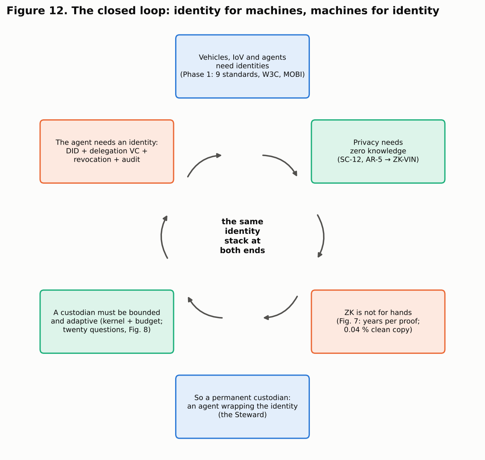
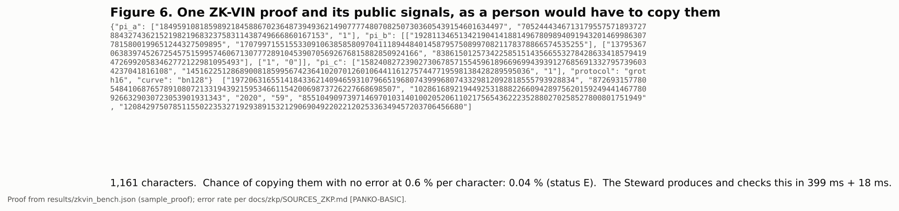
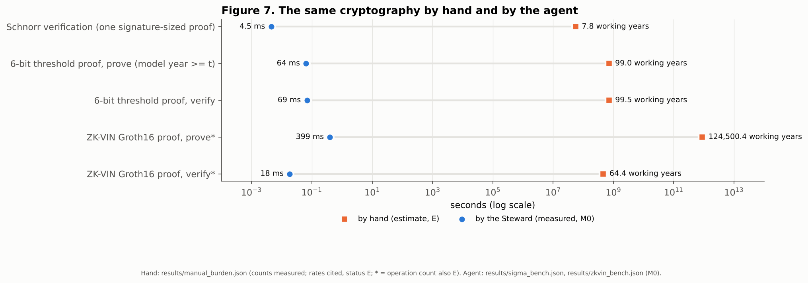
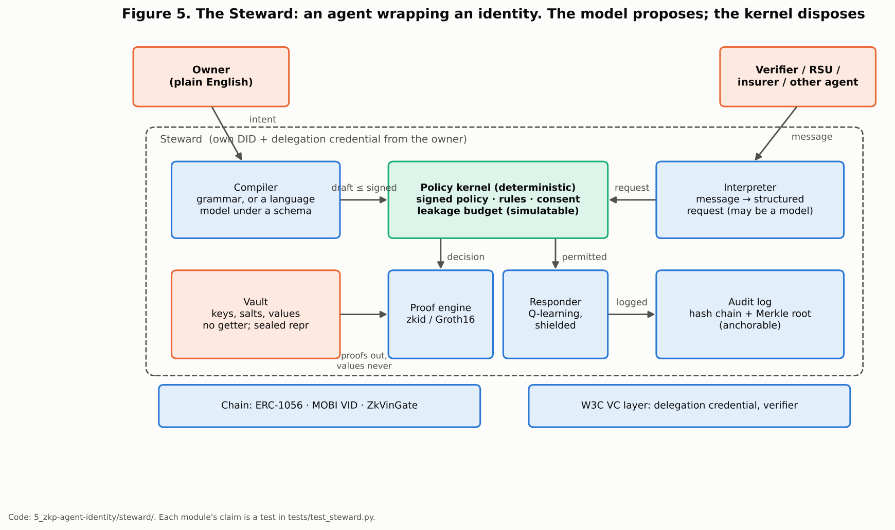

# The Agent-Wrapped Identity: Why Zero-Knowledge Identity Needs a Custodian, and Why the Custodian Needs an Identity

**Report C of Plan 1 — the full-circle argument, with its evidence**

**Author:** Nikhil Prakash (MASc, UBC ECE)
**Written:** 2026-10-15. **Supersedes:** nothing. **Binds:** `docs/STYLE_AND_RIGOUR_GUIDE.md`. Numbers come from
`5_zkp-agent-identity/results/` (commit `978988e`, `code_clean` true) with condition tags (M0 in-process, M1 Hardhat,
E estimate, Sim simulation) or from `docs/zkp/SOURCES_ZKP.md`. Verbs follow the evidence: "shows" where a test or run of
record shows it, "indicates" where an estimate or a simulation does.
**Companions:** Report A (the build and verdicts), Report B (the zero-knowledge paper). **Feeds:** Plan 2's writing
series (`PLAN_2_FULL_CIRCLE_WRITING.md`).

---

## 0. The answer first

This report argues one chain of claims and supports each link with something that can be run.

1. **Machines need identity.** Vehicles, the Internet of Vehicles and AI agents act in the world and must be
   recognised, authorised and held to account. That was the thesis's starting point, and six years of work built the
   identity stack for it.
2. **Privacy for that identity needs zero knowledge.** The stack's deferred privacy items are closed by zero-knowledge
   proofs (Report A, P1).
3. **Zero knowledge cannot be operated by hand.** Measured operation counts, priced at published human rates, put one
   verification in years and one ZK-VIN proof in the hundred-thousand-year range; one presentation copied by hand
   survives without error 0.04 % of the time (§2, status E). It is not a convenience problem; it is a safety problem.
4. **So zero-knowledge identity needs a permanent custodian with a definite profile**: always available, holding secrets
   without exposing them, turning a person's intent into an enforceable policy, computing proofs, remembering every
   disclosure to everyone, adapting to new attacks, and accountable for what it did (§4).
5. **That profile is an AI agent wrapping the identity, if and only if it is bounded.** The Steward, built and tested
   here, meets each requirement; a language model may propose, but a deterministic kernel disposes (§5–§7).
6. **The custodian must itself be an identity.** To be trusted by verifiers and revocable by its owner, the agent needs
   a DID, a delegation credential, revocation and an anchored audit trail: exactly the stack of step 1 (§8).

Identity for machines; machines for identity. The loop closes on the same stack at both ends (Figure 12).



---

## 1. Where the loop began

The research began with vehicles: which blockchain identity standard should a connected vehicle use, at what cost,
with what security, and can it meet a V2V latency budget? Nine standards were built and measured, a W3C layer reached
94.3 % on an internal compliance checker, MOBI VID was realised on five backends, and the testbed put real signatures
and credential checks in the V2X message path (README; claim register). Along the way a broader thought kept returning:
if vehicles need identities, so will every machine that acts on its own, and above all AI agents, which will need not
only identifiers but reputations. That thought was set aside as too large for the thesis.

Plan 1 started from the other end, with a narrow technical gap: the zero-knowledge VIN tier the MOBI VID design had
specified and the project had deferred. Building it surfaced the question this report answers: *who, or what, is going
to operate this?*

---

## 2. The wall of hex: why zero-knowledge identity is not for hands

### 2.1 What one presentation involves

A single ZK-VIN presentation to an insurer involves a 64-character private key, a 77-digit salt, a 743-character proof
and 416 characters of public signals (Figure 6), together 1,300 characters that must be exactly right; behind the proof
lie about 116 million field multiplications of the textbook prover (an estimate from the circuit's 3,505 wires,
status E) and, behind the verification, four pairings.



### 2.2 Priced at human rates

Ken Shirriff computed a round of SHA-256 with pencil and paper in 16 minutes 45 seconds and estimated a full Bitcoin
block hash at 1.49 days, "0.67 hashes per day", against hardware "about a quintillion times faster" [@SHIRRIFF2014]. A
SHA-256 round is about 26 operations on 32-bit words (FIPS 180-4), so a person manages roughly one word operation every
39 seconds. Pricing a 256-bit modular multiplication at a generous 200 word operations (≈ 2.1 hours) gives the times in
Figure 7. The operation counts are measured by the `zkid` counters; the times are estimates (status E).



| Task | By hand (E) | By the Steward (M0) |
|---|---|---|
| Verify one Schnorr proof | ≈ 7.8 working years | 4.5 ms |
| Prove "model year ≥ t" (6-bit threshold proof) | ≈ 99 working years | 64 ms |
| Prove ZK-VIN (Groth16) | ≈ 124,500 working years | 399 ms |
| Verify ZK-VIN | ≈ 64 working years | 18 ms |

### 2.3 Error, not only effort

Speed is not the only problem. People mis-copy. A classic compilation puts residual keying errors at about 0.6 % per
character [@PANKO-BASIC, partial]; Barchard and Pace found visual checking "resulted in 2958% more errors than double
entry" [@BARCHARD2011]; audited clinical data entry still errs at about 14 per 10,000 fields [@NAHM2008]. At 0.6 % per
character, a private key is copied correctly 68 % of the time and one ZK-VIN presentation 0.04 % of the time (status E,
`results/manual_burden.json`). Checksums help but do not rescue: a mistyped EIP-55 address passes the check 0.0247 % of
the time [@EIP55], and Bech32 guarantees detection only of errors in at most four characters [@BIP173].

The ledger punishes mistakes permanently. Krombholz et al. found that 22 % of 990 Bitcoin users had already lost money
to breaches or their own errors [@KROMBHOLZ2016]. Address poisoning, an attack on people's habit of checking only the
ends of a long hex string, made 270 million attempts against 17 million victims and caused at least US$83.8 million in
losses on two chains in two years [@TSUCHIYA2025]; one victim sent 1,155 WBTC, about US$68 million, to a look-alike
address [@WBTC-POISON-2024, partial]. Private-key compromises were 43.8 % of crypto stolen in 2024 [@CHAINALYSIS2025].
Chainalysis's widely reported estimate that about 3.7 million bitcoin, around 20 % of supply, had not moved in five years
is old and contested [@CHAINALYSIS-LOST, partial], but no one disputes the direction.

### 2.4 The precedent: nobody runs DEFLATE by hand

None of this is strange. "Phil Katz designed the deflate format" [@RFC1951]; billions of people compress files without
knowing what Huffman coding is, and verify the result by whether the file opens. Mining Bitcoin by hand is the
reductio: possible in principle, absurd in practice. Zero-knowledge identity belongs in the same category as
compression and mining. It is an algorithm that people *use* through software and never *perform*. The question is
not whether software operates it, but what kind of software, under whose control, with what limits.

---

## 3. The brutal interface and the mediated one

Using a blockchain directly is hard, technical and risky: a terminal, a key file, a hex address, a gas price, and an
irreversible signature. Wallets made it possible for millions (MetaMask passed 30 million monthly active users
[@METAMASK-MAU, partial]) but not safe: Eskandari et al. found that Bitcoin forces users onto public-key cryptography
with "a number of security and usability challenges" [@ESKANDARI2015]; Voskobojnikov et al., analysing wallet reviews,
found UX problems that "might lead to dangerous errors and irreversible monetary losses" [@VOSKOBOJNIKOV2021, partial];
phishing signature prompts drained about US$494 million in 2024 [@SCAMSNIFFER2024, partial]. Marlinspike's observation
cuts deeper: "People do not want to run their own servers", and almost all dApps rely on one or two providers
[@MOXIE2022].

The industry's own direction is to move cryptography out of people's hands into software they control: account
abstraction lets smart-contract accounts carry "arbitrary verification logic" and "custom recovery" [@ERC4337];
passkeys keep keys inside authenticators, "phishing resistant and secure by design" [@WEBAUTHN3; @FIDO-PASSKEYS]; the EU
obliges member states to offer citizens a software identity wallet [@EIDAS2]. Each step moves the custodian from the
person to software. None of them, on its own, can *decide* what to disclose to whom across a lifetime of requests. That
is the step this report takes.

| Interface | The person handles | Decides disclosure | Remembers past disclosures | Plain-language rules |
|---|---|---|---|---|
| Terminal and key file | keys, hex, gas, signatures | the person, unaided | no | no |
| Browser wallet | approvals of opaque prompts | the person, per prompt | no | no |
| Smart account / passkey | biometric or PIN | rules coded by the wallet vendor | no | no |
| **Agent wrapper (the Steward)** | **sentences in English** | **a signed policy, enforced by a kernel** | **yes, across all verifiers** | **yes** |

---

## 4. What the custodian must be

The burden of §2 defines a requirement profile. Each requirement is stated with what fails without it.

| Id | Requirement | Without it | How the Steward meets it | Evidence |
|---|---|---|---|---|
| R1 | **Always available**, at machine speed | V2X and service requests wait for a person who is driving or asleep | runs as a process beside the vehicle's identity | demo, M0 timings |
| R2 | **Custody**: holds keys and salts without exposing them | secrets on screens, in logs, in a model's context | sealed vault, no getter, redacted representation | `test_vault_never_shows_a_value` |
| R3 | **Intent to policy**: turns plain language into enforceable rules | people approve prompts they cannot read | grammar compiler; optional model compiler under a schema; owner signs | `test_english_compiles_to_the_expected_policy` |
| R4 | **Computation**: proves and verifies in zero knowledge | §2: years per proof | `zkid` and snarkjs | Report A |
| R5 | **Memory**: knows everything disclosed to everyone | the twenty-questions attack succeeds (§7) | leakage monitor over all verifiers | `attacks.json` |
| R6 | **Adaptation**: changes behaviour as attacks change | static rules fail new variants (§7) | learned responder within the kernel's shield; policy changes in English | learning curve; demo step 9 |
| R7 | **Accountability and identity**: verifiers can check whom it acts for; the owner can revoke it; its actions are auditable | an unaccountable bot holding a person's identity | did:ethr DID, delegation credential, revocation, hash-chained audit with an anchorable root | `test_agent_presents_its_own_delegated_identity`, `test_audit_log_is_tamper_evident` |

A plain library meets R4. A wallet meets R2 and part of R1. Only something with state, language, judgement within
rules, and an identity of its own meets all seven. That is the working definition of an AI agent wrapping an identity
used here: *a persistent, delegated software principal that holds an identity's secrets, enforces its owner's policy,
operates its cryptography, and is itself identified and accountable.*

What the agent is *not* is equally important. It is not a model with keys. The model's role is limited to reading
language: the owner's (to draft a policy) and, optionally, a verifier's (to structure a request). Neither path can cause
a disclosure.

---

## 5. The Steward: a bounded agent



The architecture follows the security literature on language-model agents. Prompt injection is the first risk in
OWASP's list for LLM applications, and indirect injection arrives through content the model reads [@OWASP-LLM01];
language-model applications "blur the line between data and instructions" [@GRESHAKE2023]. The defences that work
separate the model that reads untrusted text from the component that acts: Willison's dual-LLM pattern, in which the
quarantined model "does not have access to tools" [@WILLISON2023]; CaMeL's separation of control flow from data flow,
which solved 77 % of AgentDojo tasks with provable security against 84 % undefended [@DEBENEDETTI2025; @AGENTDOJO2024];
and design patterns in which untrusted input cannot trigger consequential actions [@BEURERKELLNER2025]. The Steward is
built the same way, with one more layer from safe reinforcement learning: a *shield* that "monitors the actions from the
learner and corrects them only if the chosen action causes a violation of the specification" [@ALSHIEKH2018].

| Component | May read untrusted text | May decide a disclosure | May touch secrets |
|---|---|---|---|
| Interpreter (optional model) | yes | no | no |
| Compiler (grammar or model) | the owner's text | no (drafts only) | no |
| Kernel (deterministic) | no (structured fields only) | **yes, within the signed policy** | no |
| Responder (learned) | no | chooses among what the kernel permits | no |
| Vault | no | no | **yes** (proofs and signatures out) |

The kernel's request schema has no "reveal" operation and rejects unknown fields; the vault has no method that returns
a value; a policy drafted by a model is adopted only if it is no wider than the one the owner signed. These are tests,
not intentions (Report A §5).

---

## 6. Rules in plain English

The owner writes:

```text
Never reveal my VIN.
Insurers may check that my model year is at least a threshold.
Toll operators may check my region.
Round my model year to 5-year buckets.
Do not leak more than 3 bits about my model year.
Ask me before sharing my region.
Block verifier insurer:shady.
```

The Steward compiles this into a policy (two rules, one limit, three never-reveal items, one block), the owner signs its
hash, and from then on every request is judged against it (`results/demo_transcript.txt`, steps 1–2). The grammar has ten
sentence forms and refuses anything else rather than guess (`test_unknown_english_is_refused_not_guessed`). A language
model can widen coverage, constrained by the policy's JSON schema; whatever it drafts goes through the same validation,
and is adopted without a new signature only if it is narrower. In the demo, "Do not leak more than 2 bits" is adopted at
once; "more than 10 bits" and "Regulators may check …" are returned to the owner with the reason (step 9). People set
rules in their own words; the agent turns them into something that can be enforced and audited; the owner remains the
only party who can loosen them.

---

## 7. A new attack vector, and the system adapting

### 7.1 The attack

A zero-knowledge predicate proof reveals one bit. A verifier that chooses thresholds adaptively learns the hidden value
by bisection, and every answer is a valid zero-knowledge proof. Against this project's predicate credentials the
attacker recovers the exact model year on all 30 seeds within five questions (Z-E5, Sim). Spread over fresh identities
(a Sybil set), it defeats any per-verifier limit; a licensed insider defeats any rule that trusts accreditation. For
this system the vector is new: Phase 1's credentials disclosed claims outright, so the question did not arise until
predicates did. In kind it is old, the tracker of statistical databases [@DENNING1979; @DINUR2003], and ETSI notes that
disclosed predicate values stay correlatable [@ETSI-TR119476]. What is shown here is the attack measured on a vehicle
identity stack and a custodian that stops it.

### 7.2 The defence, and how it adapts

The Steward keeps, for each attribute, the set of values consistent with every answer it has given to *anyone*. Before
answering, it computes the worst case over both possible answers; if either would push total leakage past the owner's
budget, it declines, and because the decision does not depend on the true value, the refusal leaks nothing
[@KENTHAPADI2005]. A question between bucket boundaries is answered on the boundary, in the stronger direction. Within
those limits a learned responder decides when to answer exactly, coarsen or decline, from features the agent can see.

The adaptation runs at three timescales, all demonstrated:

1. **Within a session**, the budget responds to the attack as it happens: in the demo's Sybil run, one question is
   answered (on a boundary) and the next eleven, from eleven fresh identities, are refused; the attacker ends with
   1.42 bits of 5 (`demo_transcript.txt`, step 8).
2. **Across sessions**, the responder learns from reward. On held-out seeds its adversary leakage fell from 0.17 to
   0.067 bits and settled within 1,000 episodes (Figure 9, Sim).
3. **Across threat models**, the owner changes the rules in English and the kernel enforces them at once (demo step 9),
   while the shield guarantees that no learned behaviour can exceed what the owner signed.


### 7.3 What the numbers say, including what went against the plan

| Defence | Single identity | Sybil split | Accredited insider (post hoc) | Honest service (single) |
|---|---|---|---|---|
| None | 5.00 bits, exact 30/30 | 5.00, exact 30/30 | 5.00, exact 30/30 | 100.0 % |
| Static cap, 2 per verifier | 2.00 | **5.00, exact 30/30** | 2.00 | 41.2 % |
| Learner without the kernel budget | 0.00 | 0.00 | **5.00, exact 30/30** | 97.7 % |
| **Steward** | 0.00 (max 0.00) | 0.23 (max 1.00) | 2.45 (max 3.00) | 88.3 % (min 70.0 %) |

(Mean adversary bits over seeds 1–30, Sim; `results/attacks.json`.) The static rule is beaten by the Sybil split; the
learner alone is beaten by the insider; the Steward's kernel holds every variant within 3.0 bits. The cost is real:
because the budget assumes all verifiers may collude, honest answers spend it too, and the pre-registered goal of
serving at least 90 % of honest requests on every seed was **not met** (Z-E6 FAIL, 25 of 60 runs below). A global budget
without the learner bounds leakage equally well. The honest summary: *memory and a simulatable budget are what make
the custodian safe; learning makes it more useful within that bound; a better trade-off between the two is open work.*

---

## 8. The custodian is an identity too

To act for its owner, the Steward must be recognisable as the owner's agent and stoppable by the owner. It therefore
holds:

- its own **DID** (`did:ethr`, derived from its key);
- an **AgentDelegationCredential**, a W3C Verifiable Credential issued by the owner's DID through the Phase 1 VC layer,
  naming the agent, the scope it may act in, the hash of the signed policy it enforces, and an expiry;
- **revocation** through the issuer's registry; and
- a **hash-chained audit log** whose Merkle root can be anchored on chain.

A verifier checks the chain owner → agent → presentation; the test shows it failing for the wrong scope, an impostor
key and a revoked credential (`test_agent_presents_its_own_delegated_identity`; demo step 3).

This is where the circle closes. The literature on AI agents arrives at the same requirements from the other side:
identifiers for AI systems where they "could have a large impact upon the world" [@CHAN2024-IDS]; agent identifiers,
monitoring and activity logs for visibility [@CHAN2024-VIS]; extending OAuth and OpenID Connect with agent-specific
credentials and "translating flexible, natural language permissions into auditable access control configurations"
[@SOUTH2025]; the OpenID Foundation's finding that today's protocols do not yet cover cross-domain autonomous agents
[@OIDF2025]; the Model Context Protocol's OAuth 2.1 authorisation [@MCP2024; @MCP-AUTH]; the Agent2Agent protocol
[@A2A2025; @LF-A2A2025]; "know your agent" proposals [@KYA-SKYFIRE, partial]; and payment networks requiring agents to be
"registered and verified" and to prove "a consumer's chosen agent is allowed to act on the consumer's behalf"
[@MASTERCARD-AGENTPAY; @VISA-VIC]. Each of those is a DID, a delegation credential, a revocation list and an audit log
by another name. The thesis built that stack for vehicles. It serves agents unchanged.

So there are two loops, one inside the other. Machines (vehicles, agents) need identities: the thesis. Identities, once
they are zero knowledge, need machines to operate them: this report. And the machine that operates an identity is
itself identified by the same means.

---

## 9. Against the user-as-product model

The dominant data economy treats the person as the source of a resource. Zuboff calls it the claiming of "human
experience as free raw material" [@ZUBOFF2019]; data brokers are a market estimated in the hundreds of billions of
dollars [@DATABROKER-MKT, partial]. Vehicles have joined it: every brand Mozilla reviewed failed its privacy test
[@MOZILLA-CARS-2023, partial], driving behaviour reached insurers through a data broker [@HILL2024-NYT, partial], and the
FTC acted against GM for collecting it without affirmative consent [@FTC-GM-2025]. Centralised identity stores fail at
scale [@EQUIFAX-FTC2019; @FB-CA-2018].

An agent wrapper inverts the default. Instead of the platform's software collecting from the person, the person's
software discloses for the person, by rule, minimally and with a record. Requests are answered with bits, not documents;
the sum of bits is capped; the agent works for whoever signed its policy.

That inversion is not automatic. An agent built and run by a platform could become the next hegemon, holding everyone's
secrets and deciding for them. The safeguards are the ones this report insists on: the owner signs the policy; the
model cannot widen it; the vault never reveals; the agent's delegation is revocable; its log is anchorable; its code is
open. Without them an agent is a more efficient collector, not a custodian.

---

## 10. SSI is a spectrum, not a binary

### 10.1 Why another digital identity at all

A person or a vehicle already has identities: a licence, a registration, accounts with every service. The case for one
more, a self-sovereign one, is not ideology; it is that none of the existing ones lets the subject prove a fact without
surrendering a document, or carry their identity between providers, or see what was disclosed. Allen's principles
state what is missing [@ALLEN2016]; Cameron's laws state why minimal disclosure is stable [@CAMERON2005].

### 10.2 First an identity-management system

An SSI system must first be a competent identity and identity-management system. Table C-1 lists the baseline
functions (after ISO/IEC 24760-1 [@ISO24760, partial] and NIST SP 800-63-4 [@NIST-800-63-4]) and what this build
provides.

**Table C-1. Baseline functions of an identity and identity-management system.**

| Function | Requirement | This build | Status |
|---|---|---|---|
| Identifier assignment | unique, persistent identifier per entity | DIDs (did:ethr, did:nft, did:key, did:mobi); ERC-1056 and eight other standards | Built |
| Enrolment and proofing | bind the identifier to a real entity by an accountable party | MOBI VID I birth certificate issued by the manufacturer, anchored on chain | Built |
| Authentication | prove control of the identifier | ECDSA (EIP-191) proofs; Schnorr proof of key knowledge on and off chain (layer 5) | Built |
| Attribute assertion | issue and verify claims about the entity | W3C VC 2.0 issuer/holder/verifier, 10 automotive schemas | Built |
| Authorisation | decide access from identity state | IDTx executor (Phase 2 F1); ZkVinGate; Steward kernel | Built (prototype) |
| Maintenance | update attributes, keys and lifecycle state | MOBI VID II, 11 lifecycle event types; ERC-1056 owner change and delegates | Built |
| Delegation | let another party act within limits | ERC-1056 delegates with validity; Steward delegation credential (scope, policy hash, expiry) | Built |
| Revocation and suspension | withdraw a credential or key promptly | revocation registry; delegate expiry; freshness-k bound (register #32, #37) | Built |
| Recovery | regain control after key loss | ERC-4337 accounts measured; no recovery flow evaluated | Partial |
| Audit and accountability | record who did what, verifiably | on-chain events; Steward hash-chained log with an anchorable Merkle root | Built |
| De-registration and erasure | end an identity; erase personal data | VID II decommission event; only commitments and hashes on chain, so off-chain erasure removes the link | Partial |
| Interoperability | others can resolve and verify | W3C DID resolution, 4 methods; external DID suite 335/336 (register #24) | Built |

### 10.3 Then the SSI extension, as far as each case allows

**Table C-2. Strict SSI properties (after Allen 2016), the default here, and whether a strict mode is available.**

| Property | Strict SSI asks | Default here | Strict mode | Constraint |
|---|---|---|---|---|
| Existence | the identity exists independently of any issuer | vehicle DID controlled by the owner's key | Yes | regulators still require a manufacturer-issued birth record |
| Control | the holder controls identifier and keys | owner key; agent acts under a revocable delegation | Yes | key loss without recovery is permanent |
| Access | the holder can see all data about them | Steward vault and audit log | Yes | data held by verifiers is outside the holder's view |
| Transparency | open systems and algorithms | open-source contracts, circuits and agent | Yes | the Groth16 setup here is single-party |
| Persistence | long-lived identity | chain-anchored DID | Yes | persistence conflicts with erasure; keep only commitments on chain |
| Portability | not tied to one provider | MOBI VID on five backends (H4) | Yes | migration cost differs by backend |
| Interoperability | usable across systems | W3C DID and VC | Yes | automotive profiles still maturing |
| Consent | disclosure only with the holder's agreement | owner-signed policy; per-rule consent | Yes | safety broadcasts (BSM) cannot wait for consent |
| Minimisation | disclose the least needed | SD digests; ZK predicates; leakage budget and coarsening | Yes | budgets cost honest service (Z-E6) |
| Protection | the holder's rights win over the network's | no PII on chain; scoped nullifiers | Partial | ZkVinGate names the identity; an anonymity set is to-do |
| Decentralised trust | no single operator can deny or rewrite identity | public-chain anchoring | Optional | a permissioned ledger or database substrate is allowed where decentralisation buys nothing (F2) |

Both tables are generated from one data file (`5_zkp-agent-identity/figures/ssi_tables.json`) and drawn in Figure 11.

### 10.4 Partial by constraint, not by control

Where a property is partial or optional above, the reason is a constraint of the use case or of physics, law or cost,
not a choice to keep control. Decentralisation is used where it buys something (no single party can rewrite a
vehicle's history; anyone can verify) and not for show: there is no reason to put a toll price on chain, or to make a
safety broadcast wait for consent. The F2 focus in Phase 2 compares a database, an anchored journal, a permissioned
chain and a rollup as substrates for exactly this reason.

**Table C-3. Use cases: what goes where, which SSI properties are realised, which are constrained, and why.**

| Use case | On chain | Off chain / in the agent | Realised | Constrained, and why |
|---|---|---|---|---|
| V2V safety broadcast (BSM, 10 Hz) | nothing per message | short-lived pseudonymous credential; signature per message | minimisation, unlinkability across pseudonym changes | consent (safety cannot wait); ZK per message (proving is 399 ms against a 100 ms budget) |
| RSU session or service access | optional gate decision | ZK-VIN at session start; session credential | minimisation, consent, scoped nullifier | none material |
| Insurance quote | optional `ZkVinGate.admit` record (301,163 gas) | ZK-VIN or threshold proof by the Steward | minimisation, consent, unlinkability from tolls | the insurer may require identification to bind a policy (law, not design) |
| Toll | nullifier record per scope, optional | ZK-VIN with the toll scope | one-use per scope, unlinkability across operators | the toll operator must be able to bill; settlement identity is revealed to the payment provider |
| Sale and ownership transfer | ERC-1056 owner change; MOBI VID II event | new owner's agent receives the salt | control, persistence, portability | the transfer itself is public by design (provenance) |
| Recall or regulator inquiry | lifecycle events | lawful access to the opening, by policy | accountability | protection yields to a lawful order; the agent logs the disclosure |
| EV charging | optional settlement | proof of eligibility, payment token | minimisation | billing identity at the charge-point operator |
| An AI agent buying for its owner | delegation credential status; optional audit root | agent DID, delegation scope, spending limit | control, consent, revocation, audit | merchants and networks require registration (KYA) |
| End of life | decommission event | salt destroyed | erasure in effect (the commitment can no longer be opened) | the commitment remains on chain |

### 10.5 Built to be strictly SSI-compatible

Nothing in the build forces a compromise that a strict deployment would reject. Keys can be held only by the owner and
the owner's agent (did:key or did:ethr, no custodian); the chain can be public; every rule can require consent; every
disclosure can be a zero-knowledge predicate; the agent can run locally; the audit root can be anchored. The strict
mode column of Table C-2 marks the two places where it is not yet complete: protection at the gate (an anonymity set)
and setup trust (a ceremony). Both are named to-dos, not design limits.

---

## 11. Benefits and risks of the agent wrapper

| Benefit | What it means here | Evidence |
|---|---|---|
| Security | secrets never leave the vault; proofs bound to verifier and nonce; injection cannot cause a disclosure | tests |
| Availability | proofs at machine speed, any hour | M0 timings |
| Customisability | rules in English, compiled, signed, changed at will; the owner alone can loosen them | demo steps 1, 2, 9 |
| Sovereignty | the owner signs the policy and can revoke the agent | delegation tests |
| Privacy over time | the total disclosed is capped across all verifiers | `attacks.json` |
| Accountability | every decision in a tamper-evident log | audit test |

| Risk | Mitigation here | Residual |
|---|---|---|
| Agent compromise | vault isolation; revocable delegation; audit | a compromised host compromises the vault |
| Model error or injection | model never on the decision path; schema; narrowing-only | coverage of the grammar is limited |
| Over-refusal | coarsening; learned responder | Z-E6: service below 90 % on some runs |
| Dependency on a vendor | open code; local operation; standard DIDs and VCs | operational burden of self-hosting |
| Opacity | signed policy; reasons on every refusal; audit | owners must read their policy |

---

## 12. Limits of this argument

The manual-burden figures are estimates priced from measured counts, using rates that are generous to people; one rate
is from a partial source. The attack results are a seeded simulation with synthetic verifiers. The ZK-VIN keys come from
an insecure setup. No live language model was exercised. The Steward is a research prototype on one host, not a
deployed product. None of these limits touches the structure of the argument; each limits how far its numbers travel.

---

## 13. Conclusion

The research set out to give machines identities. It ends by finding that the most private form of identity, zero
knowledge, can only be operated by a machine, and that the machine which operates it must itself be identified,
delegated, revocable and auditable. The agent wrapper is not an add-on to self-sovereign identity; it is the condition of
its use, as a pressure suit is the condition of a person's presence in vacuum: personal, fitted, bounded, and carrying
its own life support. The same stack that names a vehicle names the agent that speaks for it. That is the closed loop
this work set out without looking for, and the place from which the thesis can be finished.
